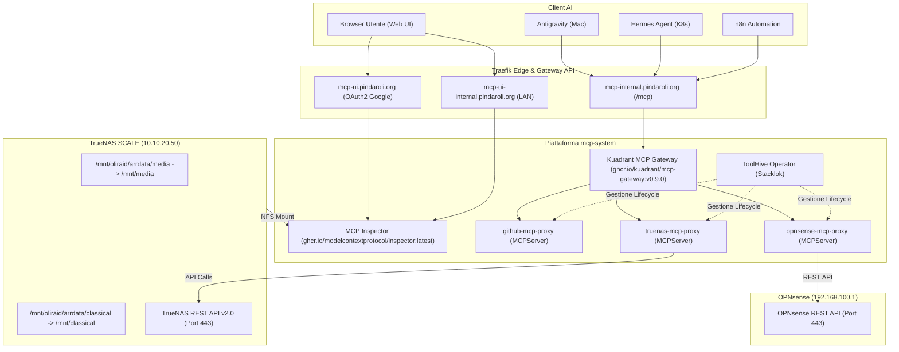

# Piattaforma MCP (Model Context Protocol)

## 🎯 Visione & Obiettivo Architetturale (MCP-as-a-Service)

L'infrastruttura MCP del lab adotta un'architettura **High-Availability 24/7 su TrueNAS SCALE bare-metal (`10.10.20.50`)**:
1. **Operatività Ininterrotta 24/7 su TrueNAS Docker (Provider Primario Attivo)**: La suite completa di 10 server MCP risiede ed è orchestrata tramite Docker Compose su TrueNAS bare-metal (`/mnt/stripe/truenas-docker/mcp/docker-compose.yaml`). Questo garantisce la piena operatività dell'agente AI (Antigravity) anche quando i nodi Proxmox e il cluster Kubernetes Talos vengono spenti per risparmio energetico (`shutdown_to_truenas_only.yml`).
2. **Accessibilità LAN Diretta su Porte Dedicate (Opzione A)**: Ciascun server MCP è mappato su una porta host dedicata (`8101`–`8110`) sull'IP di TrueNAS (`10.10.20.50`), garantendo zero dipendenze da Ingress Traefik, certificati TLS esterni o resolver DNS Unbound.
3. **Disabilitazione Conservativa K8s (Standby Reversibile)**: Nel namespace Kubernetes `mcp-system`, la configurazione Helm (`mcp-gateway-values.yaml`) è mantenuta intatta al 100% nel repository con `replicas: 0` ed `enabled: false`. Nessun file, chart o secret SOPS è stato eliminato.
4. **Ruolo di MCP Inspector**: Inspector rimane opzionale per collaudo manuale.

---

## 1. Architettura e Topologia

L'architettura risiede nel namespace dedicato `mcp-system` ed è articolata in 4 componenti cooperanti:

1. **Kuadrant MCP Gateway (`mcp-broker-router`)**:
   - Router e federatore centrale per tutti i server MCP del lab.
   - Esposto internamente su `mcp-internal.pindaroli.org` tramite HTTPRoute su Gateway Traefik.
   - Firma le sessioni con token JWT (`mcp-gateway-signing-key`).
2. **Stacklok ToolHive Operator**:
   - Gestore del ciclo di vita dei micro-server MCP tramite CRD `MCPServer` (`toolhive.stacklok.dev/v1beta1`).
   - Isola ciascun server in pod dedicati ed esegue il bridging `stdio` -> `HTTP/SSE`.
3. **MCP Inspector (Web UI & File Access)**:
   - Portale di collaudo e test interattivo per strumenti e prompt.
   - Protezione anti-DNS rebinding con `ALLOWED_ORIGINS`.
   - Accesso al file system ZFS di TrueNAS tramite mount NFS diretti su `/mnt/media` e `/mnt/classical`.
4. **Traefik IngressRoute**:
   - Routing split-horizon: accesso esterno su `mcp-ui.pindaroli.org` protetto da Google OAuth2, e accesso LAN diretto su `mcp-ui-internal.pindaroli.org`.

---

## 2. Politica "Chart di Progetto" (Project Chart)

Ai sensi della regola aurea [[GEMINI#3. Security & Operational Policies (The Golden Rules)|HELM DEPLOYMENT & PROJECT CHARTS]]:
- **Motivazione dell'incompatibilità upstream**: La chart ufficiale Kuadrant (`oci://ghcr.io/kuadrant/charts/mcp-gateway`) impone la presenza della Service Mesh Istio/Envoy e una dozzina di controller/CRD enterprise non presenti nel cluster.
- **Implementazione**: Viene mantenuta la Chart di Progetto `helm-charts/mcp-gateway/` (versione semantica `0.2.7`) che aggrega sia il Broker Kuadrant, sia i server federati gestiti da ToolHive (GitHub, TrueNAS, OPNsense, Talos, Gemini DeepSearch, Kubernetes), sia l'Inspector Web UI.
- **Pattern di Sicurezza & Segreti**: Tutti i carichi di lavoro ToolHive adottano lo standard architetturale [[mcp-secret-projection-pattern]] (Archetipo 1 per credenziali scalari in RAM, Archetipo 2 per certificati mTLS e configurazioni proiettate come volumi di sola lettura dal Kubelet con filesystem immutabile, e RBAC In-Cluster Native con `ClusterRoleBinding` a `cluster-admin` per il server `kubernetes`).
- **Configurazione Centralizzata**: L'intero deployment di produzione è governato dichiarativamente dal file [mcp-gateway/mcp-gateway-values.yaml](file:///Users/olindo/prj/k8s-lab/mcp-gateway/mcp-gateway-values.yaml).

---

## 3. Storage e Volumi NFS

L'Inspector monta direttamente le condivisioni NFS di primo livello da TrueNAS (`10.10.50`):
* `nfs-media`: `/mnt/oliraid/arrdata/media` montato su `/mnt/media`.
* `nfs-classical`: `/mnt/oliraid/arrdata/classical` montato su `/mnt/classical`.

I dataset rispettano lo schema NFS standard del lab: `chmod 777`, ownership `olindo:k8s`, export con `maproot_user="root"` e `maproot_group="wheel"`.

---

## 4. Catalogo Server MCP Attivi 24/7 su TrueNAS Docker (`10.10.20.50`)

Lo stack Docker Compose in `/mnt/stripe/truenas-docker/mcp/` ospita i 12 server MCP remoti della flotta GEMINI, tutti protetti dal gateway **Traefik v3.3.4** su porta host unica **`8100`** con sidecar **Docker Socket Proxy L7** (`tecnativa/docker-socket-proxy:v0.4.1`), unificati sullo standard **Streamable HTTP RFC 2025** e raggiungibili tramite `"serverUrl"` nel client Antigravity:

| Server MCP | Immagine Container (GHCR Immutabile) | Transport MCP Container | Porta Host Traefik | Endpoint Client Antigravity (`serverUrl`) | Protocollo e Target Backend |
| :--- | :--- | :--- | :--- | :--- | :--- |
| **`truenas-master-mcp`** | `ghcr.io/pindaroli/truenas-mcp:1.0.0-r1` | Streamable HTTP `/mcp` (Supergateway) | **`8100`** | `http://10.10.20.50:8100/truenas/mcp` | WebSocket JSON-RPC 2.0 (`wss://10.10.20.50/api/current`) |
| **`opnsense`** | `ghcr.io/pindaroli/opnsense-mcp:0.5.3-r1` | Streamable HTTP `/mcp` (Supergateway) | **`8100`** | `http://10.10.20.50:8100/opnsense/mcp` | OPNsense Firewall REST API (`https://192.168.100.1:443`) |
| **`talos`** | `ghcr.io/pindaroli/talos-mcp:2.5.1-r1` | Streamable HTTP `/mcp` (Supergateway) | **`8100`** | `http://10.10.20.50:8100/talos/mcp` | Talos Control Plane gRPC API (`10.10.20.141/55:50000`) |
| **`gemini-deepsearch`** | `ghcr.io/pindaroli/gemini-deepsearch-mcp:0.2.0` | Nativo FastMCP Streamable HTTP `/mcp` | **`8100`** | `http://10.10.20.50:8100/gemini/mcp` | Google Gemini Cloud API |
| **`kubernetes`** | `ghcr.io/containers/kubernetes-mcp-server@sha256:6992...` | Nativo Go Streamable HTTP `/mcp` | **`8100`** | `http://10.10.20.50:8100/kubernetes/mcp` | Kubernetes API Server VIP (`10.10.20.55:6443`) |
| **`ollama`** | `ghcr.io/pindaroli/ollama-mcp:2.1.0-r1` | Streamable HTTP `/mcp` (Supergateway) | **`8100`** | `http://10.10.20.50:8100/ollama/mcp` | Demone Ollama Mac Studio (`10.10.20.100:11434`) |
| **`kef`** | `ghcr.io/pindaroli/kef-mcp:1.0.0` | Nativo FastMCP Streamable HTTP `/mcp` | **`8100`** | `http://10.10.20.50:8100/kef/mcp` | Casse KEF LSX II LT (`10.10.20.210`) |
| **`nowaikit`** | `ghcr.io/pindaroli/nowaikit-mcp:4.15.1-r1` | Streamable HTTP `/mcp` (Supergateway) | **`8100`** | `http://10.10.20.50:8100/nowaikit/mcp` | ServiceNow Cloud REST API (`dev395227.service-now.com`) |
| **`github-mcp-server`** | `ghcr.io/pindaroli/github-mcp-server:0.7.0-r1` | Streamable HTTP `/mcp` (Supergateway) | **`8100`** | `http://10.10.20.50:8100/github/mcp` | GitHub Cloud REST/GraphQL API (`api.github.com`) |
| **`arrstack-mcp`** | `ghcr.io/pindaroli/arrstack-mcp:1.3.0` | Nativo FastMCP Streamable HTTP `/mcp` | **`8100`** | `http://10.10.20.50:8100/arrstack/mcp` | Radarr, Lidarr, Prowlarr, qBittorrent, Bitmagnet (61 tool: indexers, apps, categories, trackers, tags, interactive releases, GraphQL DHT search) |
| **`ragflow-local`** | `ghcr.io/pindaroli/ragflow-mcp:1.0.0` | Streamable HTTP `/mcp` (Supergateway) | **`8100`** | `http://10.10.20.50:8100/ragflow/mcp` | RAGFlow Server (`https://ragflow-internal.pindaroli.org`) |
| **`meross`** | `ghcr.io/pindaroli/meross-mcp:0.1.2` | Dual Gateway (FastAPI REST + FastMCP) | **`8100`** | `http://10.10.20.50:8100/meross/mcp` | Meross Cloud IoT API + REST Homepage Widget (`/meross/api/v1/...`) |

*(Nota: La flotta originaria su Kubernetes in `mcp-system` è mantenuta integra e pronta in standby dichiarativo con `replicas: 0` ed `enabled: false` in `mcp-gateway/mcp-gateway-values.yaml`)*.

---

## 5. Server MCP Standalone & Dashboard Bridges (`mcp_config.json`)

Server MCP nativi o integrati in applicazioni terze gestiti tramite script bridge standard library in `scripts/<mcp-name>/`:

| Server | Trasporto Client | Target Endpoint | Script Bridge | Funzionalità Esposte |
| :--- | :--- | :--- | :--- | :--- |
| **`homepage-k8s`** | Stdio (Python) | `https://home-internal.pindaroli.org/api/mcp` | `scripts/homepage-mcp/bridge.py` | Ispezione, validazione e documentazione YAML K8s Homepage |
| **`homepage-truenas`** | Stdio (Python) | `http://10.10.20.50:3000/api/mcp` | `scripts/homepage-mcp/bridge.py` | Ispezione, validazione e documentazione YAML TrueNAS Homepage |

---

## 6. Server MCP SaaS Gestiti (`mcp_config.json`)

Server MCP ufficiali gestiti da cloud provider terzi, integrati via Streamable HTTP con autenticazione via token:

| Server | Trasporto Client | Target Endpoint | Autenticazione | Funzionalità Esposte |
| :--- | :--- | :--- | :--- | :--- |
| **`cloudflare`** | Streamable HTTP | `https://mcp.cloudflare.com/mcp` | Bearer Token SOPS (`cfut_...`) | Code Mode: gestione DNS `pindaroli.org`, Tunnels, Zone, WAF e Zero Trust |

---

## 7. Server MCP Zero-Install & Dual Gateway ([[zero-install-executable-package-pattern]])

Server autonomi distribuiti ed eseguiti on-demand come pacchetti effimeri senza installazione permanente sull'host:

| Server | Progetto & Repository | Trasporto Client | Target & Architettura | Funzionalità Esposte |
| :--- | :--- | :--- | :--- | :--- |
| **`meross`** | [`pindaroli/meross-mcp`](https://github.com/pindaroli/meross-mcp) | Stdio (`uvx`) & HTTP/SSE porta `8112` | Meross Cloud MQTT over TLS & REST API Gateway (`/api/v1/devices`) | 6 tool MCP per controllo relè, commutazione canali e telemetria energetica ($W, V, A$) su prese e ciabatte Meross (MSS310, MSS210, MSS425E) |
| **`office_mac`** | `vAirpower/macos-office365-mcp-server` (`scripts/office-mac-mcp/`) | Stdio (`uv run`) | Motore OOXML (`python-docx`, `openpyxl`, `python-pptx`) + Bridge AppleScript/pgrep | 24 tool per creazione/modifica veloce e atomica di file `.docx`, `.xlsx`, `.pptx` su disco e ispezione sessioni attive (`check_office_status`, `list_active_*`) |
| **`macos_automator`** | `@steipete/macos-automator-mcp` | Stdio (`npx -y`) | Runtime nativo AppleScript / JXA & Knowledge Base SDEF | 2 tool (`execute_script`, `get_scripting_tips`) per controllo live finestre Word/Excel/PowerPoint, esecuzione macro VBA ed esportazione PDF Quartz |

---

## 8. Tassonomia Monorepo Docker (`docker/mcp/`)

I sorgenti e i `Dockerfile` di compilazione della flotta MCP sono organizzati nel monorepo sotto la radice `docker/mcp/` secondo le tre categorie del **Pattern di Packaging & Ingestion degli Artefatti**:

- **`docker/mcp/registry-package/`**: per server distribuiti tramite pacchetti ufficiali su npm/PyPI o container ufficiali (`github-mcp-server`, `nowaikit-mcp`, `ollama-mcp`, `opnsense-mcp`, `talos-mcp`, `truenas-mcp`).
- **`docker/mcp/upstream-tracking/`**: per server che compilano codice da repository Git upstream senza release ufficiali (`kef-mcp`).
- **`docker/mcp/in-house/`**: per server con codebase interna al monorepo (`arrstack-mcp`, `gemini-deepsearch-mcp`, `ragflow-mcp`).
- **`docker/mcp/docker-compose.yaml`**: orchestratore di flotta a livello root per il runtime su TrueNAS SCALE.

