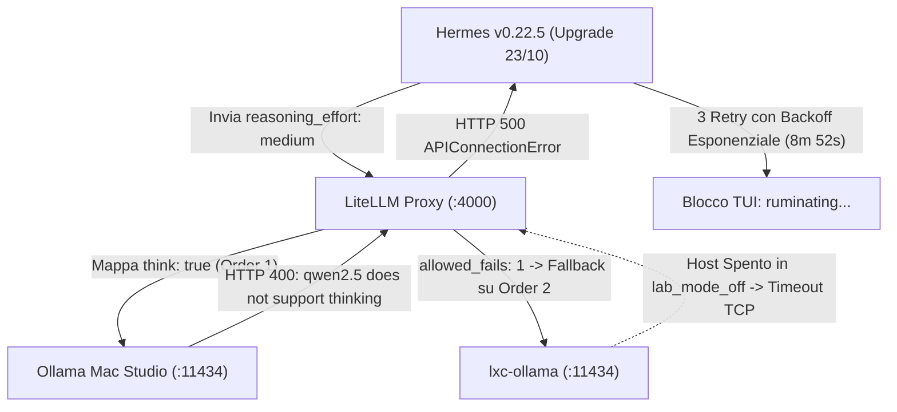

# INC-2026-10-24: Hermes Agent v0.22.5 Ruminating Hang e Failover LiteLLM in lab_mode_off

## Descrizione dell'Incidente
Durante l'utilizzo della TUI di Hermes Agent (`hermes-main`, versione `v0.22.5`), all'invio di un prompt minimale (`"ciao"`), il processo è rimasto bloccato per **8 minuti e 52 secondi** nello stato apparente di "pensiero":
> `-( * - *) ruminating... • 1m 40s | hiq-chat`

Al termine del timeout, Hermes ha stampato a video un errore critico:
```text
custom returned a server error on all 3 attempts - it looks temporarily unavailable.
Provider said: HTTP 500: litellm.APIConnectionError: Ollama_chatException - Cannot connect to host lxc-ollama.pindaroli.org:11434 ssl:<ssl.SSLContext> [Connect call failed ('REDACTED', 11434)]
Your request was not processed. Send it again if you still want me to carry it out.
- ready | big chat | 8m 52s | ✓ 53s | voice off | 3 sessions
```

**Paradosso operativo:**
L'homelab si trovava in **modalità Mac** (`lab_mode_off`), nella quale `lxc-ollama` (LXC 300 su PVE3) è spento e tutti i carichi LLM devono essere serviti in locale da Ollama su Mac Studio (`olindo-macstudio.pindaroli.org:11434`). Ciononostante, LiteLLM ha tentato di contattare `lxc-ollama` generando un'attesa estenuante.

---

## Analisi della Root Cause

Dall'ispezione dei log dei container (`docker logs hermes-main`, `docker logs litellm`), dei log di sistema (`/opt/homebrew/var/log/ollama.log`) e del dump della richiesta (`/Users/olindo/hermesAgent/HermesMain/sessions/request_dump_...json`), è emersa una concatenazione di 5 eventi:



### 1. Upgrade recente a Hermes Agent v0.22.5 (Commit `71b42289`)
Il giorno precedente (`2026-10-23`), Hermes Agent era stato aggiornato da `v2026.7.20` a `v0.22.5`. In questa nuova versione, Nous Research ha introdotto la gestione unificata dei modelli di reasoning/thinking:
- Per i provider OpenAI/custom, Hermes attiva di default il parametro `"reasoning_effort": "medium"`.
- Sulla versione precedente (`v2026.7.20`) tale parametro non veniva emesso e le chiamate erano semplici richieste chat standard.

### 2. Validazione Thinking su Ollama 0.32.1 (macOS)
Ollama sul Mac Studio è in esecuzione alla versione `0.32.1`. Nelle versioni recenti, Ollama effettua un controllo stringente:
- Se la richiesta include `think: true` (o `reasoning_effort`), ma il modello caricato non include la capability nativa di thinking nel ModelFile/GGUF, Ollama rifiuta categoricamente la chiamata:
  ```json
  {"error": "\"qwen2.5:32b-instruct-q5_K_M\" does not support thinking"}
  ```
- Il modello configurato per `big-chat` è `qwen2.5:32b-instruct-q5_K_M` (modello instruct puro, senza reasoning stream). Ollama sul Mac ha quindi risposto con **HTTP 400 Bad Request** in appena 67 ms.

### 3. Logica di Failover del Router LiteLLM
In `docker/truenas/litellm/config.yaml`, il gruppo `big-chat` è configurato con due backend:
- `order: 1`: `http://olindo-macstudio.pindaroli.org:11434`
- `order: 2`: `http://lxc-ollama.pindaroli.org:11434`
- Con `allowed_fails: 1`, il router di LiteLLM ha interpretato l'errore 400 del Mac Studio come un fallimento del backend primario e ha dirottato la richiesta sul backend secondario (`lxc-ollama`).

### 4. Asimmetria di Stato Homelab (`lab_mode_off`)
In modalità FULL, `lxc-ollama` su PVE3 è acceso; in modalità Mac (`lab_mode_off`), PVE3 e il CT 300 sono spenti. La connessione verso `10.10.20.33:11434` è andata in timeout TCP. LiteLLM ha esaurito i propri retry e ha ritornato HTTP 500 a Hermes, mascherando l'errore 400 originario del Mac.

### 5. Retry Loop e Hang a Video
Hermes ha catturato l'HTTP 500 ed è entrato nel proprio loop di recovery (3 tentativi con backoff esponenziale). Durante tutta la durata dei tentativi (8m 52s), la TUI è rimasta bloccata sul timer di ruminazione.

---

## Azioni Correttive Adottate

### 1. Sanificazione Parametri in LiteLLM (`drop_params: true`)
Modificato [`docker/truenas/litellm/config.yaml`](file:///Users/olindo/prj/k8s-lab/docker/truenas/litellm/config.yaml) per istruire il proxy a scartare i parametri non supportati prima di inoltrare la richiesta a backend eterogenei:
```yaml
litellm_settings:
  drop_params: true
```

### 2. Disattivazione Esplicita di Reasoning in Hermes Agent
Configurato [`/Users/olindo/hermesAgent/HermesMain/config.yaml`](file:///Users/olindo/hermesAgent/HermesMain/config.yaml) impostando `reasoning_effort: false` nella sezione `agent`:
```yaml
agent:
  gateway_timeout: 1800
  max_turns: 90
  verify_on_stop: false
  reasoning_effort: false
```
Questo garantisce che Hermes non emetta `"reasoning_effort": "medium"` nel payload della richiesta per modelli non-thinking.

### 3. Convergenza e Riavvio dei Container
Eseguito il riavvio controllato dei container coinvolti:
```bash
docker restart litellm
docker restart hermes-main
```

### 4. Validazione Test-Driven
Testata la chiamata API diretta a LiteLLM con payload completo e streaming:
```text
HTTP/1.1 200 OK
x-litellm-model-api-base: http://olindo-macstudio.pindaroli.org:11434
x-litellm-attempted-retries: 0
x-litellm-attempted-fallbacks: 0
{"content": "Ciao! Come posso aiutarti oggi?"}
```
Latenza totale: ~2.3 secondi, zero tentativi verso `lxc-ollama`, nessun blocco.

---

## Stato
**RISOLTO**. Stack locale e proxy allineati.
