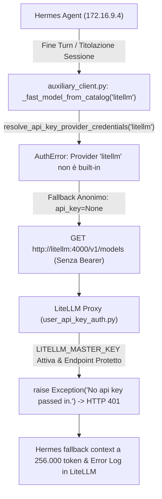

# INC-2026-10-25: Eccezione LiteLLM Proxy 401 Unauthorized su Probe Anonimi Modelli da Hermes Agent

## Descrizione dell'Incidente
Nei log del container Docker `litellm` su TrueNAS SCALE Bare Metal (`10.10.20.50:4000`) è stata rilevata la seguente eccezione ricorsiva:

```text
14:26:49 - LiteLLM Proxy:ERROR: auth_exception_handler.py:197 - litellm.proxy.proxy_server.user_api_key_auth(): Exception occured - No api key passed in.
Requester IP Address:172.16.9.4
Traceback (most recent call last):
  File "/app/.venv/lib/python3.13/site-packages/litellm/proxy/auth/user_api_key_auth.py", line 1964, in user_api_key_auth_builder
    raise Exception("No api key passed in.")
Exception: No api key passed in.
INFO:     172.16.9.4:34296 - "GET /v1/models HTTP/1.1" 401 Unauthorized
```

In parallelo, nei log di Hermes Agent (`hermes-main`, IP `172.16.9.4` sulla rete `truenas-ai-net`) compariva l'avviso di fallimento nel calcolo del context window:

```text
WARNING agent.model_metadata: Could not determine context length for model 'big-chat' (base_url=http://litellm:4000/v1) — falling back to 256,000 tokens. Set model.context_length in config.yaml to override.
```

Nonostante le inferenze principali (`POST /v1/chat/completions`) andassero a buon fine con HTTP 200 (in quanto autenticate con Bearer token), ogni turn di chat o operazione ausiliaria di titolazione generava errori di autenticazione 401 nei log del proxy e forzava Hermes a un context window anomalo di 256K token.

---

## Analisi della Root Cause



### 1. Assenza di `context_length` Dichiarativo in Hermes
All'avvio e ad ogni turn, Hermes esegue `get_model_context_length()` (`agent/model_metadata.py`). In assenza della chiave `context_length` nel blocco `model:` di `/opt/data/config.yaml`, Hermes avvia una cascata di probe su endpoint locali (`/v1/props`, `/version`, `/v1/models`) tramite `_openai_models_list_context()`. La funzione di probe interna invoca `httpx.Client` senza propagare la chiave API (`api_key=""`), causando una richiesta non autenticata.

### 2. Upstream Bug in Hermes `_fast_model_from_catalog` per Provider Personalizzati
Al termine di ogni sessione chat, Hermes avvia l'attività ausiliaria `title_generation`. Per selezionare il modello rapido, invoca `_fast_model_from_catalog("litellm")` (`agent/auxiliary_client.py`).
La funzione tenta di estrarre le credenziali tramite `resolve_api_key_provider_credentials("litellm")`, la quale però supporta solo i provider built-in registrati in `_registry_lookup()` ("openai", "anthropic", "groq", ecc.) e solleva `AuthError` per qualsiasi provider custom.
Catturata l'eccezione, Hermes esegue un fallback di scraping del catalogo anonimo (`fetch_models_with_pricing(api_key=None)`), inviando un `GET /v1/models` privo di header `Authorization`.

### 3. Policy di Autenticazione Rigida di LiteLLM Proxy
In LiteLLM Proxy, quando sono definite `LITELLM_MASTER_KEY` e la connessione PostgreSQL, tutti gli endpoint proxy standard (`/v1/models`, `/models`, `/v1/chat/completions`) sono protetti dalla dipendenza `Depends(user_api_key_auth)`. Se la richiesta è priva di token, la riga 1964 di `user_api_key_auth.py` solleva tassativamente `Exception("No api key passed in.")` con status HTTP 401.

---

## Risoluzione Applicata

La bonifica è stata implementata in modo congiunto e simmetrico sia su Hermes sia su LiteLLM, mantenendo la persistenza ZFS e la replica in failover per Mac Studio.

### 1. Hardening e Dichiarazione Esplicita in Hermes `config.yaml`
Sul file persistito in `/mnt/stripe/hermesAgent/HermesMain/config.yaml` su TrueNAS e in `/Users/olindo/hermesAgent/HermesMain/config.yaml` su Mac Studio:
1. Dichiarato `context_length: 131072` (finestra nativa 128K per Qwen 2.5 32B), consentendo a Hermes di soddisfare il "Passo 0" ed escludere il probing di contesto.
2. Esplicitato `base_url: http://litellm:4000/v1` e `key_env: LITELLM_API_KEY` direttamente sotto `model:`.
3. Pinned l'attività `auxiliary.title_generation` sul modello `big-chat`.
4. Configurato `discover_models: false` con la lista esplicita dei 5 modelli del lab (`big-chat`, `big-alt`, `vision`, `vision-light`, `embed`).

```yaml
model:
  default: big-chat
  provider: litellm
  base_url: http://litellm:4000/v1
  key_env: LITELLM_API_KEY
  context_length: 131072
auxiliary:
  title_generation:
    model: big-chat
    provider: litellm
providers:
  litellm:
    base_url: http://litellm:4000/v1
    discover_models: false
    key_env: LITELLM_API_KEY
    models:
      - big-chat
      - big-alt
      - vision
      - vision-light
      - embed
```

### 2. Configurazione `pass_through_endpoints` su LiteLLM Proxy
In `docker/truenas/litellm/config.yaml` (montato sia su TrueNAS SCALE sia su OrbStack Mac Studio in failover), sono stati configurati i path di discovery del catalogo modelli come pass-through con `auth: false` in `general_settings`:

```yaml
general_settings:
  pass_through_endpoints:
    - path: "/v1/models"
      auth: false
    - path: "/models"
      auth: false
```

Questo permette ai client interni e agli agenti di consultare liberamente la lista dei modelli disponibili (`GET /v1/models` -> HTTP 200), mentre le chiamate inferenziali (`POST /v1/chat/completions`) continuano a richiedere tassativamente l'autenticazione Bearer con chiave master o virtuale.

---

## Validazione e Verifica Test-Driven

1. **Test Discovery Anonimo `/v1/models`**:
   ```bash
   curl -i http://10.10.20.50:4000/v1/models
   ```
   **Esito**: HTTP/1.1 200 OK con payload JSON completo dei 6 modelli censiti (`chat`, `big-chat`, `big-alt`, `vision`, `vision-light`, `embed`).

2. **Test Isolamento Inferenziale `/v1/chat/completions`**:
   ```bash
   curl -i -X POST http://10.10.20.50:4000/v1/chat/completions \
     -H "Content-Type: application/json" \
     -d '{"model":"big-chat","messages":[{"role":"user","content":"hi"}]}'
   ```
   **Esito**: HTTP/1.1 401 Unauthorized confermato (nessun bypass di sicurezza sulle inferenze reali).

3. **Test E2E Hermes Agent & Titolazione**:
   Eseguita sessione reale `hermes chat -q '...'` su TrueNAS:
   - Inference completata con successo: `200 OK`.
   - Title generation completata con successo: `200 OK`.
   - Modelli consultati senza warning di fallback: `200 OK`.
   - **Log Audit LiteLLM**: 0 eccezioni `No api key passed in.`, 0 errori 401 nelle chiamate provenienti da Hermes (`172.16.9.4`).
