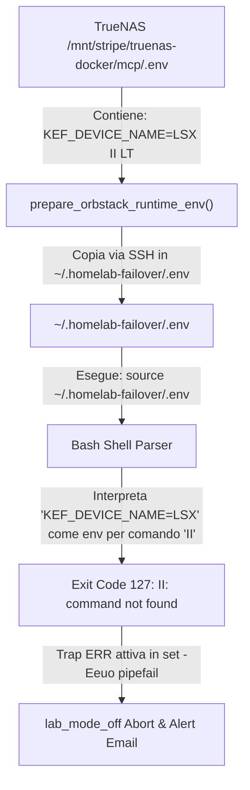

# INC-2026-10-25: Errore di Sintassi Sourcing Bash in lab_mode_off OrbStack Runtime Env

## Descrizione dell'Incidente
Durante l'avvio della procedura di convergenza [[homelab-idempotent-mode-scripts|lab_mode_off.sh]] da menu interattivo `go.py`, l'orchestratore ha completato con successo la Fase 1 (`ensure_compute_off`, cluster K8s e Proxmox VE già spenti), ma si è interrotto bruscamente all'inizio della Fase 2 (`sync_hermes_state_from_truenas`):

```text
▶️  [Fase 2/4] Esecuzione: sync_hermes_state_from_truenas...
🔐 [OrbStack Failover] Verifica directory e file .env runtime in /Users/olindo/.homelab-failover...
📥 [OrbStack Failover] Copia 1:1 di .env.ai e .env.mcp da TrueNAS (olindo@10.10.20.50)...
/Users/olindo/.homelab-failover/.env: line 39: II: command not found
❌ Procedura lab_mode_off fallita alla riga 39 (exit code: 127)
📧 Invio email via SMTP SSL (smtp.gmail.com:465) a o.pindaro@gmail.com...
✅ Email inviata con successo.
```

L'interruzione ha impedito il completamento della sincronizzazione di stato di Hermes, lo spegnimento ordinato di TrueNAS Bare Metal e l'attivazione automatica dei container di failover su Mac Studio.

---

## Analisi della Root Cause



### 1. Discrepanza sintattica Docker Compose vs Bash
Nei file `.env` interpretati nativamente da Docker Compose (`--env-file`), valori contenenti spazi senza apici (es. `KEF_DEVICE_NAME=LSX II LT`) sono considerati validi.
Tuttavia, all'interno della libreria `scripts/infrastructure/orbstack_failover.sh` (funzione `prepare_orbstack_runtime_env`), per esportare le variabili nell'ambiente della shell corrente per l'interpolazione di Compose veniva utilizzato:

```bash
set -a
source "${FAILOVER_RUNTIME_DIR}/.env"
set +a
```

### 2. Esecuzione accidentale di comando
All'istruzione `source`, l'interprete Bash ha letto la riga 39:
```env
KEF_DEVICE_NAME=LSX II LT
```
interpretando `KEF_DEVICE_NAME=LSX` come assegnazione d'ambiente temporanea per l'invocazione dell'eseguibile `II` con argomento `LT`. Non esistendo alcun binario `II` nel PATH di sistema, Bash ha generato l'errore fatale `line 39: II: command not found` (exit code: 127), innescando immediatamente la trap `ERR` dello script.

---

## Risoluzione e Correzioni Applicate

### 1. Quotatura preventiva del valore sorgente su TrueNAS
Sul server TrueNAS (10.10.20.50), il file `/mnt/stripe/truenas-docker/mcp/.env` è stato aggiornato per includere i doppi apici conformi allo standard POSIX:
```env
KEF_DEVICE_NAME="LSX II LT"
```
Lo stesso quoting è stato applicato ai file di cache locale in `~/.homelab-failover/.env` e `~/.homelab-failover/.env.mcp`.

### 2. Hardening e Parser Sicuro in `orbstack_failover.sh`
Per eliminare alla radice la vulnerabilità a fallimenti futuri (qualora venissero aggiunte altre variabili con spazi o caratteri speciali non quotati nei file Docker `.env`), il costrutto fragile `source "${FAILOVER_RUNTIME_DIR}/.env"` in `scripts/infrastructure/orbstack_failover.sh` è stato sostituito con un loop di lettura sicuro riga per riga:

```bash
# Esporta le variabili in ambiente per l'interpolazione Compose in modo sicuro
# (previene fallimenti di 'source' in presenza di valori Docker non quotati con spazi)
while IFS='=' read -r key val || [ -n "$key" ]; do
    [[ "$key" =~ ^[[:space:]]*# ]] && continue
    [[ -z "$key" ]] && continue
    key="$(echo -n "$key" | xargs)"
    if [[ "$key" =~ ^[a-zA-Z_][a-zA-Z0-9_]*$ ]]; then
        val="${val%\"}"
        val="${val#\"}"
        val="${val%\'}"
        val="${val#\'}"
        export "$key=$val"
    fi
done < "${FAILOVER_RUNTIME_DIR}/.env"
```

### 3. Validazione
Il fix è stato validato eseguendo un test isolato di `prepare_orbstack_runtime_env`, verificando sia la copia da TrueNAS sia la corretta esportazione della variabile d'ambiente:
```text
🔐 [OrbStack Failover] Verifica directory e file .env runtime in /Users/olindo/.homelab-failover...
📥 [OrbStack Failover] Copia 1:1 di .env.ai e .env.mcp da TrueNAS (olindo@10.10.20.50)...
SUCCESS! KEF_DEVICE_NAME is: [LSX II LT]
```

---

## Lezioni Apprese (Preventive Actions)
- **Divieto di `source` per file `.env` Docker**: I file `.env` destinati a Docker Compose non devono mai essere eseguiti direttamente tramite `source` in script Bash, poiché lo standard Docker consente costrutti sintattici non compatibili con la shell.
- **Parser Dichiarativo**: L'esportazione di variabili da file chiave-valore deve sempre avvenire tramite parsing controllato delle chiavi o passando i file direttamente a Docker Compose tramite il flag nativo `--env-file`.
