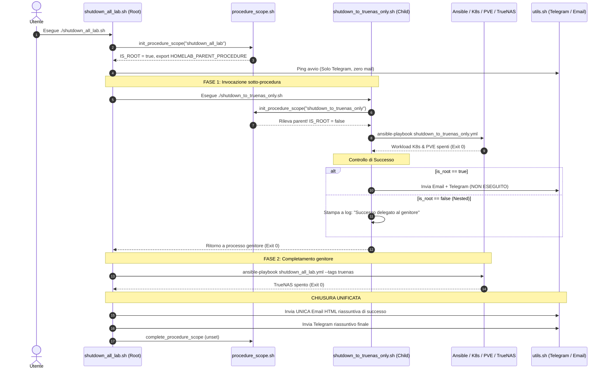
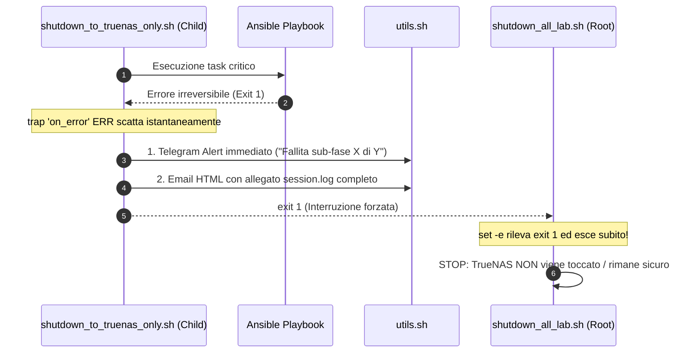

# Pattern: Hierarchical Automation Alerting

Questo pattern definisce lo standard architetturale per la gestione delle notifiche (Email HTML e messaggistica Telegram) all'interno di script e procedure di automazione gerarchiche o composte nell'Homelab.

---

## 📌 Contesto e Problema

Nelle architetture Homelab complesse, le procedure operative possono essere eseguite in due modalità distinte:
1. **Modalità Standalone**: l'operatore lancia una procedura atomica specifica (es. `./scripts/infrastructure/shutdown_to_truenas_only.sh` per spegnere solo il cluster di calcolo K8s e Proxmox, mantenendo TrueNAS attivo).
2. **Modalità Composta (Parent / Child)**: una procedura master di livello superiore include o invoca una procedura secondaria (es. `./scripts/infrastructure/shutdown_all_lab.sh` che invoca prima `shutdown_to_truenas_only` e poi provvede allo shutdown controllato dello storage TrueNAS).

In assenza di una gestione gerarchica, emergono due criticità:
- **Email Spamming (Start Clutter)**: l'invio di email all'inizio di ogni procedura intasa la casella di posta con messaggi transitori privi di valore diagnostico.
- **Notifiche Premature / Duplicate**: la sotto-procedura invia una notifica finale di successo ("Completato con successo!") a metà dell'opera complessiva, prima che la procedura master abbia terminato il suo flusso.

---

## 💡 Principi Guida del Pattern

1. **Zero Start Emails**: Nessuna procedura invia email all'avvio. La casella di posta elettronica è riservata rigorosamente al **Report Finale di Successo** o all'**Alert Immediato di Errore Critico**. All'avvio è consentito esclusivamente un leggero ping testuale su Telegram o output a console.
2. **Single Summary Alert (Root-Only Success)**: Nelle procedure composte, solo la procedura **Root** emette la notifica finale riassuntiva di successo (Email HTML + riassunto Telegram). Le sotto-procedure (Child) sopprimono la propria notifica finale di successo.
3. **Standalone Full Reporting**: Se una sotto-procedura viene lanciata direttamente in modo autonomo (Standalone), assume automaticamente il ruolo di **Root** ed emette il proprio report finale di successo.
4. **Universal Error Visibility (Fail-Fast & No Silencing)**: **Gli errori non vengono MAI soppressi**. Se si verifica un'eccezione o un errore a qualsiasi livello della gerarchia (Root o Child), scatta immediatamente il gestore di trap (`trap ERR`), inviando alert Telegram ed Email HTML con **allegato il file di log completo della sessione**.
5. **Separazione delle Responsabilità (Layered Architecture)**: Il modulo di ciclo di vita (`procedure_scope.sh`) è separato dal modulo di trasporto notifiche (`utils.sh`). I motori tecnici (Ansible, Python, CLI) rimangono puri esecutori senza logica di alerting.

---

## 🗺️ Architettura a Livelli (Layered Architecture)

```mermaid
flowchart TD
    USER["👤 Utente / Menu go.py"] --> WRAPPER_ROOT

    subgraph LAYER_1["1. ORCHESTRATION & ALERTING LAYER (Solo Bash)"]
        WRAPPER_ROOT["📜 Script Wrapper Root\n(es. shutdown_all_lab.sh)"]
        WRAPPER_CHILD["📜 Script Wrapper Child\n(es. shutdown_to_truenas_only.sh)"]
        
        SCOPE["⚙️ procedure_scope.sh\n(Traccia HOMELAB_PARENT_PROCEDURE)"]
        NOTIFY["📨 utils.sh\n(SOPS + Telegram + SMTP SSL Gmail)"]
        
        WRAPPER_ROOT -->|1. Inizializza Scope| SCOPE
        WRAPPER_ROOT -->|2. Invoca sotto-script| WRAPPER_CHILD
        WRAPPER_CHILD -->|3. Rileva Scope Child| SCOPE
    end

    subgraph LAYER_2["2. EXECUTION ENGINE LAYER (Zero Notifiche, solo Exit Codes)"]
        ANSIBLE["🅰️ Ansible Playbooks\n(shutdown_to_truenas_only.yml,\nshutdown_all_lab.yml)"]
        PYTHON["🐍 Python Scripts\n(wake_node.py, ecc.)"]
        CLI["💻 CLI Tools\n(kubectl, ssh, talosctl)"]
        
        WRAPPER_CHILD -->|Esegue| ANSIBLE
        WRAPPER_CHILD -->|Esegue| CLI
        WRAPPER_ROOT -->|Esegue| PYTHON
    end

    subgraph LAYER_3["3. ALERTING CHANNELS (Uscita)"]
        TG["💬 Telegram Bot"]
        MAIL["📧 Email HTML + Log Allegato"]
    end

    %% Flusso Notifiche
    WRAPPER_ROOT -.->|Solo se Root (Successo Finale)| NOTIFY
    WRAPPER_CHILD -.->|Soppresso se Child (Delega a Root)| NOTIFY
    WRAPPER_CHILD -.->|In Caso di Errore (trap ERR)| NOTIFY
    NOTIFY --> TG
    NOTIFY --> MAIL
```

---

## 🔄 Flussi di Sequenza (Sequence Diagrams)

### 1. Esecuzione Composta di Successo (Parent vs Child)



### 2. Flusso di Errore Universale (Fail-Fast Immediato)



---

## 🛠️ Implementazione Standard dei Moduli

### 1. Modulo Gestore Scope: `scripts/infrastructure/procedure_scope.sh`
Governa lo stato gerarchico di processo via variabile d'ambiente Unix `HOMELAB_PARENT_PROCEDURE`:

```bash
#!/usr/bin/env bash
# ==============================================================================
# PROCEDURE_SCOPE.SH — Gestore del ciclo di vita gerarchico delle procedure
# ==============================================================================

init_procedure_scope() {
    local proc_name="$1"
    CURRENT_PROCEDURE_NAME="$proc_name"
    if [ -z "${HOMELAB_PARENT_PROCEDURE:-}" ]; then
        export HOMELAB_PARENT_PROCEDURE="$proc_name"
        IS_ROOT_PROCEDURE=true
    else
        IS_ROOT_PROCEDURE=false
    fi
}

is_root_procedure() {
    [ "${IS_ROOT_PROCEDURE:-true}" = "true" ]
}

get_parent_procedure() {
    echo "${HOMELAB_PARENT_PROCEDURE:-}"
}

complete_procedure_scope() {
    if is_root_procedure; then
        unset HOMELAB_PARENT_PROCEDURE
        unset CURRENT_PROCEDURE_NAME
        unset IS_ROOT_PROCEDURE
    fi
}
```

### 2. Modulo Trasporto Notifiche: `scripts/infrastructure/utils.sh`
Focalizzato puramente sul trasporto di rete:
- `send_telegram`: invio messaggi HTML via bot API Telegram.
- `send_summary_email`: invio email HTML via SMTP SSL Gmail (porta 446/465) con supporto allegati log multipart MIME base64.
- `_load_notification_secrets`: caricamento dinamico credenziali da SOPS (`secrets-sops/`).

### 3. Template di Routine Operativa (`.sh`)
Ogni script adotta la struttura a 5 blocchi standard:

```bash
#!/usr/bin/env bash
set -Eeuo pipefail

# 1. Setup ambiente e import moduli ortogonali
SCRIPT_DIR="$(cd "$(dirname "${BASH_SOURCE[0]}")" && pwd)"
ROOT_DIR="$(cd "$SCRIPT_DIR/../.." && pwd)"
cd "$ROOT_DIR" || exit 1

source "$SCRIPT_DIR/procedure_scope.sh"   # <-- Gestione dello stato gerarchico
source "$SCRIPT_DIR/utils.sh"             # <-- Strumenti di notifica (TG / Email)

PROCEDURE_NAME="nome_procedura"
init_procedure_scope "$PROCEDURE_NAME"    # <-- Dichiarazione scope

LOG_DIR="${ROOT_DIR}/logs/automation"
mkdir -p "$LOG_DIR"
LOG_FILE="${LOG_DIR}/${PROCEDURE_NAME}_$(date +%Y%m%d_%H%M%S).log"
exec > >(tee -a "$LOG_FILE") 2>&1

# 2. Gestore errori universale con deduplicazione gerarchica
on_error() {
    local exit_code=$?
    local err_msg="Procedura ${PROCEDURE_NAME} fallita alla riga $1 (exit code: $exit_code)"
    if ! is_root_procedure; then
        err_msg="Sub-procedura ${PROCEDURE_NAME} (richiamata da $(get_parent_procedure)) fallita alla riga $1 (exit code: $exit_code)"
    fi
    echo "❌ $err_msg"

    # Deduplicazione: se l'errore è già stato notificato dalla sotto-fase, propaga senza alert duplicato
    if has_error_been_reported; then
        echo "ℹ️ [NESTED] Errore già segnalato. Uscita senza alert duplicato."
        exit "$exit_code"
    fi
    mark_error_reported

    send_telegram "❌ <b>ERRORE CRITICO HOMELAB</b>%0A${err_msg}%0AConsulta l'email per il log completo." "Homelab Alert"
    # Invio email HTML con allegato log completo...
    exit "$exit_code"
}
trap 'on_error $LINENO' ERR

# 3. Avvio: NESSUNA mail, solo ping Telegram se Root
if is_root_procedure; then
    send_telegram "🚀 <b>Avvio ${PROCEDURE_NAME}</b>..." "Homelab Power"
fi

# 4. Esecuzione task o sotto-procedure...
"$SCRIPT_DIR/sub_procedura.sh"

# 5. Notifica finale di successo: SOLO se Root
if is_root_procedure; then
    send_telegram "🎉 <b>${PROCEDURE_NAME} Completato con successo!</b>" "Homelab Power"
    send_summary_email "$DEFAULT_EMAIL_RECIPIENT" "✅ [SUCCESS] ${PROCEDURE_NAME}" "$stop_html" "Successo"
    complete_procedure_scope
else
    echo "ℹ️ [NESTED] Sotto-procedura ${PROCEDURE_NAME} completata. Segnalazione finale delegata a $(get_parent_procedure)."
fi
```

---

### 4. Interoperabilità Cross-Linguaggio (Python & Ansible)

Dato che la chiave di sincronizzazione `HOMELAB_PARENT_PROCEDURE` risiede nell'ambiente di processo Unix:
- **In Python**: qualsiasi script Python lanciato eredita la variabile ed accede con `os.environ.get("HOMELAB_PARENT_PROCEDURE")`.
- **In Ansible**: qualsiasi playbook Ansible può verificare lo stato con `lookup('env', 'HOMELAB_PARENT_PROCEDURE')`.

Tuttavia, per mantenere l'architettura pulita e disaccoppiata (**Single Responsibility Principle**), Ansible e Python non inviano email né gestiscono token di notifica, limitandosi a restituire il codice di uscita (`rc=0` successo, `rc!=0` errore) all'orchestratore Bash.

---

## 📊 Matrice di Responsabilità per Tecnologia

| Tecnologia | Ruolo nell'Homelab | Gestisce le Notifiche? | Gestisce la Gerarchia? | Come comunica con l'Orchestratore? |
| :--- | :--- | :---: | :---: | :--- |
| **Bash (`.sh`)** | **Orchestratore di Sessione** | **SÌ** (Telegram + Email HTML) | **SÌ** (`procedure_scope.sh`) | Governa il terminale, apre il log in `logs/` e fa da controllore. |
| **Ansible (`.yml`)** | **Motore di Configurazione** | No *(solo echo/debug a console)* | No | Ritorna codice di uscita (`rc=0` successo, `rc!=0` errore). |
| **Python (`.py`)** | **Utility & Tool Specifici** | No *(solo log/stdout)* | No | Esegue il calcolo/azione e ritorna codice di uscita (`sys.exit(0/1)`). |

---

## 📊 Matrice Notifiche

| Evento | Procedura Standalone (Root) | Sotto-procedura (Child) | Procedura Padre (Parent) | Canali |
| :--- | :--- | :--- | :--- | :--- |
| **Avvio** | Testo Telegram breve | Silente / Log console | Testo Telegram breve | Telegram (No Email) |
| **Step Intermedio** | Ping Telegram (opzionale) | Ping Telegram (opzionale) | Ping Telegram (opzionale) | Telegram |
| **Errore / Trap** | **Attivo al 100%** | **Attivo (Notifica Child con Log)** | **Soppresso se già segnalato da Child (`has_error_been_reported`)** | **Telegram + Email HTML con Log** |
| **Successo Finale** | **Invia Report Completo** | **Soppresso (Delegato a Parent)** | **Invia Report Unificato Finale** | **Telegram + Email HTML** |

---

## 🔗 Relazioni & Riferimenti
- [[Power_Sequence]]: Sequenza operativa di accensione e spegnimento del rack.
- [[homelab-full-power-automation]]: Piano di implementazione WoL idempotente e gestione allarmi.
- [`procedure_scope.sh`](file:///Users/olindo/prj/k8s-lab/scripts/infrastructure/procedure_scope.sh): Modulo dedicato per la gestione dello scope di processo.
- [`utils.sh`](file:///Users/olindo/prj/k8s-lab/scripts/infrastructure/utils.sh): Libreria unificata notifiche SMTP e Telegram.
