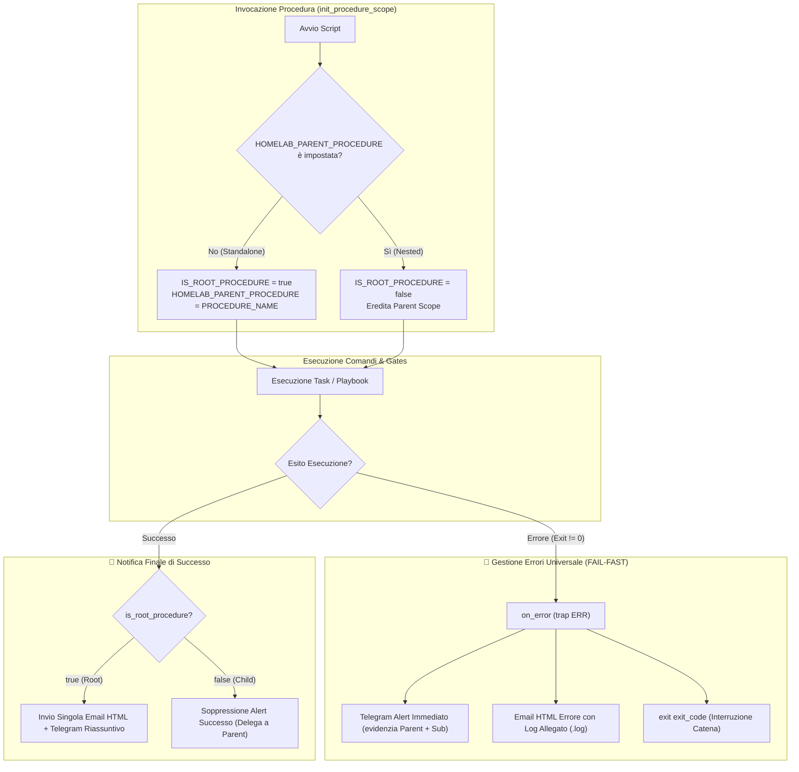

# Pattern: Hierarchical Automation Alerting

Questo pattern definisce lo standard architetturale per la gestione delle notifiche (Email HTML e messaggistica Telegram) all'interno di script e procedure di automazione gerarchiche o composte nell'Homelab.

---

## 📌 Contesto e Problema

Nelle architetture Homelab complesse, le procedure operative possono essere eseguite in due modalità distinte:
1. **Modalità Standalone**: l'operatore lancia una procedura atomica specifica (es. `./scripts/infrastructure/shutdown_to_truenas_only.sh` per spegnere solo il cluster di calcolo K8s e Proxmox, mantenendo TrueNAS attivo).
2. **Modalità Composta (Parent / Child)**: una procedura master di livello superiore include o invoca una procedura secondaria (es. `./scripts/infrastructure/shutdown_all_lab.sh` che invoca prima `shutdown_to_truenas_only` e poi provvede allo shutdown controllato dello storage TrueNAS).

In assenza di una gestione gerarchica, emergono due criticità:
- **Email Spamming (Start Clutter)**: l'invio di email all'inizio di ogni procedura intasa la casella di posta con messaggi transitori privi di valore diagnostico.
- **Notifiche Premature / Duplicate**: la sotto-procedura invia una notifica finale di successo ("Completato con successo!") a metà dell'opera complessiva, prima che la procedura master abbia terminato il suo flusso.

---

## 💡 Principi Guida del Pattern

1. **Zero Start Emails**: Nessuna procedura invia email all'avvio. La casella di posta elettronica è riservata rigorosamente al **Report Finale di Successo** o all'**Alert Immediato di Errore Critico**. All'avvio è consentito esclusivamente un leggero ping testuale su Telegram o output a video.
2. **Single Summary Alert (Root-Only Success)**: Nelle procedure composte, solo la procedura **Root** emette la notifica finale riassuntiva di successo (Email HTML + riassunto Telegram). Le sotto-procedure (Child) sopprimono la propria notifica finale di successo.
3. **Standalone Full Reporting**: Se una sotto-procedura viene lanciata direttamente in modo autonomo (Standalone), assume automaticamente il ruolo di **Root** ed emette il proprio report finale di successo.
4. **Universal Error Visibility (No Silencing)**: **Gli errori non vengono MAI soppressi**. Se si verifica un'eccezione o un errore a qualsiasi livello della gerarchia (Root o Child), scatta immediatamente il gestore di trap (`trap ERR`), inviando alert Telegram ed Email HTML con **allegato il file di log completo della sessione**.

---

## 🗺️ Flusso Operativo e Decisionale



---

## 🛠️ Implementazione Standard

### 1. Libreria Condivisa (`scripts/infrastructure/utils.sh`)
La libreria espone le funzioni di ciclo di vita dello scope gerarchico:

```bash
# Inizializza il contesto della procedura
init_procedure_scope() {
    local proc_name="$1"
    CURRENT_PROCEDURE_NAME="$proc_name"
    if [ -z "${HOMELAB_PARENT_PROCEDURE:-}" ]; then
        export HOMELAB_PARENT_PROCEDURE="$proc_name"
        IS_ROOT_PROCEDURE=true
    else
        IS_ROOT_PROCEDURE=false
    fi
}

# Verifica se la procedura corrente è la root principale
is_root_procedure() {
    [ "${IS_ROOT_PROCEDURE:-true}" = "true" ]
}

# Reset dello scope al termine della Root
complete_procedure_scope() {
    if is_root_procedure; then
        unset HOMELAB_PARENT_PROCEDURE
    fi
}
```

### 2. Struttura degli Script Wrapper (`.sh`)
Ogni script adotta la struttura seguente:

```bash
#!/usr/bin/env bash
set -Eeuo pipefail

SCRIPT_DIR="$(cd "$(dirname "${BASH_SOURCE[0]}")" && pwd)"
ROOT_DIR="$(cd "$SCRIPT_DIR/../.." && pwd)"
cd "$ROOT_DIR" || exit 1

source "$SCRIPT_DIR/utils.sh"

PROCEDURE_NAME="nome_procedura"
init_procedure_scope "$PROCEDURE_NAME"

# Gestore errori: sempre attivo con log completo
on_error() {
    local exit_code=$?
    local err_msg="Procedura ${PROCEDURE_NAME} fallita alla riga $1 (exit code: $exit_code)"
    if ! is_root_procedure; then
        err_msg="Sub-procedura ${PROCEDURE_NAME} (chiamata da ${HOMELAB_PARENT_PROCEDURE}) fallita alla riga $1 (exit code: $exit_code)"
    fi
    echo "❌ $err_msg"
    send_telegram "❌ <b>ERRORE CRITICO HOMELAB</b>%0A${err_msg}%0AConsulta l'email per il log completo." "Homelab Alert"
    # Invio email con log allegato...
    exit "$exit_code"
}
trap 'on_error $LINENO' ERR

# Ping informativo iniziale (SOLO Telegram, NESSUNA mail di start)
if is_root_procedure; then
    send_telegram "🚀 <b>Avvio ${PROCEDURE_NAME}</b>..." "Homelab Power"
fi

# ... ESECUZIONE OPERAZIONI O SUB-PROCEDURE ...

# Notifica finale di successo: SOLO se Root
if is_root_procedure; then
    send_telegram "🎉 <b>${PROCEDURE_NAME} Completato con successo!</b>" "Homelab Power"
    send_summary_email "$DEFAULT_EMAIL_RECIPIENT" "✅ [SUCCESS] ${PROCEDURE_NAME}" "$stop_html" "Successo"
    complete_procedure_scope
else
    echo "ℹ️ [NESTED] Sotto-procedura ${PROCEDURE_NAME} completata. Notifica finale delegata a ${HOMELAB_PARENT_PROCEDURE}."
fi
```

---

## 📊 Matrice Notifiche

| Evento | Procedura Standalone (Root) | Sotto-procedura (Child) | Procedura Padre (Parent) | Canali |
| :--- | :--- | :--- | :--- | :--- |
| **Avvio** | Testo Telegram breve | Silente / Log console | Testo Telegram breve | Telegram (No Email) |
| **Step Intermedio** | Ping Telegram (opzionale) | Ping Telegram (opzionale) | Ping Telegram (opzionale) | Telegram |
| **Errore / Trap** | **Attivo al 100%** | **Attivo al 100% (evidenzia Child)** | Propagato via `exit != 0` | **Telegram + Email HTML con Log** |
| **Successo Finale** | **Invia Report Completo** | **Soppresso (Delegato a Parent)** | **Invia Report Unificato Finale** | **Telegram + Email HTML** |

---

## 🔗 Relazioni & Riferimenti
- [[Power_Sequence]]: Sequenza operativa di accensione e spegnimento del rack.
- [[homelab-full-power-automation]]: Piano di implementazione WoL idempotente e gestione allarmi.
- [`utils.sh`](file:///Users/olindo/prj/k8s-lab/scripts/infrastructure/utils.sh): Libreria unificata notifiche SMTP e Telegram.
