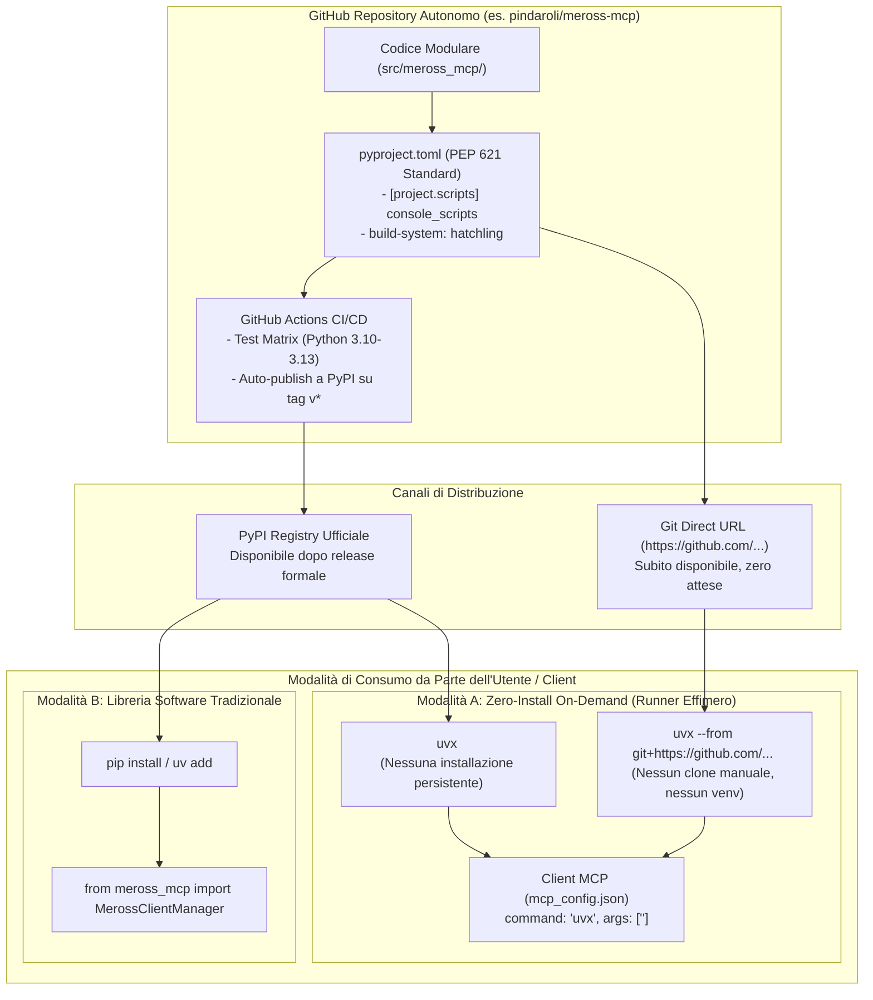

# Pattern: Zero-Install Executable Package (Packaging per Caricamento On-Demand ed Esecuzione Effimera)

Questo pattern definisce lo standard architetturale del lab per progettare, impacchettare e distribuire strumenti software (in particolare server **Model Context Protocol**) fruibili sia come **libreria importabile**, sia soprattutto come **eseguibile a caricamento dinamico senza installazione locale persistente** (*zero-install / ephemeral execution*).

---

## 🗺️ Mappe Concettuali e Relazioni
- [[MCP_Platform]] (Piattaforma e client MCP del lab)
- [[mcp-registry-package-pattern]] (Pattern di containerizzazione per pacchetti già pubblicati su registry)
- [[mcp-secret-projection-pattern]] (Proiezione credenziali e assenza di file locali non protetti)
- [[SCHEMA]] (Regole di governance e catalogazione del Wiki)

---

## 1. Problema e Motivazione

Nei flussi operativi moderni con assistenti AI (Google Antigravity, Claude Desktop, agenti CLI) e nella condivisione open-source di tool su GitHub:
1. **Attrito dell'installazione locale**: Chiedere a un utente o a un agent runner di clonare un repository Git, creare un ambiente virtuale dedicato (`python -m venv .venv`), attivarlo e lanciare `pip install -r requirements.txt` crea complessità, spreco di spazio disco, disallineamento di versioni e "inquinamento" del filesystem dell'host.
2. **Esigenza di esecuzione on-demand (Zero-Install)**: Utility CLI e server MCP vengono spesso invocati su richiesta tramite moderni package runner effimeri (come **`uvx`** / `pipx` per Python, o **`npx`** per Node.js). Questi strumenti creano un ambiente temporaneo e isolato in cache, scaricano il pacchetto (da PyPI o direttamente dall'URL Git pubblico), lo eseguono e lo distruggono o mantengono in cache trasparente senza alterare il sistema operativo.
3. **Dualità Pacchetto vs Libreria**: Un progetto ben strutturato deve poter essere utilizzato contemporaneamente:
   - Come **applicazione/server eseguibile on-demand** (`uvx meross-mcp` oppure `uvx --from git+https://...`).
   - Come **libreria standard** installabile via dependency manager (`pip install meross-mcp` o `uv add meross-mcp`) per consentire a sviluppatori terzi di riutilizzare le classi core nel proprio codice Python (`from meross_mcp import MerossClientManager`).

---

## 2. Architettura del Pattern



---

## 3. Requisiti di Implementazione del Pattern

Per conformarsi al pattern **Zero-Install Executable Package**, un progetto Python DEVE implementare i seguenti requisiti tecnici:

### 1. Standard PEP 621 e Packaging `src/` Layout
- Struttura basata sulla directory `src/<package_name>/` per prevenire import accidentali di moduli locali durante test e build.
- `pyproject.toml` completo di:
  ```toml
  [build-system]
  requires = ["hatchling"]
  build-backend = "hatchling.build"

  [project]
  name = "meross-mcp"
  version = "0.1.0"
  description = "Zero-install Model Context Protocol (MCP) server & library for Meross smart plugs"
  readme = "README.md"
  license = { text = "MIT" }
  requires-python = ">=3.10"
  dependencies = [
      "meross-iot==0.4.10.4",
      "fastmcp>=0.4.0",
      "pydantic>=2.0.0",
  ]

  [project.scripts]
  meross-mcp = "meross_mcp.server:main"

  [tool.hatch.build.targets.wheel]
  packages = ["src/meross_mcp"]
  ```

### 2. Zero File-System Dependencies (Env-First Architecture)
- L'eseguibile **non deve richiedere file di configurazione con path hardcodati** sul disco dell'utente.
- Tutti i parametri operativi devono essere configurabili tramite:
  1. **Variabili d'ambiente** (es. `MEROSS_EMAIL`, `MEROSS_PASSWORD`, `MEROSS_API_BASE_URL`).
  2. **Flag CLI** (es. `meross-mcp --transport sse --port 8112`).
- Eventuali dati di runtime o file temporanei devono essere confinati in memoria RAM o nella directory effimera del sistema operativo (`tempfile.gettempdir()` / `/tmp`).

### 3. Dual-Delivery: Git Direct & Registry Pubblico
Il pacchetto deve poter essere consumato in due modalità progressive:
1. **Fase Pre-Release / Git Direct**:
   Chiunque può testare il server semplicemente eseguendo:
   ```bash
   uvx --from git+https://github.com/pindaroli/meross-mcp.git meross-mcp
   ```
2. **Fase di Pubblicazione su PyPI**:
   Una pipeline CI/CD GitHub Actions rilascia il pacchetto su PyPI al push di ogni tag Git (`git tag v0.1.0 && git push origin v0.1.0`), abilitando l'invocazione minimale:
   ```bash
   uvx meross-mcp
   ```

### 4. Configurazione Trasparente nel Client MCP (`mcp_config.json`)
La registrazione nel client MCP (es. Antigravity, Claude Desktop) non richiede all'utente di clonare o mantenere il codice. Diventa una dichiarazione pura:

```json
{
  "mcpServers": {
    "meross": {
      "command": "uvx",
      "args": ["meross-mcp"],
      "env": {
        "MEROSS_EMAIL": "user@example.com",
        "MEROSS_PASSWORD": "secretpassword"
      }
    }
  }
}
```
*(Oppure via `--from git+https://github.com/pindaroli/meross-mcp.git` prima della pubblicazione su PyPI).*

---

## 4. Esempi Esistenti nel Lab Confluenti con Questo Pattern
Nel lab questo pattern è già adottato con successo da diversi tool integrati in `~/.gemini/antigravity/mcp_config.json`:
- **`exos`**: lanciato direttamente tramite `/opt/homebrew/bin/uvx --from git+https://github.com/ntunes/netmiko-mcp-server.git netmiko-mcp` senza avere il codice sorgente clonato nel progetto.
- **`vinted`**: eseguito on-demand tramite `npx -y -p @googlarz/vinted-client vinted-mcp`.
- **`gmp-code-assist`**: eseguito on-demand tramite `npx -y @googlemaps/code-assist-mcp@latest`.

Il progetto `meross-mcp` adotta questo standard nativamente fin dal primo commit.
