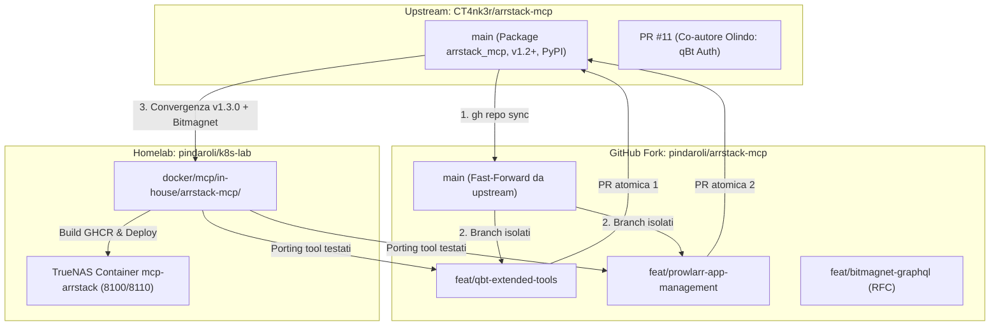

# Piano: Allineamento Fork arrstack-mcp, Strategia Pull Request Upstream & Convergenza In-House Homelab

## 🎯 Descrizione dell'Obiettivo
Questo piano definisce la strategia tecnica e la sequenza operativa per:
1. **Allineare il fork GitHub pubblico** ([`pindaroli/arrstack-mcp`](https://github.com/pindaroli/arrstack-mcp)) con il ramo `main` dell'autore originale ([`CT4nk3r/arrstack-mcp`](https://github.com/CT4nk3r/arrstack-mcp)), rimuovendo i rami obsoleti e configurando un ambiente di lavoro locale isolato (`/Users/olindo/prj/arrstack-mcp`).
2. **Contribuire a monte (Upstream PRs)** mediante PR verticali, atomiche e corredate da test mock, portando su upstream le estensioni già testate e stabili sviluppate nel lab:
   - **PR 1**: `qbt` Extended REST Tools (categorie, tag, file list, tracker, recheck/reannounce).
   - **PR 2**: `prowlarr` Management Tools (elenco, test e sincronizzazione applicazioni Servarr, statistiche indexer).
   - **PR 3 / RFC**: Proposta di integrazione per il motore DHT Bitmagnet GraphQL.
3. **Aggiornare il container in-house TrueNAS** ([`docker/mcp/in-house/arrstack-mcp`](file:///Users/olindo/prj/k8s-lab/docker/mcp/in-house/arrstack-mcp/)) adottando la nuova architettura a package modulare (`arrstack_mcp/`), beneficiando del supporto a Jellyseerr, della redazione automatica delle credenziali nei log e della ricerca interattiva delle release in Radarr.

---

## 🗺️ Mappa Concettuale e Relazioni
- [[MCP_Platform]]: Flotta MCP su TrueNAS SCALE bare-metal (`10.10.20.50:8100/arrstack/mcp`)
- [[Servarr]]: Stack multimediale e client qBittorrent su TrueNAS
- [[arrstack-mcp-bitmagnet-graphql-extension]]: Estensione v1.2.0 GraphQL per Bitmagnet
- [[arrstack-mcp-prowlarr-qbittorrent-rest-extension]]: Estensione v1.1.0 REST per Prowlarr e qBt
- [[arrstack-mcp-truenas-docker-migration]]: Containerizzazione Docker e Traefik Umbrella Gateway



---

## ⚠️ User Review Required

> [!IMPORTANT]
> **Nessuna interruzione di servizio in Homelab**: Il microservizio attuale su TrueNAS (`10.10.20.50:8100/arrstack/mcp`) rimane attivo e operativo durante l'intero ciclo di contribuzione upstream. L'aggiornamento dell'in-house container avverrà solo nella Fase 5, a valle della convergenza.

> [!NOTE]
> **Packaging upstream e separazione repository**: Per non inquinare il repository di infrastruttura `k8s-lab`, l'attività open-source per le PR upstream verrà condotta all'interno di una directory dedicata `/Users/olindo/prj/arrstack-mcp` collegata al tuo fork GitHub.

---

## 📋 Open Questions & Decisioni di Design
1. **Priorità di rilascio delle PR**: Si suggerisce di iniziare con la PR di qBittorrent (estensione naturale del lavoro precedente su cui sei già accreditato come co-autore), seguita da Prowlarr.
2. **Canale per Bitmagnet**: Bitmagnet richiede dipendenze GraphQL/Pydantic e una nuova sezione in `config.py`. Si consiglia di aprire preventivamente una GitHub Issue (RFC) per validare l'interesse del maintainer prima di scrivere la PR.

---

## 🏗️ Fasi Operative Dettagliate

### FASE 1: Sincronizzazione del Fork GitHub & Ambiente Locale

#### Passo 1.1: Sincronizzazione Fast-Forward del Fork Remoto
Allineare il branch `main` del fork `pindaroli/arrstack-mcp` all'ultimo commit di `CT4nk3r/arrstack-mcp:main`.
```bash
gh repo sync pindaroli/arrstack-mcp --source CT4nk3r/arrstack-mcp
```
*Verifica*: Verificare con `gh api repos/CT4nk3r/arrstack-mcp/compare/pindaroli:main...CT4nk3r:main` che `ahead_by` e `behind_by` siano pari a 0.

#### Passo 1.2: Eliminazione del Branch Remoto Obsoleto
Rimuovere il branch `fix-qbittorrent-5.2-compatibility` che è già stato integrato in upstream via PR #6 e rifinito in PR #11.
```bash
gh api --method DELETE repos/pindaroli/arrstack-mcp/git/refs/heads/fix-qbittorrent-5.2-compatibility
```
*Verifica*: `gh api repos/pindaroli/arrstack-mcp/branches` deve mostrare unicamente il branch `main`.

#### Passo 1.3: Clone e Configurazione dell'Ambiente Locale
Clonare il fork in `/Users/olindo/prj/arrstack-mcp` e configurare il remote upstream:
```bash
git clone https://github.com/pindaroli/arrstack-mcp.git /Users/olindo/prj/arrstack-mcp
cd /Users/olindo/prj/arrstack-mcp
git remote add upstream https://github.com/CT4nk3r/arrstack-mcp.git
git remote -v
```

#### Passo 1.4: Installazione Virtualenv ed Esecuzione Test Baseline
```bash
cd /Users/olindo/prj/arrstack-mcp
uv venv .venv --python 3.12
source .venv/bin/activate
uv pip install -e ".[dev]" pytest pytest-asyncio
pytest
```
*Verifica*: Tutti i test unitari di upstream devono superare (il numero esatto, indicato in origine come 271, NON è verificato: registrare il valore reale dal primo `pytest`).

> [!NOTE]
> **Verifiche del grill-me (2026-10-22)**: il fork `pindaroli/arrstack-mcp` risulta indietro di 7 commit rispetto a upstream `main` (ahead 0); il branch `fix-qbittorrent-5.2-compatibility` esiste ancora. Upstream non ha `CONTRIBUTING`; i merge esterni passati hanno richiesto 11-40 giorni (PR #6: 40 giorni, #9/#10: 11 giorni).

---

### FASE 2: PR 1 — qBittorrent Extended REST Tools Upstream

#### Passo 2.1: Creazione Branch
```bash
cd /Users/olindo/prj/arrstack-mcp
git checkout -b feat/qbt-extended-tools
```

#### Passo 2.2: Implementazione dei Tool in `arrstack_mcp/server.py`
Porting mirato delle funzioni già collaudate in `k8s-lab`:
- `qbt_list_categories`: Elenco categorie e relativi percorsi di salvataggio (`GET /api/v2/torrents/categories`).
- `qbt_create_category`: Creazione nuova categoria con percorsi personalizzati (`POST /api/v2/torrents/createCategory`).
- `qbt_set_category`: Assegnazione o rimozione categoria a un torrent (`POST /api/v2/torrents/setCategory`).
- `qbt_torrent_files`: Ispezione dei file contenuti all'interno di un torrent (`GET /api/v2/torrents/files`).
- `qbt_torrent_trackers`: Elenco dei tracker e relativo stato di contatto (`GET /api/v2/torrents/trackers`).
- `qbt_recheck` / `qbt_reannounce`: Verifica integrità hash e forzatura annuncio (`POST /api/v2/torrents/recheck`, `reannounce`).
- `qbt_list_tags`, `qbt_add_tags`, `qbt_remove_tags`: Gestione completa tag qBt (`GET /api/v2/torrents/tags`, `POST /api/v2/torrents/addTags`, `removeTags`).

#### Passo 2.3: Unit Test Mock in `tests/test_qbittorrent.py`
Estendere `tests/test_qbittorrent.py` (esistente upstream) con test mock (simulazione risposte qBittorrent API v2) per ogni nuovo tool, nel rispetto della suite upstream.
**Pre-check nomi**: prima di scrivere codice, confrontare i nomi/parametri dei tool con la convenzione upstream (upstream ha già `radarr_*_tags`, `*_set_quality_profile_qualities`, `sonarr_list_series_by_tag`); un disallineamento è il principale rischio di richiesta di rifacimento della PR.

#### Passo 2.4: Esecuzione Test & Creazione Pull Request
```bash
pytest tests/test_qbittorrent.py
git add arrstack_mcp/server.py tests/test_qbittorrent.py README.md
git commit -m "feat(qbittorrent): add category, tag, tracker, file inspection and recheck tools"
git push origin feat/qbt-extended-tools
gh pr create --repo CT4nk3r/arrstack-mcp --title "feat(qbittorrent): add category, tag, tracker, file inspection and recheck tools" --body "..."
```

---

### FASE 3: PR 2 — Prowlarr Management Tools Upstream

#### Passo 3.1: Creazione Branch
```bash
cd /Users/olindo/prj/arrstack-mcp
git checkout main
git pull upstream main
git checkout -b feat/prowlarr-app-management
```

#### Passo 3.2: Implementazione dei Tool in `arrstack_mcp/server.py`
- `prowlarr_list_applications`: Elenco app Servarr collegate (Radarr, Sonarr, Lidarr), ID, syncLevel e URL.
- `prowlarr_sync_applications`: Trigger del comando di sincronizzazione indexer verso una o tutte le app.
- `prowlarr_test_applications`: Test di connettività verso le applicazioni Servarr configurate.
- `prowlarr_indexer_stats`: Statistiche aggregate per indexer (query, grab, fallimenti).

#### Passo 3.3: Unit Test & Invio PR
Scrittura test in un nuovo file `tests/test_prowlarr.py` (upstream ha solo `tests/test_prowlarr_grab.py`, da non sovrascrivere), validazione con `pytest` e creazione della PR verso `CT4nk3r/arrstack-mcp`.

---

### FASE 4: Bitmagnet GraphQL — Issue RFC & Valutazione Upstream

#### Passo 4.1: Apertura Issue RFC su GitHub
Aprire una issue descrittiva intitolata `RFC: Bitmagnet GraphQL integration for autonomous DHT torrent discovery`.
- Descrivere il caso d'uso: Bitmagnet come crawler DHT autonomo e indicizzatore locale.
- Illustrare l'architettura dei due tool proposti (`bitmagnet_simple_search` e `bitmagnet_complex_search`).
- Richiedere feedback al maintainer se preferisce integrarlo nativamente nel package o se mantenerlo come estensione per client self-hosted.

---

### FASE 5: Convergenza e Rollout nel Container TrueNAS Homelab

#### Passo 5.0: Censimento Divergenze (esito diff in-house vs upstream)
L'in-house (`src/server.py` + `ard.py`, v1.2.0) NON è un package. Tool presenti solo in-house: `qbt_*` estesi (categorie, tag, files, trackers, recheck, reannounce), `prowlarr_{list,sync,test}_applications` e `prowlarr_indexer_stats`, `bitmagnet_*`. Tool presenti solo upstream: `seerr_*` (5), `radarr_{releases,grab_release,list_tags,list_movies_by_tag,set_movie_tags,set_quality_profile_qualities}`, `sonarr_{list_episode_files,list_series_by_tag,list_tags,set_quality_profile_qualities,set_series_tags}`. **Decisioni dell'utente (grill-me 2026-10-22)**:
1. `qbt_*` estesi → **PR upstream** (Fase 2, nomi uniformati a upstream).
2. `prowlarr_*` app management → **PR upstream** (Fase 3, nomi uniformati).
3. `bitmagnet_*` → **RFC (issue) upstream**; nel frattempo **locale** nel branch `homelab`.
4. Tool solo-upstream (`seerr_*`, `radarr_*`/`sonarr_*` tag e quality profile, `radarr_releases`) → **adottare tutti**; abilitare `seerr` in `ENABLED_SERVICES` con nuovo segreto SOPS per `SEERR_URL`/`SEERR_API_KEY`.

**Divergenze aggiuntive scoperte dal confronto env/compose (DECISE, grill-me 2026-10-22)**:
- `/health` (patch locale `src/server.py` riga ~261): **nessuna patch nel fork**. Il healthcheck del compose passa a `GET http://127.0.0.1:8080/.well-known/mcp-server-card.json` (rotta upstream, risponde 200; `127.0.0.1:*` è nei default di `MCP_ALLOWED_HOSTS`).
- DNS rebinding: **protezione upstream intatta**, nessuna patch. Verificato nel codice dell'SDK `mcp` (`transport_security.py`) che `MCP_ALLOWED_HOSTS=*` NON è un jolly (solo match esatto o suffisso `:*` sulla porta). Nuovo valore nel compose: `MCP_ALLOWED_HOSTS=10.10.20.50:*,127.0.0.1:*,localhost:*` (host reale dei client: `10.10.20.50:8100`). Rimuovere `MCP_DNS_REBINDING_PROTECTION` (ignorata da upstream).
- CI: il workflow `.github/workflows/docker-arrstack-mcp.yml` **resta in `k8s-lab`**. Il Dockerfile (`docker/mcp/in-house/arrstack-mcp/`) fa `git clone` del fork a `ARRSTACK_REF`, letto da un nuovo file `UPSTREAM_REF`; `VERSION` resta la versione dell'immagine. Trigger: push su `k8s-lab` (path della directory) e `workflow_dispatch`. Da riscrivere: step di build con `--build-arg ARRSTACK_REF`.

**Da verificare in collaudo (non ancora testato)**: risposta 200 reale del nuovo healthcheck e accettazione dell'header `Host: 10.10.20.50:8100` tramite Traefik.

#### Passo 5.1: Sostituzione dell'in-house con build dal fork (strategia decisa)
La Fase 5 è una **sostituzione**, non un refactor:
- Branch di integrazione `homelab` nel fork, con merge dei branch `feat/*` (qbt, prowlarr, bitmagnet). Ad ogni release upstream: rebase/merge e risoluzione conflitti su `server.py`.
- `Dockerfile` unprivileged (UID 1000, read-only rootfs): `git clone` del fork a SHA fissato (build arg `ARRSTACK_REF`), `pip install .`, nessun `:latest` (pattern [[mcp-upstream-tracking-pattern]]).
- Workflow CI di build/push GHCR nel fork (upstream ha chiuso la PR #12 per la pubblicazione immagine: non esiste immagine upstream).
- Modulo `bitmagnet.py` e sezione `BITMAGNET_*` in `config.py` nel branch `homelab`.
- Prima dello switch: confrontare env/segreti (`docker-compose.yaml` vs `config.py` del fork: BITMAGNET_*, credenziali qBt, Seerr) ed elencare i tool prima/dopo.
- Configurazione nativa in `config.py` per le impostazioni `BITMAGNET_*`.
- Abilitazione del toolset esteso upstream: `seerr_*` (puntato a `http://10.10.20.50:5055`), `radarr_releases`, tag e log redacting.

#### Passo 5.2: Build Immagine Docker GHCR & Deploy TrueNAS
- Versione: upstream non ha file `VERSION` (versione dinamica da `pyproject.toml`); il tag immagine `1.3.0` è assegnato dal workflow CI e legato allo SHA del fork. Il file `VERSION` in-house (1.2.0) viene dismesso con `src/server.py`.
- Build e push su GHCR (`ghcr.io/pindaroli/arrstack-mcp:1.3.0`).
- Cutover diretto (deciso dall'utente): sostituzione del container `mcp-arrstack` (8100) con il nuovo tag in `docker-compose.yaml` su TrueNAS. **Rollback manuale**: ripristinare il tag `1.2.0` nel compose e riavviare (tenere l'immagine 1.2.0 disponibile su GHCR).
- Test di validazione con `curl` dell'endpoint `/arrstack/mcp` e test interattivo da Antigravity.

---

## 🧪 Piano di Verifica e Collaudo

### Test Automatizzati
1. **Baseline Upstream**: `pytest` su `/Users/olindo/prj/arrstack-mcp` (registrare il numero reale di test passati).
2. **Nuovi Test PR 1**: `pytest tests/test_qbittorrent.py` con test dei tool di categorie, tag e tracker.
3. **Nuovi Test PR 2**: `pytest tests/test_prowlarr.py` con test di sync e test app.
4. **Test Unitari Bitmagnet**: `pytest tests/test_bitmagnet.py` per il parsing e la normalizzazione dei tipi GraphQL.

### Verifica Manuale / E2E
1. **GitHub Status**: Verifica superamento workflow CI GitHub Actions sulle Pull Request aperte.
2. **TrueNAS Live Check**: Verifica avvio del container su porta 8110 e risposta `HTTP 200` su `/arrstack/mcp`.
3. **MCP Tool Discovery**: Verifica che Antigravity veda sia i nuovi tool upstream (`seerr_search`, `radarr_releases`) sia i tool custom (`bitmagnet_simple_search`, `qbt_list_categories`).

---

## 💾 Stato di Ripristino (AI Save-State)
- **Fase Attiva**: Piano COMPLETATO con successo ✅ (Tutte le 5 Fasi eseguite e validate).
- **Ultima Azione Completata**: Rollout container v1.3.0 su TrueNAS SCALE completato; test E2E eseguiti con successo su Traefik (`/arrstack/mcp`) per qBittorrent, Prowlarr e Bitmagnet.
- **Riferimenti Contributi Upstream**:
  - **PR 1 (qBt Extended REST Tools)**: [CT4nk3r/arrstack-mcp#16](https://github.com/CT4nk3r/arrstack-mcp/pull/16) (Aperta)
  - **PR 2 (Prowlarr App Management & Stats)**: [CT4nk3r/arrstack-mcp#17](https://github.com/CT4nk3r/arrstack-mcp/pull/17) (Aperta)
  - **RFC (Bitmagnet GraphQL Integration)**: [CT4nk3r/arrstack-mcp#18](https://github.com/CT4nk3r/arrstack-mcp/issues/18) (Aperta)
  - **Branch Fork Homelab**: `pindaroli/arrstack-mcp@homelab` (`8da27d8466ab1fb067121fe2731fc8fdd1c13d7b`)
  - **Immagine GHCR Produzione**: `ghcr.io/pindaroli/arrstack-mcp:1.3.0` (Attiva e healthy su TrueNAS)
- **Prossimo Passo Operativo**: Monitoraggio delle revisioni e feedback dell'autore su PR #16, #17 e issue #18.
- **Blocchi/Decisioni Pendenti**: Nessuno. Infrastructure e stack in produzione pienamente operativi.
