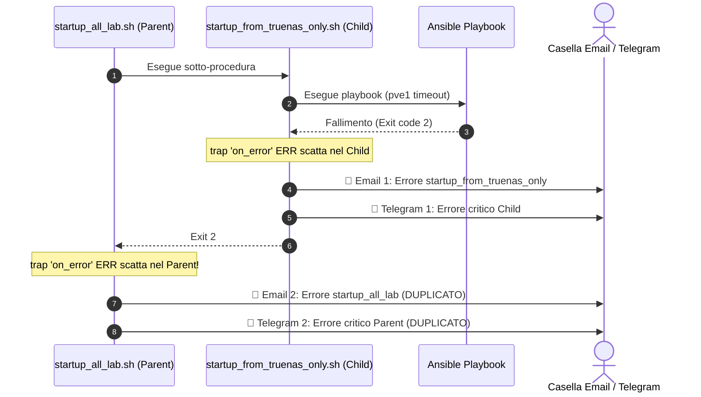

# Piano: Deduplicazione Alert nelle Procedure di Automazione Gerarchiche

Questo piano definisce la soluzione architetturale per eliminare il fenomeno del **doppio alert di errore** (Email HTML e Telegram) durante l'esecuzione di procedure composte (`startup_all_lab` -> `startup_from_truenas_only`, `shutdown_all_lab` -> `shutdown_to_truenas_only`), garantendo che l'utente riceva **un'unica segnalazione riassuntiva** sia in caso di successo che in caso di errore.

---

## 🔍 Analisi dello Stato Attuale: Perché Arrivano Due Email?

Dall'analisi dei log e dello screenshot dell'inbox, durante il fallimento del WoL di `pve1` alle ore 08:28 sono state recapitate due email di allarme:
1. `🚨 [ALERT] Errore in startup_from_truenas_only` (alle 08:28)
2. `🚨 [ALERT] Errore in startup_all_lab` (alle 08:28)

### Il Meccanismo del "Cascading Trap"
Attualmente l'architettura gerarchica definita in [[hierarchical-automation-alerting-pattern]] gestisce la deduplicazione **esclusivamente per le notifiche di successo**:
```bash
# Notifica Finale di Successo:
if is_root_procedure; then
    send_summary_email ...
else
    echo "ℹ️ [NESTED] Segnalazione finale delegata a ${HOMELAB_PARENT_PROCEDURE}."
fi
```

Al contrario, per gli errori il pattern adotta la regola:
> *"Universal Error Visibility: Gli errori non vengono mai soppressi. trap ERR scatta a qualsiasi livello."*

Quando la sotto-procedura figlia (`startup_from_truenas_only.sh`) fallisce alla riga 63 (Ansible exit code 2):
1. **Trap Figlia (Child Trap)**: Scatta la funzione `on_error` di `startup_from_truenas_only.sh`, che invia il messaggio Telegram e la prima **Email 1** con il log `startup_from_truenas_only_*.log`, terminando con `exit 2`.
2. **Trap Genitore (Parent Trap)**: `startup_all_lab.sh` era in attesa alla riga 68 (`"$SCRIPT_DIR/startup_from_truenas_only.sh"`). A causa di `set -e`, l'uscita con codice 2 del comando scatena immediatamente la trap `on_error` di `startup_all_lab.sh`.
3. Il genitore invia quindi un secondo messaggio Telegram e una seconda **Email 2** con il log `startup_all_lab_*.log` e termina con `exit 2`.



---

## 🎯 Obiettivo Architetturale

1. **Unica Segnalazione di Errore**: In caso di fallimento in una sotto-procedura, deve essere recapitata **esattamente 1 sola email e 1 solo messaggio Telegram**.
2. **Massima Precisione Diagnostica**: L'email deve contenere il contesto più specifico possibile (il log e il checkpoint esatto dove l'errore reale si è manifestato, ovvero il child).
3. **Idempotenza Standalone**: Se una procedura child viene eseguita da sola (standalone), continua a notificare autonomamente perché in quel contesto è Root.
4. **Protezione dei Fallimenti di Livello Parent**: Se il fallimento avviene in uno step proprio del genitore (es. Fase 1 avvio TrueNAS in `startup_all_lab` prima ancora di chiamare il child), il genitore deve notificare regolarmente.

---

## 💡 Opzioni a Confronto

### Opzione 1: Marker di Scope Atomico via `procedure_scope.sh` (Consigliata)
- `procedure_scope.sh` introduce un meccanismo di tracciamento dello stato di errore condiviso tra processi figli e genitori via file-marker temporaneo in `${LOG_DIR}/.error_marker_${HOMELAB_PARENT_PROCEDURE}`.
- Funzionamento:
  1. Quando si verifica un errore, `on_error()` verifica `has_error_been_reported()`.
  2. Se **non** è ancora stato segnalato: invia Telegram, Email HTML con log allegato e invoca `mark_error_reported()`.
  3. Se il processo genitore si risveglia con trap `ERR`, verifica `has_error_been_reported()`. Rilevando che la sotto-fase ha già inoltrato il report all'utente, logga a console:
     `ℹ️ [NESTED] Errore già notificato dalla sotto-procedura. Uscita senza duplicazione alert.`
     ed esce con lo stesso exit code senza inviare email o telegram duplicati.
  4. Alla fine o all'inizio di ogni procedura root, `complete_procedure_scope` pulisce eventuali marker orfani.
- **Vantaggi**: 
  - Zero modifiche complesse al codice dei playbook o alla struttura degli script.
  - La segnalazione ricevuta dall'utente contiene il log della sotto-fase specifica dove il comando è fallito.
  - Universalmente valido per tutte le procedure presenti e future.

### Opzione 2: Soppressione Child e Notifica Esclusiva da Parent (Root-Only Error)
- La sotto-procedura non invia mai email se `! is_root_procedure`, limitandosi ad uscire con errore.
- Il genitore raccoglie l'errore ed è l'unico deputato all'invio dell'email.
- **Svantaggi**: Il genitore dovrebbe determinare quale file di log tra quelli generati dalle sotto-procedure allegare, rischiando di allegare il log wrapper del parent che contiene solo una riga di invocazione fallita anziché il log tecnico dettagliato.

---

## 📋 Fasi Operative del Piano

### FASE 1: Estensione del Modulo `procedure_scope.sh`
- Aggiunta delle primitive:
  - `mark_error_reported()`: crea il file marker legato all'ID della procedura root.
  - `has_error_been_reported()`: verifica l'esistenza del marker.
  - `clean_error_marker()`: rimozione del marker in `complete_procedure_scope` e `init_procedure_scope`.

### FASE 2: Aggiornamento degli Script di Automazione
Aggiornamento delle funzioni `on_error()` nei quattro script coinvolti:
- `scripts/infrastructure/startup_all_lab.sh`
- `scripts/infrastructure/startup_from_truenas_only.sh`
- `scripts/infrastructure/shutdown_all_lab.sh`
- `scripts/infrastructure/shutdown_to_truenas_only.sh`

### FASE 3: Test e Validazione Test-Driven
- Test simulato di fallimento controllato con child annidato: verifica dell'invio di 1 sola email e 1 solo messaggio Telegram.
- Test standalone: verifica che se eseguito singolarmente il child continui a notificare.
- Aggiornamento del pattern architetturale [[hierarchical-automation-alerting-pattern]].

---

## 💾 Stato di Ripristino (AI Save-State)
- **Fase Attiva**: FASE 1 (Approvazione architetturale del piano)
- **Ultima Azione Completata**: Redazione del piano di deduplicazione e analisi comparativa delle cause
- **Prossimo Passo Operativo**: Presentazione all'utente e attesa approvazione prima dell'aggiornamento dei file
- **Blocchi/Decisioni Pendenti**: Attesa scelta/conferma dell'utente sull'Opzione 1 (Marker Scope) vs Opzione 2
