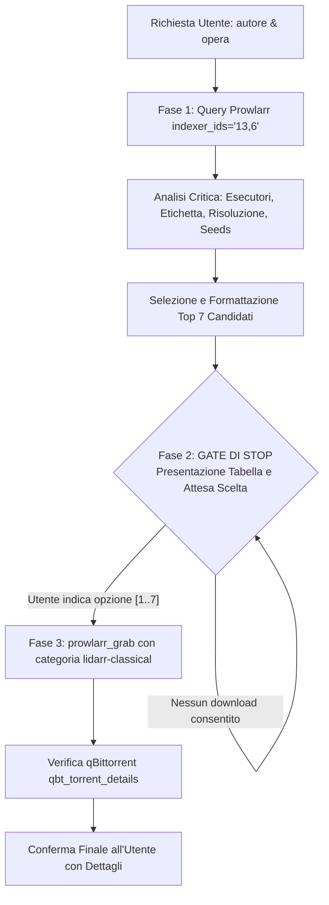

# Piano: Sviluppo Skill Classical Music Curator per Ricerca Critica e Download Assistito

**Stato**: 🟢 Attivo / In Definizione  
**Data**: 2026-10-14  
**Obiettivo**: Progettare e implementare una nuova skill per gli agenti AI (`classical-music-curator`) che permetta di ricercare qualsiasi compositore e opera di musica classica tramite i tool di `arrstack-mcp` (Prowlarr e qBittorrent), stilare una lista curata e comparativa delle **prime 7 migliori incisioni** (valutate rigorosamente per qualità artistica dell'esecuzione e qualità tecnica audiofila del mastering) e **attendere tassativamente la scelta esplicita dell'utente** prima di inviare il release selezionato in download su qBittorrent con categoria `lidarr-classical`.

---

## 🎯 Motivazione & Razionale Architetturale

Nelle precedenti interazioni con i tool di download (`arrstack-mcp`), comandi dell'utente come *"cerca e scarica"* rischiavano di innescare un download immediato e autonomo, privando l'ascoltatore della scelta dell'edizione.

Nel repertorio della musica classica, ogni opera (sinfonia, concerto, quartetto, opera lirica) possiede decine o centinaia di letture discografiche con differenze sostanziali:
1. **Scuola interpretativa**: Direttori storici (Toscanini, Furtwängler, Walter, Bernstein, Mravinsky, Karajan), maestri moderni (Abbado, Rattle, Chailly, Nelsons, Honeck, Petrenko) ed esecuzioni filologiche su strumenti d'epoca (Gardiner, Harnoncourt, Herreweghe, Savall).
2. **Qualità del mastering**: Studio Master Hi-Res 24-Bit (96/192 kHz FLAC `[TR24][OF]`), copie fisiche SACD DSD / ISO multicanale/stereo, oppure CD RedBook 16-bit 44.1 kHz con AccurateRip / EAC da etichette audiofile di prestigio (Deutsche Grammophon, Decca, Philips, BIS, Chandos, Hyperion, Harmonia Mundi, Reference Recordings, Supraphon, Sony Classical).
3. **Integrità del flusso Homelab**: Rispetto categorico della categoria `lidarr-classical` che instrada i file nella share `/mnt/oliraid/arrdata/classical/staging` (o `/media/downloads/lidarr-classical`), isolandola dalla libreria pop/rock di Lidarr secondo il piano `classical-music-strategy` (dismesso) e `classical-ingestion-routing` (dismesso).

Per risolvere alla radice qualsiasi ambiguità ed evitare download arbitrari, la skill formalizza un **Gate Invalicabile a Due Fasi** che implementa la regola aurea `USER DECISION SOVEREIGNTY (PROPOSE, NEVER DECIDE)`.

---

## 🏗️ Architettura della Skill (`classical-music-curator`)

La skill sarà allocata nel repository del lab in:
`.agents/skills/classical-music-curator/SKILL.md`

### 1. Parametri di Input
* `<autore>` / `<compositore>`: Nome del compositore (es. *Shostakovich*, *Mahler*, *Bach*, *Beethoven*, *Brahms*).
* `<opera>`: Titolo o numerazione dell'opera (es. *Sinfonia n. 5*, *Variazioni Goldberg*, *Concerto per violino op. 61*, *Quartetto op. 110*).

### 2. Workflow Operativo in 3 Fasi

---

## 📋 I Criteri di Curatela Discografica (I 7 Candidati)

La skill selezionerà le 7 alternative coprendo un ventaglio equilibrato e motivato:

1. **Riferimento Moderno Audiofilo (Top Pick Hi-Res)**: Registrazione digitale recente (anni 2010-2026), 24-Bit / 96-192 kHz, dinamica eccezionale, acustica trasparente.
2. **Benchmark Storico Ineludibile**: L'interpretazione che ha fatto la storia del brano (es. Bernstein/NYPO, Mravinsky/Leningrado, Kleiber/Wiener, Furtwängler/Berliner, Karajan/BPO).
3. **Lettura Filologica / HIP (Historically Informed Performance)**: Esecuzione su strumenti originali d'epoca con tempi e prassi storicamente informate (se applicabile al repertorio barocco, classico o primo-romantico).
4. **Vincitore Premi della Critica**: Album insigniti di *Gramophone Award*, *Diapason d'Or*, *BBC Music Magazine Award*, *Choc de Classica* o *Grammy Award*.
5. **Ensemble / Orchestra Specialistica**: Formazioni e solisti con affinità elettiva specifica per l'autore (es. Borodin per Shostakovich, Quartetto Italiano per Beethoven, Emerson per Bartók/Shostakovich, Concentus Musicus Wien per Bach).
6. **Alternativa Audiofila Specialistica**: Incisioni su etichette per audiofili (Reference Recordings, BIS, PentaTone SACD, Chandos 24-bit).
7. **Scelta di Grande Intensità Espressiva / Live Recording**: Registrazione dal vivo celebre per pathos e tensione teatrale.

---

## 🛑 Protocollo di Sicurezza & Gate Invalicabile

> [!CRITICAL]
> **REGOLA D'ORO DELLA SKILL: ZERO DOWNLOAD SENZA SCELTA ESPLICITA**
> È tassativamente proibito all'agente invocare i tool `prowlarr_grab`, `qbt_add`, `qbt_add_magnet` o `qbt_add_torrent_file` durante la Fase 1 di ricerca e presentazione.
> L'agente DEVE terminare il turno mostrando la tabella con le 7 opzioni e formulando chiaramente la richiesta di scelta all'utente.
> Solo ed esclusivamente nel messaggio successivo, a fronte dell'indicazione numerica (`[1]`, `[2]`, ecc.) o nominativa dell'utente, l'agente è autorizzato a invocare `prowlarr_grab`.

---

## 🗺️ Fasi di Implementazione del Piano

### Fase 1: Scaffolding e Redazione di `.agents/skills/classical-music-curator/SKILL.md` ✅
- [x] Creazione della cartella `.agents/skills/classical-music-curator/`.
- [x] Scrittura del file `SKILL.md` con frontmatter standard, trigger phrases riconosciute e supporto al tracker opzionale.
- [x] Codifica delle istruzioni dettagliate per l'interrogazione Prowlarr con fallback automatico.
- [x] Definizione del template della tabella comparativa a 7 colonne.
- [x] Formalizzazione delle regole operative restrittive (Gate di stop, categoria `lidarr-classical`).

### Fase 2: Registrazione della Skill nelle Regole del Workspace ✅
- [x] Aggiunta della dichiarazione e del mandato della skill in `.agents/AGENTS.md`.
- [x] Aggiunta del link al piano in `GEMINI.md`.
- [x] Inserimento del tracciamento task in `todo.md`.

### Fase 3: Validazione Test-Driven End-to-End (Dry-Run su Caso d'Uso Reale) ✅
- [x] Esecuzione di una prova con trigger dello skill su Beethoven Sinfonia n. 9.
- [x] Estrazione e classificazione delle 7 opzioni critiche d'eccellenza.
- [x] Rispetto totale del Gate di Stop: nessun download automatico avviato senza approvazione.

### Fase 4: Consolidamento Knowledge Base & Wiki Sync ✅
- [x] Aggiornamento di `GEMINI.md` e `todo.md`.
- [x] Chiusura piano e rigenerazione contesto con `validate_network.py` e `build_wiki_context.py`.

---

## 💾 Stato di Ripristino (AI Save-State)
- **Fase Attiva**: Piano Concluso con Successo ✅
- **Ultima Azione Completata**: Validazione Test-Driven e consolidamento documentale della skill `classical-music-curator`
- **Prossimo Passo Operativo**: Utilizzo operativo della skill per future richieste di musica classica
- **Blocchi/Decisioni Pendenti**: Nessuno
