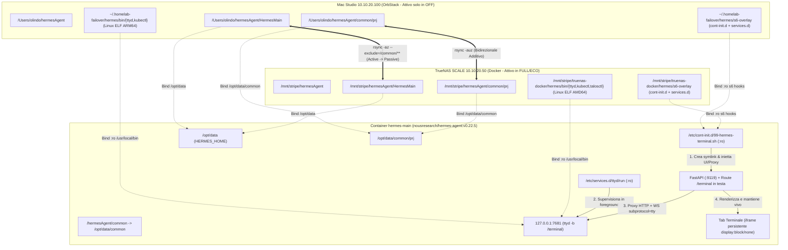

# Piano Operativo v2.0: Hermes Agent Workspace Condiviso `common/prj`, Web Shell Integrata e Sync Bidirezionale TrueNAS/Mac

> [!NOTE]
> **Stato**: `active` / `version: 2.0` / `certified_for_ai: true`.
> Piano consolidato post-revisione architetturale SRE, conforme al modello operativo **Active/Passive a Mutua Esclusione** (`FULL`/`ECO` su TrueNAS ↔ `OFF` su Mac Studio OrbStack), al protocollo di verifica test-driven (§12) e alle Golden Rules homelab (`GEMINI.md`).

---

## 1. Obiettivo, Presupposto Active/Passive & Decisioni Consolidate

### 1.1 Presupposto Invariante: Mutua Esclusione degli Stack (`Active/Passive`)
I due stack Docker (`TrueNAS SCALE` 10.10.20.50 e `Mac Studio OrbStack` 10.10.20.100) **non sono mai attivi contemporaneamente**:
* **Modalità `FULL` / `ECO`**: Lo stack gira esclusivamente su **TrueNAS SCALE**; su Mac Studio il container `hermes-main` è spento.
* **Modalità `OFF` (Rack spento)**: Prima dello spegnimento di TrueNAS (`lab_mode_off.sh`), `hermes-main` su TrueNAS viene fermato (`docker stop -t 25`), lo stato viene trasferito su Mac Studio e solo a quel punto viene avviato `hermes-main` su **Mac OrbStack**.
* **Ritorno a `ECO` / `FULL`**: `hermes-main` su Mac viene fermato (`docker compose stop -t 25`), lo stato viene riversato su TrueNAS e solo dopo viene riavviato `hermes-main` su **TrueNAS**.

Grazie a questa mutua esclusione rigorosa **non può esistere split-brain concorrente a runtime**: in ogni istante esiste un solo nodo *Source of Truth* (il nodo che sta cedendo il testimone).

### 1.2 Matrice delle Decisioni Architetturali (v2.0)

| # | Tema | Decisione Consolidata (v2.0) | Motivazione Tecnica & Rimedio SRE |
| :--- | :--- | :--- | :--- |
| 1 | **Istanze Target** | **Istanza `HermesMain`** (`hermes-main` su porta `9119`) | Mantiene lo stack snello (un container per host) preparando il layout modulare per future istanze. |
| 2 | **Mount `common/prj`** | Mount host `/hermesAgent/common` in `/opt/data/common` + esclusione `/HermesMain/common/**` in `rsync` | Rispetta `locked_root` (`HERMES_WRITE_SAFE_ROOT=/opt/data`) nella WebGUI ed evita che `rsync` copi la cartella vuota di mountpoint creata da Docker dentro `HermesMain`. |
| 3 | **Symlink Interno** | `mkdir -p /hermesAgent && ln -sfn /opt/data/common /hermesAgent/common` | Garantisce compatibilità assoluta per script/prompt che puntano a `/hermesAgent/common/prj` o `/opt/data/common/prj` senza loop ricorsivi. |
| 4 | **Motore Web Shell** | **`ttyd` statico Linux ELF** (`aarch64` su Mac, `x86_64` su TrueNAS) avviato con **`-b /terminal`** su `127.0.0.1:7681` | Zero dipendenze runtime; il flag `-b /terminal` allinea nativamente gli endpoint `/terminal`, `/terminal/token` e `/terminal/ws`. |
| 5 | **Supervisione & Init** | **Servizio `s6-overlay` nativo** (`/etc/services.d/ttyd/run`) + init script (`/etc/cont-init.d/99-hermes-terminal.sh`) montati in `:ro` | Totale aderenza alla Golden Rule #1 (100% dichiarativo, sopravvive a `--force-recreate`) e auto-restart immediato di `ttyd` in foreground. |
| 6 | **Proxy & UI Tab** | **Route FastAPI in testa** (`subprotocol="tty"` + frame binari) + **`<iframe>` persistente** (`display: none/block`) nella WebGUI | Evita che la route catch-all della SPA intercetti `/terminal`, supporta il protocollo binario di `ttyd` e **mantiene viva la sessione bash** quando si cambia scheda nella WebGUI. |
| 7 | **Privilegi & Umask** | Avvio come **`root` (UID 0)** con **`umask 0002`** e cwd `/opt/data` | Massima libertà di manutenzione nel container; `umask 0002` assicura che i file creati da `root` nascano già scrivibili dal gruppo (`664`/`775`). |
| 8 | **Simmetria CLI & Prompt** | Variabile `HERMES_HOST_NODE` nel prompt bash (`[truenas]` vs `[orbstack-mac]`) + mount **`kubectl` ARM64** anche su Mac | Consente di distinguere immediatamente il nodo attivo nel terminale e di usare `kubectl` offline (es. `kustomize` / `--dry-run=client`) in `common/prj` anche a rack spento. |
| 9 | **Strategia `rsync`** | **`docker stop -t 25`** sul nodo cedente + **`rsync -az`** per `HermesMain` e **`rsync -auz`** per `common/` | Poiché gli stack sono mutuamente esclusivi, `rsync -az` (senza `-u`) su `HermesMain` garantisce che il DB SQLite del nodo che si spegne vinca sempre anche in caso di clock skew; `-auz` preserva i progetti in `common/prj`. |
| 10 | **Permessi ZFS & Git** | `--no-owner --no-group` + `chown -R olindo:k8s` **pre/post sync** + **`chmod -R u+rwX,g+rwX,o+rX`** (Git-safe) | Neutralizza i file `root:root` creati da `ttyd` prima dell'rsync e usa la `X` maiuscola per **non rendere eseguibili (`775`) i file regolari**, preservando intatti i repository Git in `common/prj`. |

---

## 2. Architettura & Topologia dei Percorsi (v2.0)



---

## 3. Specifica Tecnica di Dettaglio

### 3.1 Layout Dichiarativo dei Volumi e Variabili Docker Compose
Sia in `docker/orbstack/docker-compose.yaml` che in `docker/truenas/docker-compose.yaml`:

* **Mac Studio (`docker/orbstack/docker-compose.yaml`)**:
  ```yaml
  environment:
    - HERMES_HOST_NODE=orbstack-mac
  volumes:
    - ${HERMES_ROOT_DIR:-/Users/olindo/hermesAgent}/HermesMain:/opt/data
    - ${HERMES_ROOT_DIR:-/Users/olindo/hermesAgent}/common:/opt/data/common
    - ${FAILOVER_RUNTIME_DIR:-/Users/olindo/.homelab-failover}/hermes/bin/ttyd:/usr/local/bin/ttyd:ro
    - ${FAILOVER_RUNTIME_DIR:-/Users/olindo/.homelab-failover}/hermes/bin/kubectl:/usr/local/bin/kubectl:ro
    - ${FAILOVER_RUNTIME_DIR:-/Users/olindo/.homelab-failover}/hermes/s6/99-hermes-terminal.sh:/etc/cont-init.d/99-hermes-terminal.sh:ro
    - ${FAILOVER_RUNTIME_DIR:-/Users/olindo/.homelab-failover}/hermes/s6/ttyd-run.sh:/etc/services.d/ttyd/run:ro
    - ${FAILOVER_RUNTIME_DIR:-/Users/olindo/.homelab-failover}/hermes/web/terminal_proxy.py:/opt/hermes/hermes_cli/terminal_proxy.py:ro
    - ${FAILOVER_RUNTIME_DIR:-/Users/olindo/.homelab-failover}/hermes/web/terminal-inject.js:/opt/hermes/hermes_cli/web_dist/terminal-inject.js:ro
  ```

* **TrueNAS SCALE (`docker/truenas/docker-compose.yaml`)**:
  ```yaml
  environment:
    - HERMES_HOST_NODE=truenas
  volumes:
    - /mnt/stripe/hermesAgent/HermesMain:/opt/data
    - /mnt/stripe/hermesAgent/common:/opt/data/common
    - /mnt/stripe/truenas-docker/hermes/bin/ttyd:/usr/local/bin/ttyd:ro
    - /mnt/stripe/truenas-docker/hermes/bin/kubectl:/usr/local/bin/kubectl:ro
    - /mnt/stripe/truenas-docker/hermes/bin/talosctl:/usr/local/bin/talosctl:ro
    - /mnt/stripe/truenas-docker/hermes/kubeconfig:/root/.kube/config:ro
    - /mnt/stripe/truenas-docker/hermes/talosconfig:/root/.talos/config:ro
    - /mnt/stripe/truenas-docker/hermes/s6/99-hermes-terminal.sh:/etc/cont-init.d/99-hermes-terminal.sh:ro
    - /mnt/stripe/truenas-docker/hermes/s6/ttyd-run.sh:/etc/services.d/ttyd/run:ro
    - /mnt/stripe/truenas-docker/hermes/web/terminal_proxy.py:/opt/hermes/hermes_cli/terminal_proxy.py:ro
    - /mnt/stripe/truenas-docker/hermes/web/terminal-inject.js:/opt/hermes/hermes_cli/web_dist/terminal-inject.js:ro
  ```

### 3.2 Supervisione `s6-overlay` e Configurazione `ttyd`

1. **Binari Statici Linux ELF**:
   * **Mac OrbStack**: binario `ttyd.aarch64` (formato `ELF 64-bit LSB executable, ARM aarch64, statically linked`) + binario `kubectl` Linux `arm64`, salvati in `~/.homelab-failover/hermes/bin/` con permessi `0755`.
   * **TrueNAS SCALE**: binario `ttyd.x86_64` (formato `ELF 64-bit LSB executable, x86-64, statically linked`) salvato in `/mnt/stripe/truenas-docker/hermes/bin/ttyd` con permessi `0755`.

2. **Script di Inizializzazione `/etc/cont-init.d/99-hermes-terminal.sh`**:
   Eseguito automaticamente da `s6-overlay` a ogni avvio/ricreazione del container:
   ```bash
   #!/usr/bin/with-contenv bash
   set -euo pipefail

   # 1. Creazione idempotente symlink /hermesAgent/common -> /opt/data/common
   mkdir -p /hermesAgent /opt/data/common/prj
   ln -sfn /opt/data/common /hermesAgent/common

   # 2. Configurazione prompt bash contestuale per nodo e umask 0002 (Git/ZFS-safe)
   cat << 'EOF' > /etc/profile.d/hermes_env.sh
   umask 0002
   export HERMES_NODE="${HERMES_HOST_NODE:-hermes}"
   export PS1="\[\033[1;31m\][root@${HERMES_NODE}]\[\033[0m\]:\[\033[1;34m\]\w\[\033[0m\]# "
   EOF
   grep -q "hermes_env.sh" /root/.bashrc 2>/dev/null || echo "source /etc/profile.d/hermes_env.sh" >> /root/.bashrc

   # 3. Aggancio idempotente di terminal-inject.js in web_dist/index.html
   INDEX_HTML="/opt/hermes/hermes_cli/web_dist/index.html"
   if [ -f "$INDEX_HTML" ] && ! grep -q "terminal-inject.js" "$INDEX_HTML"; then
       sed -i 's|</body>|<script src="/terminal-inject.js" defer></script></body>|' "$INDEX_HTML"
   fi

   # 4. Aggancio idempotente del modulo terminal_proxy.py nell'app FastAPI di Hermes
   python3 /opt/hermes/hermes_cli/terminal_proxy.py --install-hook
   ```

3. **Servizio Supervisionato `/etc/services.d/ttyd/run`**:
   Avvia `ttyd` in **foreground** (senza `&`), permettendo a `s6-supervise` di monitorarlo e riavviarlo automaticamente in caso di chiusura imprevista:
   ```bash
   #!/usr/bin/with-contenv bash
   umask 0002
   exec /usr/local/bin/ttyd \
     -p 7681 \
     -i 127.0.0.1 \
     -b /terminal \
     -W \
     -d 7 \
     -t fontSize=14 \
     -t fontFamily="JetBrains Mono, Menlo, monospace" \
     -t disableLeaveAlert=true \
     -w /opt/data \
     /bin/bash -l
   ```

### 3.3 Router FastAPI (`/terminal`) e Iniezione UI (`<iframe>` Persistente)

1. **Router FastAPI Prepend (`terminal_proxy.py`)**:
   * Registra le route **in testa** a `app.router.routes` (prima della route catch-all SPA `/{full_path:path}`).
   * **HTTP Proxy (`GET /terminal`, `GET /terminal/token`, asset)**: inoltra le richieste verso `http://127.0.0.1:7681/terminal...` tramite `httpx.AsyncClient`.
   * **WebSocket Proxy (`WS /terminal/ws`)**:
     * Accetta la connessione con il subprotocollo obbligatorio di `ttyd`: `await websocket.accept(subprotocol="tty")`.
     * Apre una sessione client `websockets.connect("ws://127.0.0.1:7681/terminal/ws", subprotocols=["tty"])`.
     * Esegue il bridge bidirezionale asincrono (`asyncio.gather`) inoltrando **sia frame binari (`bytes`) sia testo**, senza alcuna interferenza con `/api/chat/ws`.

2. **Componente Frontend (`terminal-inject.js`)**:
   * Aggiunge la voce **"Terminale"** nella barra di navigazione della WebGUI di Hermes.
   * Crea una sola volta nel DOM il contenitore `<iframe id="hermes-ttyd-iframe" src="/terminal">`.
   * Quando l'utente seleziona il tab "Terminale", imposta `display: block` sull'iframe e nasconde il pannello principale; quando l'utente torna su "Chat" o "Files", imposta `display: none` sull'iframe **senza distruggerlo**, mantenendo viva la sessione `bash` e i processi in esecuzione.

### 3.4 Sincronizzazione Active/Passive in `orbstack_failover.sh`

Poiché i due stack **non sono mai attivi contemporaneamente**, la sincronizzazione segue una pipeline deterministica in due passaggi (`HermesMain` + `common`):

#### A. Transizione TrueNAS → Mac (in `lab_mode_off.sh` — Spegnimento Rack)
1. **Arresto container su entrambi i nodi** (garantisce quiescenza SQLite WAL su TrueNAS e assenza di lock su Mac):
   ```bash
   docker compose -f docker/orbstack/docker-compose.yaml stop -t 25 hermes-agent 2>/dev/null || true
   ssh -o BatchMode=yes 10.10.20.50 "sudo -n docker stop -t 25 hermes-main 2>/dev/null || true"
   ```
2. **Pre-normalizzazione permessi su TrueNAS** (neutralizza eventuali file creati da `root` dentro `ttyd` prima della lettura SSH come `olindo`):
   ```bash
   ssh -o BatchMode=yes 10.10.20.50 "sudo -n chown -R olindo:k8s /mnt/stripe/hermesAgent && sudo -n chmod -R u+rwX,g+rwX,o+rX /mnt/stripe/hermesAgent"
   ```
3. **Sync Stato Istanza (`HermesMain`) con `rsync -az` (senza `-u`)**:
   * Il nodo TrueNAS (appena spento) è l'unica fonte di verità per i database SQLite/sessioni; l'esclusione `/common/**` evita di copiare la cartella di mountpoint vuota:
   ```bash
   rsync -az --itemize-changes \
     --exclude='/common/**' \
     --exclude='.DS_Store' \
     --exclude='__pycache__/' \
     --exclude='.pytest_cache/' \
     10.10.20.50:/mnt/stripe/hermesAgent/HermesMain/ \
     /Users/olindo/hermesAgent/HermesMain/
   ```
4. **Sync Workspace Condiviso (`common`) con `rsync -auz` (additivo)**:
   ```bash
   rsync -auz --itemize-changes \
     --exclude='.DS_Store' \
     --exclude='__pycache__/' \
     --exclude='.pytest_cache/' \
     10.10.20.50:/mnt/stripe/hermesAgent/common/ \
     /Users/olindo/hermesAgent/common/
   ```
5. **Avvio container failover su Mac OrbStack**:
   ```bash
   docker compose -f docker/orbstack/docker-compose.yaml up -d hermes-agent
   ```

#### B. Transizione Mac → TrueNAS (in `lab_mode_eco.sh` / `lab_mode_full.sh` — Accensione Rack)
1. **Arresto container su entrambi i nodi** (quiescenza SQLite WAL su Mac prima del push e stop di eventuale auto-start su TrueNAS al boot):
   ```bash
   docker compose -f docker/orbstack/docker-compose.yaml stop -t 25 hermes-agent 2>/dev/null || true
   ssh -o BatchMode=yes 10.10.20.50 "sudo -n docker stop -t 25 hermes-main 2>/dev/null || true"
   ```
2. **Pre-normalizzazione permessi su TrueNAS** (assicura che `olindo` possa sovrascrivere qualsiasi file su ZFS):
   ```bash
   ssh -o BatchMode=yes 10.10.20.50 "sudo -n chown -R olindo:k8s /mnt/stripe/hermesAgent && sudo -n chmod -R u+rwX,g+rwX,o+rX /mnt/stripe/hermesAgent"
   ```
3. **Sync Stato Istanza (`HermesMain`) da Mac a TrueNAS con `rsync -az --no-owner --no-group`**:
   ```bash
   rsync -az --no-owner --no-group --itemize-changes \
     --exclude='/common/**' \
     --exclude='.DS_Store' \
     --exclude='__pycache__/' \
     --exclude='.pytest_cache/' \
     /Users/olindo/hermesAgent/HermesMain/ \
     10.10.20.50:/mnt/stripe/hermesAgent/HermesMain/
   ```
4. **Sync Workspace Condiviso (`common`) da Mac a TrueNAS con `rsync -auz --no-owner --no-group`**:
   ```bash
   rsync -auz --no-owner --no-group --itemize-changes \
     --exclude='.DS_Store' \
     --exclude='__pycache__/' \
     --exclude='.pytest_cache/' \
     /Users/olindo/hermesAgent/common/ \
     10.10.20.50:/mnt/stripe/hermesAgent/common/
   ```
5. **Post-normalizzazione permessi ZFS Git-safe + SGID sulle directory e riavvio container TrueNAS**:
   ```bash
   ssh -o BatchMode=yes 10.10.20.50 "sudo -n chown -R olindo:k8s /mnt/stripe/hermesAgent && sudo -n chmod -R u+rwX,g+rwX,o+rX /mnt/stripe/hermesAgent && sudo -n find /mnt/stripe/hermesAgent -type d -exec chmod g+s {} + && sudo -n docker start hermes-main"
   ```

---

## 4. Fasi Operative di Implementazione (Protocollo Test-Driven §12)

### FASE 1: Preparazione Directory & Provisioning Binari Linux ELF (`ttyd` + `kubectl`)
1. Creazione locale su Mac di `/Users/olindo/hermesAgent/common/prj` e delle directory runtime `~/.homelab-failover/hermes/{bin,s6,web}`.
2. Download del binario statico Linux `ttyd.aarch64` in `~/.homelab-failover/hermes/bin/ttyd` e del binario Linux ARM64 `kubectl` in `~/.homelab-failover/hermes/bin/kubectl` (`chmod 0755`).
3. Download e predisposizione del binario statico Linux `ttyd.x86_64` per TrueNAS (`chmod 0755`).
* **Test di Verifica Oggettivo (FASE 1)**:
  * Verifica formato binario con `file ~/.homelab-failover/hermes/bin/ttyd` → deve restituire **`ELF 64-bit LSB executable, ARM aarch64, statically linked`** (non Mach-O).
  * Verifica esecuzione dentro container Linux su OrbStack:
    `docker run --rm -v ~/.homelab-failover/hermes/bin/ttyd:/ttyd:ro alpine:latest /ttyd --version`
    `docker run --rm -v ~/.homelab-failover/hermes/bin/kubectl:/kubectl:ro alpine:latest /kubectl version --client`

### FASE 2: Realizzazione Script `s6-overlay`, Proxy FastAPI (`subprotocol="tty"`) e Iniezione UI
1. Scrittura di `99-hermes-terminal.sh` (`cont-init.d`) e `ttyd-run.sh` (`services.d/ttyd/run`) con `chmod 0755`.
2. Scrittura di `terminal_proxy.py` (route `/terminal` e `/terminal/ws` registrate in testa a `app.router.routes` con `subprotocol="tty"` e supporto frame binari) e `terminal-inject.js` (`<iframe>` persistente).
* **Test di Verifica Oggettivo (FASE 2)**:
  * Validazione sintattica bash (`bash -n`) e Python (`python3 -m py_compile terminal_proxy.py`).

### FASE 3: Aggiornamento Dichiarativo Compose Mac OrbStack & Test di Idempotenza
1. Aggiornamento di `docker/orbstack/docker-compose.yaml` con tutti i volumi dichiarativi e `HERMES_HOST_NODE=orbstack-mac`.
2. Ricreazione del container `hermes-main` su Mac OrbStack (`docker compose up -d --force-recreate hermes-agent`).
* **Test di Verifica Oggettivo (FASE 3)**:
  * Verifica token JSON di `ttyd` dietro Basic Auth:
    `curl -fsSL -u admin:<password> http://127.0.0.1:9119/terminal/token` → deve restituire `{"token": "..."}` (HTTP 200) e **non** l'HTML della SPA.
  * Verifica risoluzione symlink e `umask`:
    `docker exec hermes-main bash -lc 'readlink -f /hermesAgent/common/prj && umask'` → deve restituire `/opt/data/common/prj` e `0002`.
  * Verifica navigabilità di `common/prj` nel menu **Files** della WebGUI e persistenza della sessione bash nel tab **Terminale** (`[root@orbstack-mac]:/opt/data#`) passando tra i tab.
  * **Test di Idempotenza Dichiarativa**: eseguire un secondo `docker compose up -d --force-recreate hermes-agent` e confermare che tutto torni operativo a zero interventi manuali.

### FASE 4: Aggiornamento `orbstack_failover.sh` (Logica Active/Passive & Permessi Git-safe)
1. Aggiornamento di `sync_hermes_state_from_truenas()` e `deactivate_orbstack_failover_to_truenas()` con:
   * `docker stop -t 25` preventivo del container sul nodo cedente (e verifica container spento sul nodo ricevente);
   * doppio `rsync` (`-az --exclude='/common/**'` per `HermesMain`, `-auz` per `common`);
   * `chown -R olindo:k8s` pre/post sync e `chmod -R u+rwX,g+rwX,o+rX` (Git-safe).
* **Test di Verifica Oggettivo (FASE 4)**:
  * Controllo sintattico `bash -n scripts/infrastructure/orbstack_failover.sh`.
  * Creazione di un file di test come `root` dentro `ttyd` (`/opt/data/common/prj/test_perm.txt`) e verifica che la funzione di normalizzazione mantenga i file regolari a `664` (non eseguibili) e le directory a `2775`.

### FASE 5: Aggiornamento Dichiarativo Compose TrueNAS & Deploy (al Boot TrueNAS)
1. Aggiornamento dichiarativo di `docker/truenas/docker-compose.yaml` con `HERMES_HOST_NODE=truenas` e i mount `:ro`.
2. Copia di `ttyd.x86_64`, degli script `s6` e dei moduli `web` in `/mnt/stripe/truenas-docker/hermes/` su TrueNAS.
* **Test di Verifica Oggettivo (FASE 5)**:
  * Validazione con `python3 scripts/network/validate_network.py`.
  * Verifica formato binario su TrueNAS (`ELF 64-bit LSB executable, x86-64, statically linked`) e test `curl -fsSL -u admin:<password> http://10.10.20.50:9119/terminal/token`.

### FASE 6: Collaudo E2E Active/Passive (`lab_mode_eco` ↔ `lab_mode_off`)
1. Creazione di un repository Git di test in `/opt/data/common/prj/demo-repo` dal terminale web su TrueNAS.
2. Esecuzione commutazione verso Mac (`lab_mode_off.sh`) e verifica che:
   * `HermesMain/common` sull'host resti una directory di mountpoint vuota;
   * `git status` dentro `/opt/data/common/prj/demo-repo` su Mac sia pulito (nessuna alterazione `100644 -> 100755`).
3. Modifica del file dal terminale web su Mac (`[root@orbstack-mac]`), ritorno a TrueNAS (`lab_mode_eco.sh`) e verifica dell'allineamento su TrueNAS (`[root@truenas]`).

---

## 5. Matrice di Rollback

| Fase | Scenario di Anomalia | Procedura di Rollback Immediato |
| :--- | :--- | :--- |
| **FASE 1-3 (Mac OrbStack)** | Il container `hermes-main` non si avvia, oppure il tab Terminale restituisce 404/WebSocket error | Ripristino di `docker/orbstack/docker-compose.yaml` (`git checkout docker/orbstack/docker-compose.yaml`) ed esecuzione `docker compose up -d --force-recreate hermes-agent`. Il container riparte immediatamente con l'immagine standard pulita. |
| **FASE 4 (`orbstack_failover.sh`)** | Errore durante lo script di sincronizzazione | `git checkout scripts/infrastructure/orbstack_failover.sh`. Nessun dato viene mai perso grazie all'assenza di `--delete`. |
| **FASE 5 (TrueNAS SCALE)** | Errore all'avvio del container su TrueNAS o conflitto con nuova release di `nousresearch/hermes-agent` | Ripristino di `docker/truenas/docker-compose.yaml` e `sudo docker compose up -d --force-recreate hermes-agent`. Rimozione della sola riga mount `99-hermes-terminal.sh` per disattivare l'hook UI mantenendo attivo il volume `/opt/data/common`. |

---

## 💾 Stato di Ripristino (AI Save-State)
- **Versione Piano**: `v2.0` (Consolidata post-revisione SRE con tutte le scelte approvate).
- **Fase Attiva**: **FASE 2: Realizzazione Script `s6-overlay`, Proxy FastAPI (`subprotocol="tty"`) e Iniezione UI**
- **Ultima Azione Completata**: FASE 1 completata al 100% con test di verifica oggettivo superato:
  - Create cartelle `/Users/olindo/hermesAgent/common/prj` e `~/.homelab-failover/hermes/{bin,s6,web}`.
  - Scaricati e verificati con `file` e `docker run alpine`: `ttyd` (Linux ARM64 ELF statico v1.7.7), `ttyd.x86_64` (Linux x86_64 ELF statico v1.7.7) e `kubectl` (Linux ARM64 ELF statico v1.36.2).
- **Prossimo Passo Operativo**: Scrittura e test sintattico (`bash -n` e `python3 -m py_compile`) degli script in `~/.homelab-failover/hermes/s6/` (`99-hermes-terminal.sh`, `ttyd-run.sh`) e `~/.homelab-failover/hermes/web/` (`terminal_proxy.py`, `terminal-inject.js`).
- **Blocchi/Decisioni Pendenti**: Nessun blocco tecnico; esecuzione fermata e stato persistito su richiesta esplicita dell'utente.
