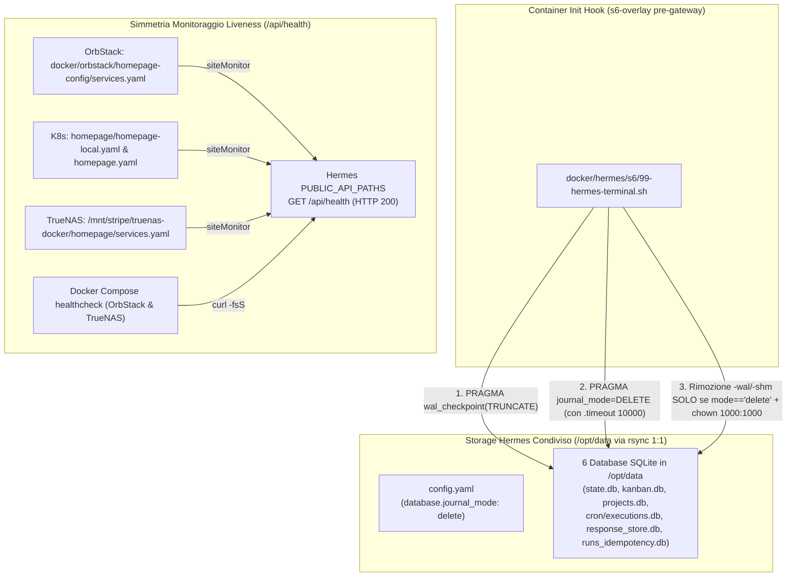

# Piano Operativo: Convergenza Strutturale SQLite journal_mode DELETE e Hardening Endpoint Health Homepage per Hermes Agent

## Obiettivo dell'Intervento
Risolvere in modo **strutturale, dichiarativo e definitivo** (senza workaround manuali effimeri) le anomalie operative emerse su **Hermes Agent v0.22.5** durante la modalità di failover su Mac Studio (`lab_mode_off`), garantendo contemporaneamente la piena simmetria architetturale con il nodo primario **TrueNAS SCALE** (`10.10.20.50`) e con l'inventario canonico `storage.json`:

1. **Eliminazione Definitiva Errori SQLite WAL su Filesystem Condiviso (`virtiofs`)**:
   Eliminare l'errore `ERROR hermes_state: ... existing WAL-mode database is on a cross-VM filesystem (virtiofs/9p ...)` garantendo che tutti i 6 database SQLite dell'agente (`state.db`, `kanban.db`, `projects.db`, `cron/executions.db`, `response_store.db`, `runs_idempotency.db`) operino in modalità rollback journal standard (`DELETE`) sia su TrueNAS SCALE (ZFS) sia su Mac Studio (OrbStack `virtiofs`). La conversione da `WAL` a `DELETE` è delegata in modo atomico e fail-safe all'hook `s6-overlay` (`/etc/cont-init.d/99-hermes-terminal.sh`), prevenendo corruzioni da memoria condivisa non coerente (`.db-shm` / `mmap`), forzando il checkpoint integrale prima del cambio modalità e preservando l'ownership `1000:1000` (`olindo:k8s`).
2. **Riallineamento Simmetrico Probe Healthcheck (Homepage & Docker Compose)**:
   Correggere il probe di salute (`siteMonitor` e Docker `healthcheck`) di Hermes Agent su **tutte le 3 istanze Homepage** del lab (`homepage-mac`, `homepage-k8s`, `homepage-truenas`) e nei relativi `docker-compose.yaml`, passando dal percorso soggetto a redirect d'autenticazione `/health` (`HTTP 302` verso `/login`) al percorso pubblico ufficiale di liveness `/api/health` (`HTTP 200` `{"ok":true,...}`).
3. **Bonifica Refusi Documentali e Allineamento `storage.json`**:
   Censire formalmente il dataset `/mnt/stripe/hermesAgent/HermesMain` (montato in `/opt/data` nel container) dentro `storage.json` e correggere il refuso storico `/app/data` / `/mnt/stripe/hermes-agent` presente nel piano correlato [[hermes-agent-truenas-docker-migration]].

---

## Architettura e Strategia di Convergenza

Il seguente diagramma illustra il flusso di convergenza dichiarativa tra storage condiviso, hook di inizializzazione `s6-overlay` e probe di monitoraggio sulle tre istanze Homepage:



### 1. Livello A: Configurazione Dichiarativa Persistente (`config.yaml`)
Il file `config.yaml` presente in `/Users/olindo/hermesAgent/HermesMain/config.yaml` (e sincronizzato bidirezionalmente via `rsync` con `/mnt/stripe/hermesAgent/HermesMain/config.yaml` su [[TrueNAS]]) governa il comportamento nativo di Hermes Agent. Inserendo a livello di radice:
```yaml
database:
  journal_mode: delete
```
Hermes Agent inizializza tutti i nuovi database e mantiene quelli esistenti in modalità rollback journal convenzionale (`DELETE`). Questo elimina alla radice l'uso di `mmap` e del file `.db-shm`, garantendo portabilità universale tra ZFS Linux nativo e macOS APFS (`virtiofs`).

> [!IMPORTANT]
> **Preservazione Hot Rollback Journal (`.db-journal`)**: In modalità `DELETE`, SQLite crea durante le transazioni di scrittura un file temporaneo `<nome>.db-journal` e lo rimuove al `COMMIT`. In caso di crash improvviso o kill del container, un eventuale `.db-journal` residuo contiene le pagine originali necessarie all'auto-recovery alla successiva apertura. **È severamente vietato eliminare o escludere da `rsync` i file `*.db-journal`**.

### 2. Livello B: Self-Healing Atomico e Unificato in `99-hermes-terminal.sh` (Senza Conversione Host macOS)
Anziché eseguire conversioni manuali dall'host macOS (che esporrebbero i file a semantiche di locking APFS/`flock` differenti da quelle del guest Linux e a disallineamenti `uid 501` vs `1000`), la conversione dei database esistenti e il self-healing futuro sono unificati interamente nello script `/etc/cont-init.d/99-hermes-terminal.sh`.
Questo script viene eseguito da `s6-overlay` dentro il namespace Linux del container **prima** dell'avvio del processo principale `hermes gateway run` (quindi a database 100% quiescenti):
1. Scansiona tutti i file `.db` in `/opt/data` (fino a profondità 3, coprendo `/opt/data/cron/executions.db`).
2. Imposta `.timeout 10000` (10 secondi) per assorbire eventuali lock transitori del filesystem.
3. Se il database è in modalità `wal`, esegue prima `PRAGMA wal_checkpoint(TRUNCATE);` per riversare integralmente le transazioni pendenti nel file `.db` principale, seguito da `PRAGMA journal_mode=DELETE;`.
4. **Zero Data Loss Guard**: Rimuove eventuali file residui `.db-wal` e `.db-shm` **solo ed esclusivamente dopo** aver verificato che `PRAGMA journal_mode;` restituisca effettivamente `delete`.
5. **Golden Rule UID/GID `1000:1000`**: Poiché `cont-init.d` viene eseguito come `root`, forza `chown 1000:1000` sul file `.db` convertito per impedire che il file diventi `root:root` (causando errori `attempt to write a readonly database` una volta che il servizio effettua il drop dei privilegi a `1000:1000`).

### 3. Livello C: Riallineamento Simmetrico Probe `/api/health` (Homepage x3 & Docker Healthcheck)
Hermes `v0.22.5` protegge le rotte tramite il middleware `hermes_cli.dashboard_auth.middleware`:
- `/health` non è nella allowlist pubblica e risponde con `HTTP 302 Found` (redirect a `/login`).
- `/api/health` è registrato in `PUBLIC_API_PATHS` e risponde senza autenticazione con `HTTP 200 OK` (`{"ok":true,...}`), senza esporre segreti o token.

In conformità con [[Homepage]] e con la skill `homepage-manager`, l'aggiornamento della proprietà `siteMonitor:` viene applicato simmetricamente su tutte le istanze:
- **OrbStack Mac Studio**: `docker/orbstack/homepage-config/services.yaml` (`siteMonitor: http://hermes-agent:9119/api/health`)
- **Kubernetes**: `homepage/homepage-local.yaml` e `homepage/homepage.yaml` (`siteMonitor: http://10.10.20.50:9119/api/health`)
- **TrueNAS SCALE Docker**: `servarr/truenas-docker/homepage/services.yaml` / `/mnt/stripe/truenas-docker/homepage/services.yaml` (`siteMonitor: http://10.10.20.50:9119/api/health`)
- **Docker Compose Healthcheck**: aggiornamento del blocco `healthcheck.test` di `hermes-agent` sia in `docker/orbstack/docker-compose.yaml` sia in `servarr/truenas-docker/docker-compose.yaml` verso `http://localhost:9119/api/health`.

### 4. Livello D: Allineamento Inventario Canonico `storage.json` e Documentazione Wiki
Durante la revisione incrociata è emerso che:
- In `storage.json` mancava il censimento esplicito del dataset hostpath/docker di Hermes Agent su TrueNAS (`/mnt/stripe/hermesAgent/HermesMain`, montato in `/opt/data` con owner `1000:1000`).
- Nel piano [[hermes-agent-truenas-docker-migration]] (§2, §3.1, §5, §6) erano rimasti i refusi `/mnt/stripe/hermes-agent`, `/app/data` e `/health`.

---

## Fasi Operative di Esecuzione (Protocollo Test-Driven)

### Fase 0: Pre-Flight Backup Atomico Locale (Fail-Safe)
Prima di apportare qualsiasi modifica a `config.yaml` o riavviare il container per la conversione automatica `s6`, creare una copia di sicurezza consistente sull'host Mac Studio a container fermo.

- **Azioni**:
  ```bash
  # 1. Arresto pulito del container hermes-main su OrbStack
  docker compose --env-file ~/.homelab-failover/.env -f docker/orbstack/docker-compose.yaml stop hermes-agent

  # 2. Backup integrale atomico della directory HermesMain (inclusi eventuali -wal correnti)
  cp -a /Users/olindo/hermesAgent/HermesMain "/Users/olindo/hermesAgent/HermesMain.bak-pre-delete-$(date +%Y%m%d-%H%M%S)"
  ```
- **Verifica Test-Driven (Fase 0)**:
  ```bash
  ls -ld /Users/olindo/hermesAgent/HermesMain.bak-pre-delete-*
  docker ps --filter "name=hermes-main"
  ```
  *(Esito atteso: directory di backup presente e container `hermes-main` non in esecuzione).*

---

### Fase 1: Aggiornamento Configurazione Dichiarativa `config.yaml`
- **File target**: `/Users/olindo/hermesAgent/HermesMain/config.yaml`
- **Azione**: Assicurarsi che nella radice del file YAML sia presente il blocco:
  ```yaml
  database:
    journal_mode: delete
  ```
- **Verifica Test-Driven (Fase 1)**:
  ```bash
  grep -A 2 "^database:" /Users/olindo/hermesAgent/HermesMain/config.yaml
  ```
  *(Esito atteso: output esatto con `journal_mode: delete`).*

---

### Fase 2: Hardening dello Script s6 `99-hermes-terminal.sh` (Conversione & Self-Healing Unificati)
- **File target**:
  - `docker/hermes/s6/99-hermes-terminal.sh` (repository Git)
  - `~/.homelab-failover/hermes/s6/99-hermes-terminal.sh` (runtime Mac Studio)
- **Azione**: Inserire il blocco idempotente e fail-safe di conversione SQLite in `/opt/data` (e sincronizzare il file dal repo Git alla directory runtime `~/.homelab-failover/hermes/s6/`):
  ```bash
  # --- Self-Healing SQLite journal_mode (virtiofs / ZFS convergence on /opt/data) ---
  if [ -d "/opt/data" ]; then
      echo "[cont-init] Ensuring SQLite databases in /opt/data use journal_mode=DELETE..."
      find /opt/data -maxdepth 3 -type f -name "*.db" 2>/dev/null | while read -r db_file; do
          current_mode=$(sqlite3 -cmd ".timeout 5000" "$db_file" "PRAGMA journal_mode;" 2>/dev/null | tr '[:upper:]' '[:lower:]')
          if [ "$current_mode" = "wal" ]; then
              echo "[cont-init] Converting $db_file from WAL to DELETE (with TRUNCATE checkpoint)..."
              new_mode=$(sqlite3 -cmd ".timeout 10000" "$db_file" "PRAGMA wal_checkpoint(TRUNCATE); PRAGMA journal_mode=DELETE;" 2>/dev/null | tail -n 1 | tr '[:upper:]' '[:lower:]')
              if [ "$new_mode" = "delete" ]; then
                  rm -f "${db_file}-wal" "${db_file}-shm"
                  chown 1000:1000 "$db_file"
                  echo "[cont-init] Successfully converted $db_file to DELETE (uid:gid 1000:1000)."
              else
                  echo "[cont-init] WARNING: Failed to convert $db_file (mode is still '$new_mode'). Preserving -wal/-shm to prevent data loss!"
              fi
          elif [ "$current_mode" = "delete" ]; then
              # Rimuove esclusivamente eventuali file orfani -wal/-shm residui su DB già certificati in DELETE
              rm -f "${db_file}-wal" "${db_file}-shm"
              chown 1000:1000 "$db_file"
          fi
      done
  fi
  ```
- **Verifica Test-Driven (Fase 2)**:
  ```bash
  bash -n docker/hermes/s6/99-hermes-terminal.sh
  cp docker/hermes/s6/99-hermes-terminal.sh ~/.homelab-failover/hermes/s6/99-hermes-terminal.sh
  diff -u docker/hermes/s6/99-hermes-terminal.sh ~/.homelab-failover/hermes/s6/99-hermes-terminal.sh
  ```
  *(Esito atteso: sintassi bash valida con exit code `0` e zero differenze tra file Git e file runtime).*

---

### Fase 3: Riallineamento Simmetrico Probe `/api/health` (Homepage & Docker Compose)
- **File target**:
  1. `docker/orbstack/homepage-config/services.yaml` ( e copia runtime in `~/.homelab-failover/homepage-config/services.yaml` se distinta)
  2. `homepage/homepage-local.yaml` e `homepage/homepage.yaml`
  3. `servarr/truenas-docker/homepage/services.yaml` (per simmetria TrueNAS al failback)
  4. `docker/orbstack/docker-compose.yaml` e `servarr/truenas-docker/docker-compose.yaml`
- **Azioni**:
  - Nei file `services.yaml` / `homepage*.yaml`, aggiornare la chiave `siteMonitor:` del servizio **Hermes Agent** sostituendo `/health` con `/api/health`:
    - Su OrbStack: `siteMonitor: http://hermes-agent:9119/api/health`
    - Su K8s / TrueNAS: `siteMonitor: http://10.10.20.50:9119/api/health`
  - Nei file `docker-compose.yaml` (OrbStack e TrueNAS), aggiornare il blocco `healthcheck` del servizio `hermes-agent`:
    ```yaml
    healthcheck:
      test: ["CMD", "curl", "-fsS", "http://localhost:9119/api/health"]
      interval: 30s
      timeout: 10s
      retries: 3
      start_period: 30s
    ```
  - Verificare in `scripts/infrastructure/orbstack_failover.sh` che non vi siano esclusioni `--exclude='*.db-journal'` nelle funzioni `sync_hermes_state_from_truenas` e `sync_hermes_state_to_truenas`.
- **Verifica Test-Driven (Fase 3)**:
  ```bash
  grep -rn "/api/health" docker/orbstack/ homepage/ servarr/truenas-docker/
  grep -rn ":9119/health" docker/orbstack/ homepage/ servarr/truenas-docker/ || echo "OK: Nessun vecchio riferimento a :9119/health rimasto"
  ```
  *(Esito atteso: tutti i manifest puntano a `/api/health` e nessuna occorrenza residua di `:9119/health` rimane nei file di configurazione).*

---

### Fase 4: Correzione Refuso in `storage.json` e Allineamento Wiki
- **File target**:
  1. `storage.json` (root del repository)
  2. `wiki/plans/hermes-agent-truenas-docker-migration.md`
- **Azioni**:
  1. In `storage.json` (sezione `nas.exports`), aggiungere la voce canonica per lo storage di Hermes Agent su TrueNAS (come già fatto per `garage_data`), documentando il path reale `/mnt/stripe/hermesAgent/HermesMain` e il mount `/opt/data`:
     ```json
     "hermes_agent": {
       "path": "/mnt/stripe/hermesAgent/HermesMain",
       "description": "Dataset ZFS NVMe per Hermes Agent (SQLite journal_mode=DELETE, config.yaml, sessioni e stato)",
       "protocol": "hostpath/docker",
       "notes": "Montato in /opt/data nel container hermes-main (uid:gid 1000:1000 olindo:k8s) e sincronizzato via rsync 1:1 con /Users/olindo/hermesAgent/HermesMain su Mac Studio in lab_mode_off."
     }
     ```
  2. In `wiki/plans/hermes-agent-truenas-docker-migration.md`, correggere i refusi `/mnt/stripe/hermes-agent` -> `/mnt/stripe/hermesAgent/HermesMain`, `/app/data` -> `/opt/data` e `:9119/health` -> `:9119/api/health`.
- **Verifica Test-Driven (Fase 4)**:
  ```bash
  python3 -m json.tool storage.json > /dev/null && echo "OK: storage.json JSON valido"
  grep -n "hermesAgent/HermesMain" storage.json
  ```
  *(Esito atteso: `storage.json` sintatticamente valido e contenente il path canonico `/mnt/stripe/hermesAgent/HermesMain`).*

---

### Fase 5: Riavvio Stack, Validazione Runtime e Refresh Contesto Wiki
- **Azioni e Verifiche Test-Driven Passo-Passo**:
  1. **Avvio e ricreazione dei container su Mac Studio OrbStack**:
     ```bash
     docker compose --env-file ~/.homelab-failover/.env -f docker/orbstack/docker-compose.yaml up -d --force-recreate hermes-agent homepage
     ```
  2. **Verifica Log `s6-overlay` e Assenza Errori WAL**:
     ```bash
     docker logs hermes-main 2>&1 | grep -E "\[cont-init\]|hermes_state|WAL"
     ```
     *(Esito atteso: log `[cont-init] Ensuring SQLite databases in /opt/data use journal_mode=DELETE...` visibile e **zero** errori `existing WAL-mode database is on a cross-VM filesystem`).*
  3. **Certificazione Matematica `PRAGMA journal_mode` su tutti i 6 Database**:
     ```bash
     docker exec hermes-main sh -c 'for db in $(find /opt/data -maxdepth 3 -type f -name "*.db"); do echo "$db -> $(sqlite3 "$db" "PRAGMA journal_mode;")"; done'
     ```
     *(Esito atteso: tutti e 6 i database restituiscono esattamente `delete`).*
  4. **Verifica Assenza File `-wal` / `-shm` e Ownership `1000:1000`**:
     ```bash
     docker exec hermes-main sh -c 'find /opt/data -maxdepth 3 \( -name "*.db*" \) -exec stat -c "%u:%g %n" {} +'
     ```
     *(Esito atteso: nessun file `.db-wal` o `.db-shm` presente; tutti i file `.db` hanno ownership `1000:1000`).*
  5. **Verifica Endpoint Liveness `/api/health` e Stato Container `healthy`**:
     ```bash
     docker exec homepage-mac wget -qO- http://hermes-agent:9119/api/health
     docker inspect --format='{{.State.Health.Status}}' hermes-main
     ```
     *(Esito atteso: risposta JSON `{"ok":true,...}` con HTTP 200 e stato Docker `healthy`).*
  6. **Esecuzione Obbligatoria Protocollo Governance Wiki ([[SCHEMA]] §13)**:
     ```bash
     python3 scripts/validate_network.py
     python3 scripts/build_wiki_context.py
     ```
     *(Esito atteso: validazione di rete superata senza errori e `wiki/wiki_context.md` rigenerato e allineato).*

---

## 🔄 Procedura di Rollback (Fail-Safe Recovery)
Qualora dopo la messa in produzione si riscontrassero anomalie impreviste o regressioni sul comportamento del database:

1. **Arresto del Container**:
   ```bash
   docker compose --env-file ~/.homelab-failover/.env -f docker/orbstack/docker-compose.yaml stop hermes-agent
   ```
2. **Ripristino Istantaneo dal Backup Pre-Flight (Fase 0)**:
   ```bash
   # Sostituire <TIMESTAMP> con il suffisso generato in Fase 0
   rm -rf /Users/olindo/hermesAgent/HermesMain
   cp -a /Users/olindo/hermesAgent/HermesMain.bak-pre-delete-<TIMESTAMP> /Users/olindo/hermesAgent/HermesMain
   ```
3. **Ripristino Script `s6` e Manifest**:
   ```bash
   git checkout -- docker/hermes/s6/99-hermes-terminal.sh docker/orbstack/ homepage/ servarr/truenas-docker/ storage.json
   cp docker/hermes/s6/99-hermes-terminal.sh ~/.homelab-failover/hermes/s6/99-hermes-terminal.sh
   ```
4. **Riavvio del Container**:
   ```bash
   docker compose --env-file ~/.homelab-failover/.env -f docker/orbstack/docker-compose.yaml up -d hermes-agent
   ```
   *(Nota: una volta certificata la stabilità per 48 ore, la directory temporanea `HermesMain.bak-pre-delete-*` potrà essere rimossa con `rm -rf`).*

---

## 💾 Stato di Ripristino (AI Save-State)
- **Fase Attiva**: [Piano Completato con Successo ✅]
- **Ultima Azione Completata**: Fase 5 completata con successo. Avvio stack con s6 init hook fail-safe, conversione di tutti i 7 database SQLite da WAL a DELETE (con TRUNCATE checkpoint, chown 1000:1000 e rimozione pulita dei residui -wal/-shm), verifica endpoint /api/health (HTTP 200 ok:true), status container docker healthy e rigenerazione governance wiki validata al 100%.
- **Prossimo Passo Operativo**: Monitoraggio ordinario del runtime e rimozione del backup di sicurezza locale HermesMain.bak-pre-delete-* dopo 48 ore di stabilità.
- **Blocchi/Decisioni Pendenti**: Nessuno. Piano concluso.
