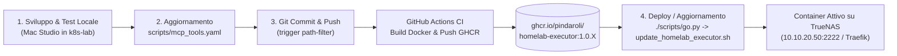

# Piano: Pipeline DevOps CI/CD e Container Immutabile Homelab Executor per `scripts/go.py`

> **Percorso Canonico Wiki**: `wiki/plans/homelab-executor-container-and-ci-pipeline.md`  
> **Comando di Ripresa**: `/resume [[homelab-executor-container-and-ci-pipeline]]`  
> **Pattern Adottati**: [[go-launcher-script-pattern]], [[script-to-mcp-tool-schema-pattern]], [[mcp-secret-projection-pattern]], [[SCHEMA]] (§6 IaC, §11 Save-State, §12 Test-Driven Verification, §13 Wiki Context Refresh).

---

## 1. Obiettivo e Decisioni Consolidate (Sessione `/grill-me`)

L'obiettivo è implementare una pipeline CI/CD GitOps su GitHub Actions e un container Docker dedicato (`ghcr.io/pindaroli/homelab-executor`) per consentire l'esecuzione remota sicura e centralizzata dei tool di `scripts/go.py` e delle procedure censite in `scripts/mcp_tools.yaml`.

### 🧭 Matrice delle Decisioni Architetturali Approvate

| # | Ambito | Decisione Approvata | Specifiche Tecniche |
|---|---|---|---|
| **1** | **Ruolo del Container & Protocolli** | **Triplice Esposizione (MCP + REST API + SSH)** | Unico container che espone:  1. **Server MCP nativo (FastMCP / SSE)** per Antigravity/Agenti basato su `scripts/mcp_tools.yaml`.  2. **REST API (FastAPI)** per trigger programmatici (`/api/run/{tool_name}`).  3. **OpenSSH Server** (porta dedicata es. `2222`) con login via sola chiave pubblica per esecuzioni TTY interattive di `go.py`. |
| **2** | **Gestione Segreti SOPS** | **Runtime SOPS Trasparente (Zero Plaintext Secrets)** | Binario `sops` pre-installato nel container; iniezione della chiave Age (`SOPS_AGE_KEY`) o montaggio read-only del file di chiavi `keys.txt` a runtime + montaggio chiave privata SSH (`~/.ssh/id_rsa`). Tutti gli script esistenti (`utils.sh`, `switch_failover_dns.py`, `cleanup_torrents.py`) decifrano on-the-fly senza alcuna modifica al codice. |
| **3** | **Immagine Base & Strato Software** | **`python:3.12-slim` Parametrizzato + Toolset DevOps** | `ARG PYTHON_BASE_IMAGE=python:3.12-slim` facilmente modificabile. Corredo di sistema completo: `ansible-core`, `sops`, `openssh-server`, `openssh-client`, `kubectl`, `talosctl`, `rsync`, `jq`, `curl`, `dnsutils`, `iputils-ping`, `socat`/`wakeonlan`. |
| **4** | **Snapshot Immutabile del Repo** | **Build Snapshot Completo al Commit** | L'immagine copia al proprio interno `scripts/`, `ansible/`, `rete.json`, `storage.json` e `secrets-sops/`. Nessun montaggio del codice da storage locale a runtime: l'immagine rappresenta lo snapshot esatto e immutabile del repository al momento del commit. |
| **5** | **Versionamento Semantico & Registry** | **SemVer Incrementale via Run Number (`ghcr.io`)** | File `docker/homelab-executor/VERSION` (es. `1.0`). La CI genera i tag semantici:  - `1.0.${{ github.run_number }}` (univoco immutabile)  - `1.0` (rolling minor)  - `latest` (rolling edge)  - `sha-${{ github.sha }}` |
| **6** | **Trigger CI/CD GitHub Actions** | **Path Filtering Dichiarativo su Push `main`** | Trigger automatico ad ogni push sul branch `main` che modifica: `ansible/**`, `rete.json`, `storage.json`, `scripts/**`, `docker/homelab-executor/**`, `.github/workflows/docker-homelab-executor.yml`. |
| **7** | **Ambiente Target & Routing** | **TrueNAS SCALE Bare Metal (`10.10.20.50`) + Traefik** | Servizio integrato nello stack Docker di TrueNAS con routing Traefik HTTPS su `mcp.pindaroli.org:8100/executor/mcp` e `executor-internal.pindaroli.org`. Porta SSH `2222` mappata sull'host `10.10.20.50`. |
| **8** | **Workflow Operativo di Aggiornamento (Step 4)** | **Script Dedicato & Voce `go.py` (`update_homelab_executor.sh`)** | Script idempotente conforme a [[go-launcher-script-pattern]] che connette via SSH a TrueNAS, esegue `docker compose pull homelab-executor && docker compose up -d homelab-executor` e attesta l'endpoint `/health`. |

---

## 2. Flusso di Lavoro Sviluppo & Rilascio (DevOps Lifecycle)

---

## 3. Mappa dei File da Creare e Modificare

| Percorso File | Operazione | Scopo |
|---|---|---|
| `docker/homelab-executor/VERSION` | **Creazione** | Base version semantica (es. `1.0`). |
| `docker/homelab-executor/requirements.txt` | **Creazione** | Dipendenze Python: `fastapi`, `uvicorn[standard]`, `mcp`, `pyyaml`, `requests`, `pydantic`. |
| `docker/homelab-executor/server/main.py` | **Creazione** | Server FastMCP + FastAPI che legge dinamicamente `scripts/mcp_tools.yaml` ed espone sia i tool MCP sia le REST API `/api/run/{tool}` e l'endpoint `/health`. |
| `docker/homelab-executor/entrypoint.sh` | **Creazione** | Script di bootstrap del container: setup chiavi SSH autorizzate, avvio `sshd` e avvio server Python. |
| `docker/homelab-executor/Dockerfile` | **Creazione** | Dockerfile multi-stage / hardened con `ARG PYTHON_BASE_IMAGE=python:3.12-slim`, installazione binari (`sops`, `kubectl`, `talosctl`, `ansible`) e copia dello snapshot immutabile del repo. |
| `.github/workflows/docker-homelab-executor.yml` | **Creazione** | Workflow GitHub Actions con path filter, buildx, estrazione metadati SemVer e push su `ghcr.io/pindaroli/homelab-executor`. |
| `docker/truenas/docker-compose.yaml` (o `docker/mcp/`) | **Modifica** | Dichiarazione del servizio `homelab-executor` con bind mount chiavi (Age + SSH) e variabili d'ambiente. |
| `docker/mcp/dynamic.yaml` | **Modifica** | Router e Service Traefik per l'esposizione HTTPS sicura del server MCP / API. |
| `scripts/infrastructure/update_homelab_executor.sh` | **Creazione** | Script operativo per il pull e rollout dell'immagine aggiornata su TrueNAS con probe di verifica. |
| `scripts/mcp_tools.yaml` | **Modifica** | Registrazione del nuovo tool `update_homelab_executor` nel server MCP e nel menu `scripts/go.py`. |
| `todo.md` & `GEMINI.md` | **Modifica** | Tracciamento avanzamento piano e allineamento indici wiki. |

---

## 4. Fasi Operative Dettagliate

### Fase 1: Creazione Componenti del Container (`docker/homelab-executor/`)
1. Creazione file `VERSION` e `requirements.txt`.
2. Sviluppo del server unificato `server/main.py` che:
   - Effettua il parsing di `scripts/mcp_tools.yaml`.
   - Registra ogni entry come tool nativo MCP.
   - Espone endpoint REST FastAPI corrispondenti per esecuzioni asincrone/sincrone.
   - Implementa l'endpoint di salute `/health`.
3. Scrittura di `entrypoint.sh` con configurazione permissiva per SSH client/server (`sshd`), configurazione `authorized_keys` da volume e avvio supervisionato.
4. Scrittura del `Dockerfile` conforme a:
   - `ARG PYTHON_BASE_IMAGE=python:3.12-slim`
   - Download sicuro del binario `sops` ufficiale (v3.9.x)
   - Download di `kubectl` e `talosctl`
   - Installazione `ansible-core` e collections di base
   - Copia di `scripts/`, `ansible/`, `rete.json`, `storage.json`, `secrets-sops/`.

### Fase 2: Configurazione della Pipeline CI/CD GitHub Actions
1. Creazione del workflow `.github/workflows/docker-homelab-executor.yml`.
2. Configurazione trigger su branch `main` con i filtri di percorso richiesti.
3. Configurazione estrazione SemVer:
   - Lettura di `VERSION` da `docker/homelab-executor/VERSION`.
   - Generazione tag `${VERSION}.${{ github.run_number }}` e tag galleggianti.
4. Configurazione login GHCR, Buildx e build-and-push su `ghcr.io/pindaroli/homelab-executor`.

### Fase 3: Configurazione dello Stack Docker su TrueNAS SCALE
1. Aggiunta della definizione del servizio `homelab-executor` in `docker/mcp/docker-compose.yaml` (o `docker/truenas/docker-compose.yaml`):
   - Immagine: `ghcr.io/pindaroli/homelab-executor:1.0` (o tag pin)
   - Porte: `2222:22` (porta SSH dedicata)
   - Volumi:
     - Chiave Age: `/root/.config/sops/age/keys.txt` (read-only)
     - Chiave SSH: `/root/.ssh/id_rsa` (read-only)
     - Chiavi pubbliche autorizzate: `/root/.ssh/authorized_keys`
   - Network: `mcp_network`
2. Aggiornamento `docker/mcp/dynamic.yaml` per il routing Traefik (`/executor/mcp` e `/api/`).

### Fase 4: Implementazione dello Script di Rollout e Integrazione in `go.py`
1. Sviluppo di `scripts/infrastructure/update_homelab_executor.sh`:
   - Connessione SSH passwordless a TrueNAS (`10.10.20.50`).
   - Esecuzione `docker compose pull homelab-executor && docker compose up -d homelab-executor`.
   - Health check su `http://10.10.20.50:8100/executor/health` o endpoint locale.
2. Registrazione in `scripts/mcp_tools.yaml` e verifica che sia indicizzato nel launcher interattivo `scripts/go.py`.

### Fase 5: Validazione Locale, Push e Collaudo End-to-End
1. Test locale di validazione syntax e linting (JSON Schema di `mcp_tools.yaml` e validazione Dockerfile).
2. Esecuzione script di conformità rete e wiki context:
   `python3 scripts/network/validate_network.py && python3 scripts/wiki/build_wiki_context.py`
3. Commit e Push del codice su GitHub per verificare l'innesco automatico della pipeline GitHub Actions.
4. Collaudo dell'aggiornamento del container con il tool sviluppato.

---

## 💾 Stato di Ripristino (AI Save-State)
- **Fase Attiva**: Fase 0 completata (Intervista `/grill-me` conclusa con tutte le decisioni architetturali concordate al 100%).
- **Ultima Azione Completata**: Redazione del piano operativo canonico `wiki/plans/homelab-executor-container-and-ci-pipeline.md`.
- **Prossimo Passo Operativo**: Presentazione del piano all'utente per approvazione e avvio della Fase 1 (creazione di `docker/homelab-executor/`).
- **Blocchi/Decisioni Pendenti**: Attesa approvazione formale dell'utente per procedere all'esecuzione della Fase 1.
