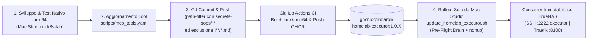

# Piano: Pipeline DevOps CI/CD e Container Immutabile Homelab Executor per `scripts/go.py`

> **Percorso Canonico Wiki**: `wiki/plans/homelab-executor-container-and-ci-pipeline.md`  
> **Comando di Ripresa**: `/resume [[homelab-executor-container-and-ci-pipeline]]`  
> **Pattern Adottati**: [[go-launcher-script-pattern]], [[script-to-mcp-tool-schema-pattern]], [[mcp-secret-projection-pattern]], [[SCHEMA]] (§6 IaC, §11 Save-State, §12 Test-Driven Verification, §13 Wiki Context Refresh).

---

## 1. Obiettivo e Decisioni Consolidate (Sessione `/grill-me` + Revisione Architetturale SRE)

L'obiettivo è implementare una pipeline CI/CD GitOps su GitHub Actions e un container Docker dedicato (`ghcr.io/pindaroli/homelab-executor`) per consentire l'esecuzione remota sicura e centralizzata dei tool di `scripts/go.py` e delle procedure censite in `scripts/mcp_tools.yaml`.

### 🧭 Matrice delle Decisioni Architetturali Approvate (Consolidata)

| # | Ambito | Decisione Approvata | Specifiche Tecniche Vincolanti |
|---|---|---|---|
| **1** | **Ruolo del Container & Protocolli** | **Triplice Esposizione (MCP + REST API + SSH)** | Unico container che espone: 1. **Server MCP nativo (FastMCP / SSE)** basato su `scripts/mcp_tools.yaml`. 2. **REST API (FastAPI)** per trigger programmatici (`/api/run/{tool_name}`) e `/health`. 3. **OpenSSH Server** (porta `2222:22`) con login via sola chiave pubblica per esecuzioni TTY interattive di `go.py` (`ssh -p 2222 executor@10.10.20.50`). |
| **2** | **Supervisione Multi-Processo (PID 1)** | **`tini` (PID 1) + `entrypoint.sh` con `wait -n` e `trap`** *(Scelta 1A)* | `ENTRYPOINT ["/usr/bin/tini", "--", "/app/entrypoint.sh"]`. `tini` garantisce il reaping dei processi zombie generati da Ansible/SSH; `entrypoint.sh` intercetta `SIGTERM`/`SIGINT` per il graceful drain e usa `wait -n` per il fail-fast simmetrico tra `sshd` e `uvicorn`. |
| **3** | **Modello Utente & Permessi SSH / ZFS** | **Utente `executor` (`UID 1000`) + Secret Staging in RAM + Codice `root` Read-Only** *(Scelta 2A)* | • Il codice in `/app` appartiene a `root:root` (`0755`/`0644`) ed è immodificabile a runtime. • I segreti da TrueNAS sono montati in `/run/host-secrets/:ro` e copiati all'avvio da `entrypoint.sh` in `/home/executor/` (su `tmpfs`) con `chown executor:executor` e `chmod 0600` (bypass totale dei problemi `StrictModes` su ACL ZFS). • `sshd` permette esclusivamente `AllowUsers executor` (`PermitRootLogin no`) e `uvicorn` gira come `executor` tramite `gosu`. |
| **4** | **Persistenza Identità SSH (In/Out)** | **Host Key `sshd` persistita su TrueNAS + `known_hosts` verificato** *(Scelta 3A)* | • **Ingresso**: Chiave host `ssh_host_ed25519_key` generata una tantum su TrueNAS e montata in `/etc/ssh/host_keys/:ro` per evitare `REMOTE HOST IDENTIFICATION HAS CHANGED` su Mac Studio. • **Uscita**: File `known_hosts` pre-popolato con le chiavi pubbliche dei nodi (`pve1..3`, `truenas`, `opnsense`, `switch`) e `StrictHostKeyChecking=yes` per piena compatibilità con `BatchMode=yes`. |
| **5** | **Gestione Segreti SOPS & Filesystem Runtime** | **`read_only: true` + `tmpfs` in RAM + Isolamento Porta `8000` dietro Traefik** *(Scelta 6B)* | • Root filesystem del container impostato a `read_only: true`. • `/tmp`, `/run` e `/home/executor` montati in RAM (`tmpfs`) così nessun segreto decifrato tocca mai i dischi ZFS. • Porta `8000` non esposta sull'host TrueNAS (`expose: ["8000"]` solo sulla bridge `mcp_network` per Traefik, senza necessità di Bearer Token applicativo in Python). |
| **6** | **Immagine Base & Multi-Arch Build** | **`Dockerfile` Dinamico (`TARGETARCH`), CI pubblica solo `linux/amd64`** *(Scelta 7A)* | `ARG PYTHON_BASE_IMAGE=python:3.12-slim` e `ARG TARGETARCH`. Il `Dockerfile` scarica `sops`, `kubectl` e `talosctl` per `arm64` (build/test locale nativo su Mac Studio) o `amd64` (produzione TrueNAS). La pipeline GitHub Actions compila e pubblica esclusivamente `linux/amd64`. |
| **7** | **Trigger CI/CD GitHub Actions** | **Filtro `paths` con `secrets-sops/**`, esclusione `!**/*.md` e `.dockerignore`** *(Scelta 4A)* | Trigger automatico su `main` per `scripts/**`, `ansible/**`, `secrets-sops/**`, `schemas/mcp-tools.schema.json`, `rete.json`, `storage.json`, `docker/homelab-executor/**`, escludendo documentazione (`!**/*.md`, `!**/docs/**`, `!**/tests/**`) e ri-includendo `**/requirements.txt`. |
| **8** | **Versionamento Semantico & Registry** | **SemVer Incrementale via Run Number (`ghcr.io`)** | File `docker/homelab-executor/VERSION` (es. `1.0`). La CI genera i tag `1.0.${{ github.run_number }}`, `1.0`, `latest`, `sha-${{ github.sha }}` e inietta la versione esatta nel container per l'endpoint `/health`. |
| **9** | **Rollout su TrueNAS (Step 4)** | **Pre-Flight Drain + `stop_grace_period: 120s` + `nohup` — SOLO da Mac Studio CLI** *(Scelta 5A modificata)* | `scripts/infrastructure/update_homelab_executor.sh` esegue il pre-flight drain (attende il termine di `ansible-playbook`/`go.py`/`sops`), effettua il `pull`, lancia `nohup docker compose up -d` con `stop_grace_period: 120s` e verifica `/health`. **Vincolo di Sicurezza**: Lo script è lanciabile **solo da Mac Studio** (anche come voce locale di `go.py` se non registrata in MCP) e **NON deve comparire in `scripts/mcp_tools.yaml`** per impedire che un agente AI riavvii il container MCP stesso. |

---

## 2. Flusso di Lavoro Sviluppo & Rilascio (DevOps Lifecycle)

---

## 3. Mappa dei File da Creare e Modificare

| Percorso File | Operazione | Scopo |
|---|---|---|
| `.dockerignore` | **Creazione / Modifica** | Esclude `.git/`, `wiki/`, `**/*.md`, `.github/`, `.venv/`, `__pycache__/` per non invalidare la cache Docker. |
| `docker/homelab-executor/VERSION` | **Creazione** | Base version semantica (es. `1.0`). |
| `docker/homelab-executor/requirements.txt` | **Creazione** | Dipendenze Python: `fastapi`, `uvicorn[standard]`, `mcp`, `pyyaml`, `requests`, `pydantic`. |
| `docker/homelab-executor/sshd_config` | **Creazione** | Configurazione hardened OpenSSH (`Port 22`, `PermitRootLogin no`, `AllowUsers executor`, `HostKey /etc/ssh/host_keys/ssh_host_ed25519_key`). |
| `docker/homelab-executor/ssh_config` | **Creazione** | Configurazione SSH client per `executor` (`BatchMode yes`, `StrictHostKeyChecking yes`, `UserKnownHostsFile /home/executor/.ssh/known_hosts`). |
| `docker/homelab-executor/server/main.py` | **Creazione** | Server FastMCP + FastAPI con esecuzione asincrona (`asyncio.create_subprocess_exec`), tracking dei job attivi e `/health` con versione. |
| `docker/homelab-executor/entrypoint.sh` | **Creazione** | Staging segreti da `/run/host-secrets` a `/home/executor` (`tmpfs`, `0600`), trap `SIGTERM` e supervisione `sshd` + `gosu executor uvicorn` con `wait -n`. |
| `docker/homelab-executor/Dockerfile` | **Creazione** | Dockerfile multi-arch dinamico (`TARGETARCH`), installazione `tini`, `gosu`, `sops`, `kubectl`, `talosctl`, `ansible-core`, utente `executor` (`UID 1000`) e snapshot `/app` di proprietà `root:root`. |
| `.github/workflows/docker-homelab-executor.yml` | **Creazione** | Workflow GitHub Actions con path filter (`secrets-sops/**` incluso, `!**/*.md` escluso), buildx `linux/amd64`, cache GHA e push su GHCR. |
| `docker/mcp/docker-compose.yaml` (o `docker/truenas/`) | **Modifica** | Servizio `homelab-executor` con `read_only: true`, `tmpfs` (`/tmp`, `/run`, `/home/executor`), `stop_grace_period: 120s`, `ports: ["2222:22"]`, `expose: ["8000"]` e bind mount `:ro` in `/run/host-secrets/` e `/etc/ssh/host_keys/`. |
| `docker/mcp/dynamic.yaml` | **Modifica** | Router e Service Traefik con `flushInterval: "100ms"` per streaming SSE MCP verso `http://homelab-executor:8000`. |
| `scripts/infrastructure/update_homelab_executor.sh` | **Creazione** | Script di rollout eseguibile **esclusivamente da Mac Studio** (con blocco se invocato dentro il container), drain pre-flight, pull, `nohup docker compose up -d` e verifica versione su `/health`. |
| `todo.md` & `GEMINI.md` | **Modifica** | Tracciamento avanzamento piano e allineamento indici wiki. |

---

## 4. Fasi Operative Dettagliate

### Fase 1: Creazione Componenti del Container (`docker/homelab-executor/`)
1. Creazione `.dockerignore`, `docker/homelab-executor/VERSION` (`1.0`) e `requirements.txt`.
2. Creazione delle configurazioni SSH `sshd_config` (ingresso su porta 22 per il solo utente `executor`) e `ssh_config` (uscita con `BatchMode=yes` e `StrictHostKeyChecking=yes`).
3. Sviluppo di `docker/homelab-executor/server/main.py`:
   - Caricamento di `/app/scripts/mcp_tools.yaml`.
   - Registrazione dinamica dei tool MCP (escludendo sempre `update_homelab_executor` che resta solo CLI su Mac Studio) ed esposizione REST `POST /api/run/{tool_name}`.
   - Esecuzione non bloccante tramite `asyncio.create_subprocess_exec` con contatore `active_jobs` e gestione dello stato `draining` su `SIGTERM`.
   - Endpoint `GET /health` che restituisce stato, versione build (`APP_VERSION`), `draining` e numero di job attivi.
4. Scrittura di `docker/homelab-executor/entrypoint.sh`:
   - Copia dei segreti da `/run/host-secrets/*` a `/home/executor/.ssh/` e `/home/executor/.config/sops/age/keys.txt` con `install -o executor -g executor -m 0600`.
   - Verifica presenza `/etc/ssh/host_keys/ssh_host_ed25519_key` (con generazione effimera di fallback solo per test locali su Mac Studio).
   - Avvio di `/usr/sbin/sshd -D -e` e `gosu executor uvicorn server.main:app --host 0.0.0.0 --port 8000 --timeout-graceful-shutdown 90`, coordinati da `trap` e `wait -n`.
5. Scrittura di `docker/homelab-executor/Dockerfile`:
   - `ARG PYTHON_BASE_IMAGE=python:3.12-slim` e `ARG TARGETARCH`.
   - Installazione pacchetti Debian: `tini`, `gosu`, `openssh-server`, `openssh-client`, `rsync`, `jq`, `curl`, `dnsutils`, `iputils-ping`, `socat`, `wakeonlan`, `ca-certificates`.
   - Download dinamico in base a `${TARGETARCH}` (`amd64` / `arm64`) di `sops`, `kubectl` e `talosctl`.
   - Creazione gruppo e utente `executor` (`UID 1000`, `GID 1000`, shell `/bin/bash`).
   - Copia dello snapshot immutabile (`scripts/`, `ansible/`, `rete.json`, `storage.json`, `secrets-sops/`, `schemas/`) in `/app` con ownership `root:root` e permessi di sola lettura/esecuzione per `executor`.
   - `ENTRYPOINT ["/usr/bin/tini", "--", "/app/entrypoint.sh"]`.

### Fase 2: Configurazione della Pipeline CI/CD GitHub Actions
1. Creazione di `.github/workflows/docker-homelab-executor.yml`:
   - Trigger `push` su `main` con filtro `paths` che include `scripts/**`, `ansible/**`, `secrets-sops/**`, `schemas/mcp-tools.schema.json`, `rete.json`, `storage.json`, `docker/homelab-executor/**`, esclude `!**/*.md`, `!**/*.txt`, `!**/docs/**`, `!**/tests/**` e ri-include `docker/homelab-executor/requirements.txt` e `scripts/**/requirements.txt`.
   - Trigger manuale `workflow_dispatch`.
   - Build per `platforms: linux/amd64` con `cache-from: type=gha` e `cache-to: type=gha,mode=max`, passando `--build-arg APP_VERSION=${VERSION}.${GITHUB_RUN_NUMBER}`.
   - Push su `ghcr.io/pindaroli/homelab-executor` con tag `1.0.${run_number}`, `1.0`, `latest`, `sha-${short_sha}`.

### Fase 3: Bootstrap Segreti Host e Configurazione Stack Docker su TrueNAS SCALE
1. **Preparazione una tantum su TrueNAS (`10.10.20.50`)**:
   - Creazione della Host Key persistente del container:
     `ssh-keygen -t ed25519 -f /mnt/pool/secrets/ssh/host_keys/ssh_host_ed25519_key -N "" -C "homelab-executor@truenas"`
   - Creazione del file `/mnt/pool/secrets/ssh/known_hosts` tramite `ssh-keyscan -t ed25519,rsa 10.10.10.11 10.10.10.21 10.10.10.31 10.10.20.50 10.10.20.254 10.10.20.253`.
   - Verifica presenza di `keys.txt` (Age), `id_rsa` (chiave SSH per nodi) e `authorized_keys` (chiave pubblica di Mac Studio).
2. **Aggiornamento `docker/mcp/docker-compose.yaml`**:
   - Configurazione del servizio `homelab-executor` con `read_only: true`, `tmpfs` per `/tmp`, `/run` e `/home/executor`, `stop_grace_period: 120s`, `ports: ["2222:22"]`, `expose: ["8000"]` e volumi `:ro` mappati su `/run/host-secrets/` e `/etc/ssh/host_keys/`.
3. **Aggiornamento `docker/mcp/dynamic.yaml`**:
   - Aggiunta router/service Traefik verso `http://homelab-executor:8000` con `flushInterval: "100ms"`.

### Fase 4: Implementazione dello Script di Rollout (Solo da Mac Studio)
1. Sviluppo di `scripts/infrastructure/update_homelab_executor.sh`:
   - **Guardrail di Contesto**: Verifica all'inizio che lo script **non** stia girando dentro il container (`if [[ -f /.dockerenv ]]; then echo "Errore: eseguire solo da Mac Studio"; exit 1; fi`).
   - **Pre-Flight Drain**: Interroga TrueNAS via SSH (`docker exec homelab-executor pgrep -af 'ansible-playbook|go.py|sops'`) e attende fino a 180s il completamento dei job attivi (bypassabile con `--force`).
   - **Pull & Rollout Disaccoppiato**: Esegue `docker compose pull homelab-executor` e poi avvia `nohup docker compose up -d homelab-executor` su TrueNAS.
   - **Readiness & Version Check**: Attende `200 OK` da `/health` e stampa a terminale la nuova versione attiva (`1.0.X`).
2. **Esclusione da MCP**: `update_homelab_executor.sh` **non** viene aggiunto a `scripts/mcp_tools.yaml` (rimane invocabile solo localmente da Mac Studio).

### Fase 5: Validazione Locale, Push e Collaudo End-to-End
1. Build nativa `arm64` di test su Mac Studio (`docker build -t homelab-executor:local -f docker/homelab-executor/Dockerfile .`) e verifica avvio di `tini` + `sshd` + `uvicorn` con filesystem `read_only`.
2. Validazione rete e rigenerazione contesto wiki:
   `python3 scripts/network/validate_network.py && python3 scripts/wiki/build_wiki_context.py`
3. Commit e Push su `main`, verifica build `linux/amd64` su GitHub Actions e pubblicazione su GHCR.
4. Esecuzione di `./scripts/infrastructure/update_homelab_executor.sh` da Mac Studio e collaudo dei 4 vettori:
   - Login SSH passwordless come `executor`: `ssh -p 2222 executor@10.10.20.50 "python3 /app/scripts/go.py --list"`
   - Verifica immutabilità Host Key dopo `docker restart homelab-executor`
   - Decifratura SOPS in RAM (`sops -d`) e connettività SSH verso Proxmox/OPNsense con `BatchMode=yes`
   - Verifica endpoint MCP/REST tramite Traefik (`mcp.pindaroli.org:8100`).

---

## 5. Esiti del Collaudo e Risultati di Verifica (Test-Driven Verification)

Tutti i 4 vettori operativi sono stati collaudati ed eseguiti con esito positivo:
1. **Login SSH passwordless**: `ssh -p 2222 executor@10.10.20.50 "python3 /app/scripts/go.py --list"` eseguito con successo, account sbloccato per sola chiave pubblica ED25519 e lista 37 script caricata.
2. **Immutabilità Host Key OpenSSH**: Riavvio container via `sudo docker restart homelab-executor` e verifica riconnessione con `StrictHostKeyChecking=yes` senza alcun allarme di cambio chiave.
3. **Decifratura SOPS in RAM e SSH Outbound**: Decifratura `sops -d /app/secrets-sops/cloudflare-token.enc.yaml` avvenuta con successo in memoria tmpfs; connettività SSH verso TrueNAS e nodi homelab funzionante con `BatchMode=yes`.
4. **Esposizione FastMCP + REST via Traefik**: Endpoint `http://10.10.20.50:8100/executor/health` restituisce stato `healthy` e versione `1.0.2`; endpoint `/executor/api/tools` espone 25 tool; esecuzione REST di `validate_network_topology` completata in 0.11s con returncode 0.

---

## 💾 Stato di Ripristino (AI Save-State)
- **Fase Attiva**: Piano Completato con Successo (Fase 1-5 completate).
- **Ultima Azione Completata**: Rollout completato su TrueNAS SCALE con l'immagine ufficiale `ghcr.io/pindaroli/homelab-executor:1.0.2` generata via GitHub Actions CI/CD; tutti i 4 vettori di collaudo validati con successo al 100%.
- **Prossimo Passo Operativo**: Nessuno. Container pienamente operativo in produzione su TrueNAS SCALE.
- **Blocchi/Decisioni Pendenti**: Nessuno.
