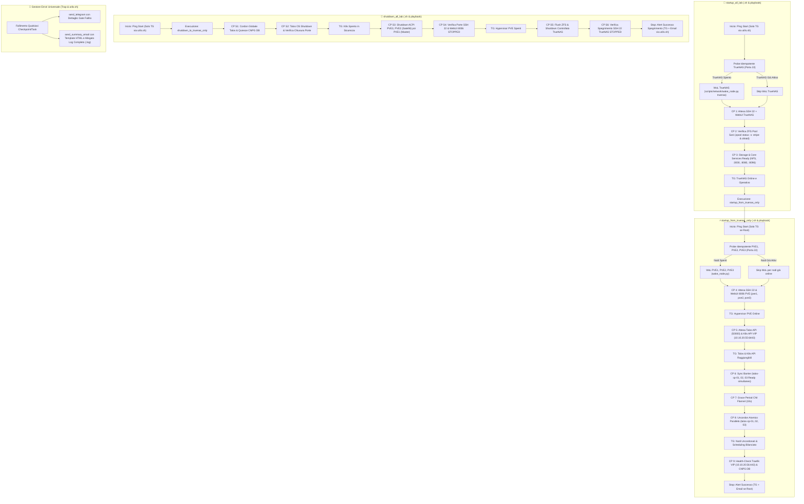

# Piano: Automazione Full Power Homelab (WoL Idempotente, Checkpoint e Alerting Multi-Canale)

Questo piano definisce l'architettura, la logica dei checkpoint vincolanti e l'implementazione completa per le procedure di accensione e spegnimento automatizzato dell'infrastruttura Homelab, **riutilizzando integralmente la libreria canonica di notifica** ([`scripts/infrastructure/utils.sh`](file:///Users/olindo/prj/k8s-lab/scripts/infrastructure/utils.sh)) e il gestore dello scope gerarchico ([`scripts/infrastructure/procedure_scope.sh`](file:///Users/olindo/prj/k8s-lab/scripts/infrastructure/procedure_scope.sh)):
1. **Completamento di `startup_from_truenas_only`** (Playbook e `.sh`): aggiunta del **Wake-on-LAN (WoL) idempotente** sui 3 nodi Proxmox VE (`pve1`, `pve2`, `pve3`) e strutturazione formale dei checkpoint.
2. **Creazione di `startup_all_lab`** (Playbook e `.sh`): sequenza globale deterministica che avvia TrueNAS con WoL idempotente, ne convalida la piena operatività e poi innesca la sequenza `startup_from_truenas_only`.
3. **Creazione di `shutdown_all_lab`** (Playbook e `.sh`): sequenza globale che esegue `shutdown_to_truenas_only` (spegnimento graceful K8s Talos + PVE) e successivamente lo shutdown controllato di TrueNAS Bare Metal.
4. **Matrice di Segnalazione & Alerting Gerarchico ([[hierarchical-automation-alerting-pattern]])**:
   - **Avvio**: Esclusivamente un breve ping testuale su **Telegram** (Zero start emails, eliminando il rumore nell'inbox).
   - **Step intermedi / Avanzamento nodi**: Notifiche di raggiungibilità/ready **esclusivamente su Telegram**.
   - **Completamento di Successo**: Se procedura Root, invio di **Email HTML + Telegram riassuntivo finale**. Nelle procedure composte (`shutdown_all_lab`, `startup_all_lab`), la sotto-fase sopprime il proprio report di successo per evitare notifiche frammentate.
   - **In caso di errore**: Fail-fast universale (`trap ERR` non silenziabile) con alert immediato su **Telegram** ed invio di **Email con allegato il file di log completo della sessione** (`logs/automation/`).

---

## 🗺️ Architettura e Flusso delle Procedure

---

## 🔍 Elenco Dettagliato dei Checkpoint (Gate Operativi)

### A. Procedura: `startup_from_truenas_only`
1. **Probe Idempotenza PVE**: test rapido porta 22 su `10.10.10.11`, `10.10.10.21`, `10.10.10.31` (timeout 2s). Se il nodo risponde, salta il WoL (**SKIP WoL**); se spento, invia Magic Packet tramite `scripts/network/wake_node.py <nodo>`.
2. **CP 1.1 — PVE SSH Gate**: attesa raggiungibilità porta 22 su tutti i 3 hypervisor (`timeout: 180`).
3. **CP 1.2 — PVE WebUI Gate**: attesa raggiungibilità porta 8006 su tutti i 3 hypervisor (`timeout: 60`).
   - *Notifica Telegram*: "Hypervisor pve1, pve2, pve3 operativi".
4. **CP 2.1 — Talos API Gate**: attesa porta 50000 su `10.10.20.141`, `10.10.20.142`, `10.10.20.143` (`timeout: 180`).
5. **CP 2.2 — Kubernetes VIP Gate**: attesa porta 6443 sul VIP `10.10.20.55` (`timeout: 120`).
   - *Notifica Telegram*: "Control plane K8s raggiungibile sul VIP 10.10.20.55".
6. **CP 3.1 — Sync Barrier Gate**: polling ciclico affinché `talos-cp-01`, `talos-cp-02` e `talos-cp-03` abbiano contemporaneamente `Ready=True` (`retries: 30, delay: 10`).
7. **CP 3.2 — Grace Period CNI**: pausa di 10s per stabilizzazione tabelle ARP/FDB e Flannel vxlan.
   - *Notifica Telegram*: "Tutti i nodi Talos sono Ready e stabilizzati".
8. **CP 4.1 — Uncordon Atomico Parallelo**: esecuzione simultanea `kubectl uncordon talos-cp-01 talos-cp-02 talos-cp-03` (preservando il taint `NoSchedule` su `talos-cp-03`).
   - *Notifica Telegram*: "Uncordon atomico completato: scheduling bilanciato aperto".
9. **CP 5.1 — Traefik Ingress Gate**: attesa porta 443 su VIP `10.10.20.56` (`timeout: 60`).
10. **CP 5.2 — Database CNPG Gate**: verifica stato `Cluster in healthy state` per il cluster `postgres-main`.

### B. Procedura: `startup_all_lab`
1. **Probe Idempotenza TrueNAS**: test porta 22 su `10.10.20.50` (timeout 2s). Se online $\rightarrow$ **SKIP WoL**; se offline $\rightarrow$ invio WoL via `scripts/network/wake_node.py truenas`.
2. **CP 1.1 — TrueNAS SSH Gate**: attesa porta 22 (`timeout: 240`).
3. **CP 1.2 — TrueNAS WebUI Gate**: attesa porta 443/80 (`timeout: 60`).
4. **CP 1.3 — ZFS Integrity Gate**: esecuzione `zpool status -x` con validazione `all pools are healthy`.
5. **CP 1.4 — TrueNAS Services Gate**: attesa porte 3000 (Homepage), 8080 (qBittorrent), 8096 (Jellyfin) e NFS export.
   - *Notifica Telegram*: "TrueNAS SCALE online e storage ZFS operativo".
6. **CP 2.0 — Catena PVE**: esecuzione dei checkpoint di `startup_from_truenas_only`.

### C. Procedura: `shutdown_all_lab`
1. **CP 1.1 — Esecuzione `shutdown_to_truenas_only`**:
   - Cordon globale Talos (`talos-cp-01`, `talos-cp-02`, `talos-cp-03`).
   - Quiesce / Checkpoint DB PostgreSQL (`CHECKPOINT;` su istanza primaria dinamica CloudNativePG in `cnpg-system`).
   - Segnale di arresto `talosctl shutdown --nodes ...` e verifica porte 50000, 6443, 443 STOPPED.
   - *Notifica Telegram*: "Cluster K8s spento in sicurezza".
   - Shutdown ACPI nodi satelliti (`pve3`, `pve2`) e nodo master (`pve1`).
   - Verifica arresto porte 22 e 8006 PVE.
   - *Notifica Telegram*: "Hypervisor pve1, pve2, pve3 disattivati".
2. **CP 2.1 — TrueNAS Flush & Shutdown**:
   - Flush I/O ZFS (`sync`).
   - Invio shutdown via `sudo -n shutdown -h now` (segnale diretto a systemd, bypass code middleware).
   - Verifica arresto porta 22 TrueNAS (`state: stopped`, `timeout: 150` con loop visivo).
   - *Notifica Telegram*: "TrueNAS SCALE spento. Tutto l'homelab è offline".

---

## 🛠️ Matrice Notifiche via `procedure_scope.sh` e `utils.sh` ([[hierarchical-automation-alerting-pattern]])

- **Start Procedura**: Ping breve `send_telegram` (Zero email di start inviate per azzerare il rumore nell'inbox).
- **Avanzamento Singoli Nodi / Gates**: Notifiche `send_telegram` puntuali (zero email intermedie).
- **Stop Procedura (Successo)**:
  - Se Root Procedure: `send_telegram` + `send_summary_email` (Template HTML con badge Verde "SUCCESSO").
  - Se Child/Nested Procedure: soppresso (delegato al parent per produrre un unico bilancio finale).
- **In Caso di Errore**: Fail-fast immediato con `send_telegram` + `send_summary_email` (Template HTML con badge Rosso "ERRORE CRITICO" e **allegato il file di log completo della sessione**).

---

## 💾 Stato di Ripristino (AI Save-State)
- **Fase Attiva**: [x] Idempotenza & Trasparenza Completa (Startup & Shutdown) Implementata (100% Gates Validati)
- **Ultima Azione Completata**: Materializzato pattern architetturale `wiki/patterns/hierarchical-automation-alerting-pattern.md`: rimosse le email di start su tutti i 4 wrapper `.sh`, introdotto il modulo dedicato `procedure_scope.sh` per la gestione gerarchica Root vs Child (`HOMELAB_PARENT_PROCEDURE`) ed emessa una sola notifica finale riassuntiva di successo nelle procedure composte, garantendo al contempo il tracciamento universale immediato di tutti gli errori.
- **Prossimo Passo Operativo**: Ritestare `shutdown_to_truenas_only.sh` e `shutdown_all_lab.sh` per validare il nuovo schema di alerting gerarchico e il checkpoint PostgreSQL dinamico.
- **Blocchi/Decisioni Pendenti**: Nessun blocco.
