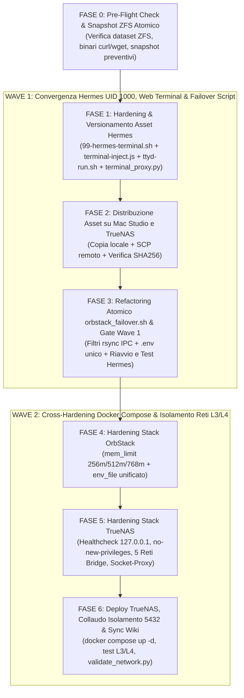

# Piano Operativo Master: Convergenza Hermes Agent (UID 1000, Sync & Web Terminal) e Cross-Hardening KISS Docker Compose (TrueNAS & OrbStack)

> **Percorso Canonico Wiki**: `wiki/plans/homelab-hermes-convergence-and-compose-cross-hardening.md` (alias: `[[homelab-hermes-convergence-and-compose-cross-hardening]]`)  
> **Piani Unificati e Sostituiti**:
> - `wiki/plans/hermes-agent-failover-sync-hardening-and-uid-convergence.md`
> - `wiki/plans/docker-compose-cross-hardening-and-kiss-alignment.md`  
> **Comando di Attivazione per l'Agente Locale**: `/resume [[homelab-hermes-convergence-and-compose-cross-hardening]]`  
> **Governance Collegata**: [[orbstack-failover-truenas-services]], [[home-internal-dns-failover-and-https-ingress]], [[hermes-agent-common-prj-and-web-terminal]], [[SCHEMA]], [[GEMINI]], [[go-launcher-script-pattern]].

> [!NOTE]
> **Stato**: `active` / `certified_for_ai: true` (Verificato e allineato 1:1 ai file reali del repository e del runtime).  
> Piano strutturale master in **2 Wave sequenziali (6 Fasi)** che unifica in un'unica finestra di manutenzione:
> 1. **Wave 1 (Hermes & Failover Script)**: Risoluzione alla radice del crash loop del Gateway Hermes, convergenza universale su UID/GID `1000:1000` (`olindo:k8s`), esclusione di socket IPC e lock effimeri in `rsync`, consolidamento del file `.env` di failover e ripristino permanente del Web Terminal (`ttyd` via `/terminal`) nella WebGUI React.
> 2. **Wave 2 (Cross-Hardening Docker Compose TrueNAS & OrbStack)**: Adozione di healthcheck universali su IPv4 locale (`127.0.0.1`), hardening `no-new-privileges`, isolamento L3/L4 dei database PostgreSQL tramite reti bridge `internal: true`, disaccoppiamento di Dozzle dal socket Docker grezzo tramite `socket-proxy` L7 dedicato (`tecnativa/docker-socket-proxy:v0.4.1`), e limiti di memoria (`mem_limit`) sui container in emulazione sotto OrbStack.

---

## 1. Contesto, Root Cause Analysis (Post-Mortem) e Razionale dell'Unificazione

### 1.1 Root Cause Analysis dell'Incidente Post-Startup Hermes Agent
All'accensione del Mac Studio in modalità failover/ripristino verso TrueNAS (`lab_mode_eco`), sono emerse due anomalie bloccanti su Hermes (`:9119`):
1. **Crash Loop di `gateway-default` ogni 20 secondi (Chat muta)**:
   - Il servizio `dashboard` (FastAPI) rispondeva, ma l'engine `gateway-default` falliva il bootstrap con:
     ```text
     WARNING gateway.control_socket: Gateway control socket failed to start (non-fatal): control socket belongs to another user
     RuntimeError: gateway session bootstrap control listener unavailable
     WARNING gateway.host_rendezvous: ignoring host record /opt/data/.local/state/hermes/gateway-locks/host-gateway.json: owned by uid 1000 (expected 10000)
     ```
   - **Causa Primaria (Disallineamento UID 10000 vs 1000)**: Nel codice di Hermes (`/opt/hermes/gateway/control_socket.py`), il controllo `if bind_path.lstat().st_uid != os.getuid(): raise PermissionError(...)` impedisce l'avvio se `/opt/data/gateway.sock` appartiene a un UID diverso. Nel container l'utente `hermes` aveva UID `10000`, mentre sul dataset ZFS di TrueNAS (`/mnt/stripe/hermesAgent/HermesMain`) e su Mac Studio (OrbStack) i file appartenevano a UID `1000` (`olindo:k8s`).
   - **Causa Secondaria (Sincronizzazione IPC via `rsync`)**: Lo script `orbstack_failover.sh` sincronizzava `HermesMain/` senza escludere i socket UNIX (`*.sock*`) e i lock di processo (`gateway-locks/`), trasferendo descrittori IPC orfani tra host diversi.
2. **Invisibilità del pulsante Web Terminal nella WebGUI**:
   - Lo script `terminal-inject.js` appendeva il bottone su `document.querySelectorAll("nav, aside")[0]`, finendo fuori dal flusso flexbox scrollabile (`coreItems`) della SPA React o rimosso dai re-render di React Router, oltre all'assenza di cache-busting aggiornato in `/opt/hermes/hermes_cli/web_dist/index.html`.

### 1.2 Analisi Comparativa Cross-Stack (`docker/truenas` vs `docker/orbstack`)
Dall'ispezione congiunta di `docker/truenas/docker-compose.yaml` (stack stateful su ZFS bare-metal `10.10.20.50`) e `docker/orbstack/docker-compose.yaml` (stack stateless di emergenza su Mac Studio `10.10.20.100`):
- **Rifiuto del DRY Rigido (Preservazione KISS)**: I due file Compose non devono essere fusi in un unico template complesso, poiché hanno responsabilità hardware e di persistenza opposte.
- **Opportunità di Cross-Hardening Simmetrico**:
  - *Da OrbStack verso TrueNAS*: Healthcheck nativi contro processi in deadlock, `no-new-privileges: true`, segmentazione delle reti bridge per isolare i database PostgreSQL (`:5432`) e protezione di Dozzle tramite `socket-proxy` L7.
  - *Da TrueNAS verso OrbStack*: Consolidamento di `.env.mcp` e `.env.ai` in un singolo `.env` (`chmod 600`) e limiti `mem_limit` cgroups v2 per contenere l'overhead di memoria dell'emulazione Rosetta 2.

### 1.3 Perché un Piano Master Unificato in 2 Wave
I due interventi condividono **tre risorse critiche**: lo script `scripts/infrastructure/orbstack_failover.sh`, il container `hermes-agent` (`hermes-main`) su TrueNAS e i dataset ZFS `/mnt/stripe/truenas-docker` + `/mnt/stripe/hermesAgent`. L'esecuzione unificata in **2 Wave separate da un Gate di Verifica** elimina doppi refactoring, doppi riavvii dei container e rischi di regressione incrociata.

---

## 2. Le 10 Invarianti Architetturali Consolidate (Matrice Master KISS & SRE)

| # | Ambito | Invariante / Decisione Approvata | Implementazione Tecnica & Beneficio SRE |
| :- | :--- | :--- | :--- |
| **1** | **Identità Universale** | **Convergenza Globale su UID/GID `1000:1000`** | Rimappatura di `hermes` a `1000:1000` in `99-hermes-terminal.sh` (con spostamento a `19999` di eventuali utenti collidenti nella base image e riallineamento `find / -xdev` dei file ex-`10000` in `/opt/hermes`). Allinea ZFS (`olindo:k8s`), OrbStack, Git e container (**KISS 5/5**). |
| **2** | **Boot Rapido & Sicuro** | **Auto-Clean IPC, `chown` con `-prune` & Hook s6/FastAPI** | Rimozione al boot di tutti i socket UNIX (`find -type s`), `*.sock*`, `*.lock` e `gateway-locks/*`. Il riallineamento ownership su `/opt/data` usa `-path /opt/data/common -prune` per non scansionare i repository Git in `common/prj`, preservando symlink `/hermesAgent/common`, hook `terminal_proxy.py` e servizio `s6-overlay` `ttyd` (**KISS 5/5**). |
| **3** | **Anti-Orphan Sync** | **Filtro IPC in `rsync` Preservando i Lockfile Codice** | Esclusione in `orbstack_failover.sh` di `*.sock`, `*.sock.*`, `/*.lock` (ancorato alla root di `HermesMain` per non escludere `uv.lock`/`poetry.lock`/`yarn.lock` nelle sottodirectory) e `*gateway-locks/`. Consistenza SQLite (`sessions.db`) garantita (**KISS 5/5**). |
| **4** | **Resilienza Web Terminal** | **Ancoraggio React `MutationObserver` + Proxy `/terminal`** | Iniezione del pulsante Terminale come fratello di `[href*="/chat"]` protetta da `MutationObserver` idempotente, Floating Pill di emergenza, iframe persistente puntato a `/terminal` (dietro `terminal_proxy.py` autenticato), cache-buster `?v=2.2` in `/opt/hermes/hermes_cli/web_dist/index.html` e `git config --system --add safe.directory '*'` (**KISS 4.5/5**). |
| **5** | **Healthcheck TrueNAS** | **Healthcheck Nativi su IPv4 `127.0.0.1`** | Blocchi `healthcheck` su `jellyfin`, `qbittorrent`, `homepage`, `prowlarr` e `webhook-normalizer` puntati esplicitamente a `127.0.0.1` (evitando falsi negativi IPv6 `::1` di `localhost`) (**KISS 5/5**). |
| **6** | **Hardening Privilegi** | **`no-new-privileges: true` Selettivo** | Applicato a `jellyfin`, `qbittorrent`, `prowlarr`, `flaresolverr`, `homepage`, `webhook-normalizer`, `minimserver-autosymlink`, `bitmagnet`, `bitmagnet-postgres`, `litellm`, `litellm-postgres`, `socket-proxy` e `dozzle`. **Esclusi per design**: `hermes-agent` (richiede `s6-setuidgid`/root per `ttyd`) e `scrutiny` (richiede accesso SMART raw `/dev`) (**KISS 5/5**). |
| **7** | **Isolamento Database L3/L4** | **Reti Bridge Segmentate & Multi-Homing Consumer** | Creazione di `media-net`, `ai-net`, `db-bitmagnet-net` (`internal: true`) e `db-litellm-net` (`internal: true`). Assenza di `ports:` su `bitmagnet-postgres` e `litellm-postgres`. `bitmagnet` (`media-net` + `db-bitmagnet-net`) e `litellm` (`ai-net` + `db-litellm-net`) mantengono accesso esterno isolando al 100% la porta `5432` (**KISS 4.5/5**). |
| **8** | **Protezione Docker Socket** | **`socket-proxy` L7 Dedicato in `docker/truenas`** | Istanza locale `tecnativa/docker-socket-proxy:v0.4.1` (~6 MB RAM) su rete `truenas-socket-proxy` (`internal: true`) dentro `docker/truenas/docker-compose.yaml`. Elimina `/var/run/docker.sock` da Dozzle (`amir20/dozzle:v11.2.0` su porta `"8888:8080"`) mantenendo i due stack TrueNAS (`truenas` e `mcp`) autonomi al boot (**KISS 4.5/5**). |
| **9** | **Hardening OrbStack** | **Unificazione `.env` & Cgroups `mem_limit`** | Consolidamento di `.env.mcp` e `.env.ai` in `~/.homelab-failover/.env` (`chmod 600`) in `orbstack_failover.sh` e `docker/orbstack/docker-compose.yaml`. Limiti RAM su OrbStack: `256m` per MCP leggeri/proxy/dozzle, `512m` per `homepage` (`homepage-mac`)/`github-mcp`, `768m` per MCP intensivi (`gemini-deepsearch-mcp`, `nowaikit-mcp`) e `litellm` (**KISS 4.5/5**). |
| **10** | **Divieti Anti-KISS** | **Preservazione `dynamic.yaml` TrueNAS & Zero-DB Mac** | Vietato introdurre label Traefik cross-stack su TrueNAS (si mantiene il file provider statico `docker/mcp/dynamic.yaml` verso `10.10.20.50:<porta>`) e vietato introdurre PostgreSQL su Mac Studio in failover (**Guardrail Architetturale**). |

---

## 3. Mappa Globale dei File Oggetto di Modifica

```text
k8s-lab/
├── docker/
│   ├── hermes/
│   │   ├── s6/
│   │   │   ├── 99-hermes-terminal.sh           # [CREAZIONE/MODIFICA - WAVE 1] UID 1000 safe remap, find -xdev, prune common, socket clean, hook terminal_proxy & s6 ttyd
│   │   │   └── ttyd-run.sh                     # [VERSIONAMENTO GIT - WAVE 1] Copia nel repo dello script s6-overlay di avvio ttyd (-p 7681 -i 127.0.0.1 -b /terminal)
│   │   └── web/
│   │       ├── terminal-inject.js              # [CREAZIONE/MODIFICA - WAVE 1] MutationObserver idempotente, sibling [href*="/chat"], iframe /terminal e floating fallback
│   │       └── terminal_proxy.py               # [VERSIONAMENTO GIT - WAVE 1] Copia nel repo del router FastAPI Prepend (/terminal, /terminal/ws subprotocol=tty)
│   ├── orbstack/
│   │   └── docker-compose.yaml                 # [MODIFICA - WAVE 2] mem_limit (256m/512m/768m) e singolo env_file .env su tutti i servizi
│   └── truenas/
│       └── docker-compose.yaml                 # [MODIFICA - WAVE 2] 5 reti bridge, healthcheck 127.0.0.1, no-new-privileges, socket-proxy v0.4.1 e Dozzle v11.2.0
├── scripts/
│   └── infrastructure/
│       └── orbstack_failover.sh                # [MODIFICA - WAVE 1] Esclusioni rsync IPC, chown 1000:1000 con -prune, generazione e uso .env unificato
├── wiki/
│   └── plans/
│       └── homelab-hermes-convergence-and-compose-cross-hardening.md # [CREAZIONE] Piano Master Unificato
├── todo.md                                     # [MODIFICA - CHIUSURA] Allineamento task attivi
└── GEMINI.md                                   # [MODIFICA - CHIUSURA] Censimento procedura e stato architetturale
```

---

## 4. Sequenza Operativa in 2 Wave (Protocollo Test-Driven §12)

### Diagramma del Flusso Esecutivo e Gate di Controllo



---

### FASE 0: Pre-Flight Check in Sola Lettura e Snapshot ZFS Preventivo

#### 0.1 Ispezione Pre-Flight su TrueNAS (`10.10.20.50`)
Verifica in un unico passaggio i dataset ZFS, il nome esatto del container/servizio Hermes e la disponibilità di `curl` o `wget` nei container destinatari degli healthcheck:

```bash
ssh -o BatchMode=yes olindo@10.10.20.50 "
  echo '=== 1. VERIFICA DATASET ZFS ===' &&
  zfs list -o name,mountpoint | grep -E 'stripe($|/truenas-docker|/hermesAgent)' &&
  echo '=== 2. VERIFICA CONTAINER E SERVIZIO HERMES ===' &&
  sudo docker ps --filter name=hermes --format 'Container={{.Names}} | Service={{.Label \"com.docker.compose.service\"}} | Status={{.Status}}' &&
  echo '=== 3. VERIFICA BINARI HEALTHCHECK (curl / wget) ===' &&
  for c in jellyfin qbittorrent prowlarr homepage webhook-normalizer; do
    printf '%-20s: ' \"\$c\"
    sudo docker exec \"\$c\" sh -c 'command -v curl || command -v wget || echo MISSING' 2>/dev/null || echo 'NOT_RUNNING'
  done
"
```

#### 0.2 Creazione Snapshot ZFS Preventivo Coordinato
```bash
ssh -o BatchMode=yes olindo@10.10.20.50 "
  sudo zfs snapshot stripe/truenas-docker@pre-unified-hardening-20261025 &&
  (sudo zfs snapshot stripe/hermesAgent@pre-unified-hardening-20261025 2>/dev/null || true) &&
  sudo zfs list -t snapshot -r stripe | grep pre-unified-hardening-20261025
"
```
*Criterio di successo Fase 0*: Snapshot `@pre-unified-hardening-20261025` elencato da `zfs list` e stato attuale dei container documentato.

---

### FASE 1 (Wave 1): Aggiornamento e Versionamento Configurazione Container Hermes (`docker/hermes/`)

#### 1.0 Importazione nel Repository Git di `ttyd-run.sh` e `terminal_proxy.py`
Copia nel repository Git (`docker/hermes/`) i due file già collaudati in `~/.homelab-failover/hermes/` per garantire il versionamento completo di tutti i 4 asset montati dal container:
```bash
mkdir -p docker/hermes/s6 docker/hermes/web &&
cp -f ~/.homelab-failover/hermes/s6/ttyd-run.sh docker/hermes/s6/ttyd-run.sh &&
cp -f ~/.homelab-failover/hermes/web/terminal_proxy.py docker/hermes/web/terminal_proxy.py &&
chmod +x docker/hermes/s6/ttyd-run.sh
```

#### 1.1 Scrittura di `docker/hermes/s6/99-hermes-terminal.sh`
Lo script unifica la convergenza UID/GID `1000:1000` e l'auto-clean IPC con i 4 blocchi strutturali di Hermes (`symlink /hermesAgent/common`, profilo `/etc/profile.d/hermes_env.sh`, cache-buster `?v=2.2` in `/opt/hermes/hermes_cli/web_dist/index.html`, hook FastAPI `terminal_proxy.py --install-hook` e registrazione del servizio `s6-overlay v3` `/run/service/ttyd`):

```bash
#!/usr/bin/with-contenv bash
# ==============================================================================
# 99-hermes-terminal.sh — s6-overlay cont-init.d
# Invarianti:
#   1. Convergenza UID/GID hermes -> 1000:1000 (olindo:k8s) senza collisioni
#   2. Symlink /hermesAgent/common -> /opt/data/common e profilo bash contestuale
#   3. Auto-clean socket UNIX (.sock) e gateway-locks orfani al boot
#   4. Chown rapido su /opt/data con esclusione (-prune) di /opt/data/common
#   5. Git safe.directory universale, cache-busting ?v=2.2 in web_dist/index.html
#   6. Installazione hook FastAPI terminal_proxy.py e avvio servizio s6 ttyd
# ==============================================================================
set -euo pipefail

echo "[cont-init:99-hermes-terminal] Avvio convergenza UID 1000, bonifica IPC e setup Web Terminal..."

# 1. Creazione idempotente symlink /hermesAgent/common -> /opt/data/common
mkdir -p /hermesAgent /opt/data/common/prj
ln -sfn /opt/data/common /hermesAgent/common

# 2. Risoluzione collisioni UID/GID 1000 nella base image Linux e rimappatura hermes -> 1000:1000
if id -u hermes >/dev/null 2>&1; then
    EXISTING_USER="$(getent passwd 1000 | cut -d: -f1 || true)"
    if [ -n "${EXISTING_USER}" ] && [ "${EXISTING_USER}" != "hermes" ]; then
        echo "[cont-init:99-hermes-terminal] Spostamento utente collidente ${EXISTING_USER} (UID 1000 -> 19999)"
        usermod -o -u 19999 "${EXISTING_USER}"
    fi

    EXISTING_GROUP="$(getent group 1000 | cut -d: -f1 || true)"
    if [ -n "${EXISTING_GROUP}" ] && [ "${EXISTING_GROUP}" != "hermes" ]; then
        echo "[cont-init:99-hermes-terminal] Spostamento gruppo collidente ${EXISTING_GROUP} (GID 1000 -> 19999)"
        groupmod -o -g 19999 "${EXISTING_GROUP}"
    fi

    if [ "$(id -u hermes)" != "1000" ] || [ "$(id -g hermes)" != "1000" ]; then
        groupmod -o -g 1000 hermes
        usermod -o -u 1000 -g 1000 hermes
        echo "[cont-init:99-hermes-terminal] Riallineamento file rootfs container da UID/GID 10000 a 1000:1000..."
        find / -xdev \( -uid 10000 -o -gid 10000 \) -exec chown -h hermes:hermes {} + 2>/dev/null || true
    fi
fi

# 3. Auto-Clean al boot di socket UNIX e lock effimeri orfani in /opt/data
if [ -d /opt/data ]; then
    find /opt/data -path /opt/data/common -prune -o -maxdepth 4 -type s -delete 2>/dev/null || true
    rm -f /opt/data/*.sock /opt/data/*.sock.path /opt/data/*.lock
    rm -rf /opt/data/.local/state/hermes/gateway-locks/*

    # 4. Riallineamento selettivo /opt/data (escluso il mount /opt/data/common dei repo Git)
    find /opt/data -path /opt/data/common -prune -o \
        \( ! -user hermes -o ! -group hermes \) \
        -exec chown -h hermes:hermes {} +
fi

# 5. Configurazione prompt bash contestuale per nodo, umask 0002 e Git safe.directory
cat << 'EOF' > /etc/profile.d/hermes_env.sh
umask 0002
export HERMES_NODE="${HERMES_HOST_NODE:-hermes}"
export PS1="\[\033[1;31m\][root@${HERMES_NODE}]\[\033[0m\]:\[\033[1;34m\]\w\[\033[0m\]# "
git config --global --add safe.directory '*' 2>/dev/null || true
EOF
grep -q "hermes_env.sh" /root/.bashrc 2>/dev/null || echo "source /etc/profile.d/hermes_env.sh" >> /root/.bashrc
if command -v git >/dev/null 2>&1; then
    git config --system --add safe.directory '*' 2>/dev/null || true
    git config --global --add safe.directory '*' 2>/dev/null || true
fi

# 6. Aggancio idempotente con cache-buster (?v=2.2) di terminal-inject.js in web_dist/index.html
INDEX_HTML="/opt/hermes/hermes_cli/web_dist/index.html"
if [ -f "${INDEX_HTML}" ]; then
    sed -i '/terminal-inject\.js/d' "${INDEX_HTML}"
    sed -i 's|</body>|  <script src="/terminal-inject.js?v=2.2" defer></script>\n</body>|' "${INDEX_HTML}"
fi

# 7. Aggancio idempotente del modulo terminal_proxy.py nell'app FastAPI di Hermes
if [ -f /opt/hermes/hermes_cli/terminal_proxy.py ]; then
    python3 /opt/hermes/hermes_cli/terminal_proxy.py --install-hook
fi

# 8. Supervisione automatica ttyd sotto s6-overlay v3 (/run/service/ttyd)
if [ -f /etc/services.d/ttyd/run ]; then
    mkdir -p /run/service/ttyd
    cp /etc/services.d/ttyd/run /run/service/ttyd/run
    chmod 0755 /run/service/ttyd/run
    if [ -x /command/s6-svscanctl ]; then
        /command/s6-svscanctl -a /run/service 2>/dev/null || true
    fi
fi

echo "[cont-init:99-hermes-terminal] Completato. Identità attiva: $(id hermes 2>/dev/null || echo 'N/A')"
```

#### 1.2 Scrittura di `docker/hermes/web/terminal-inject.js`
Lo script usa un `MutationObserver` con guardia idempotente su `#hermes-terminal-nav-btn`, inserisce il pulsante come fratello diretto del link Chat (`[href*="/chat"]`) nella lista scrollabile della sidebar React, carica l'iframe persistente sul percorso autenticato **`/terminal`** (servito da `terminal_proxy.py` verso `127.0.0.1:7681`) e attiva una Floating Pill di fallback qualora la sidebar sia collassata o la struttura DOM cambi:

```javascript
(() => {
  'use strict';

  const BTN_ID = 'hermes-terminal-nav-btn';
  const FAB_ID = 'hermes-terminal-fab';
  const OVERLAY_ID = 'hermes-terminal-overlay';

  function getTerminalUrl() {
    return '/terminal';
  }

  function ensureTerminalOverlay() {
    let overlay = document.getElementById(OVERLAY_ID);
    if (overlay) return overlay;

    overlay = document.createElement('div');
    overlay.id = OVERLAY_ID;
    overlay.style.cssText = [
      'position:fixed', 'inset:0', 'z-index:9998',
      'background:rgba(15,17,23,0.92)', 'display:none',
      'flex-direction:column', 'backdrop-filter:blur(4px)'
    ].join(';');

    const header = document.createElement('div');
    header.style.cssText = [
      'display:flex', 'align-items:center', 'justify-content:space-between',
      'padding:8px 16px', 'background:#161922', 'border-bottom:1px solid #2d3343',
      'color:#e2e8f0', 'font-family:system-ui,sans-serif', 'font-size:13px'
    ].join(';');

    const title = document.createElement('span');
    title.textContent = 'Hermes Web Terminal (ttyd — /opt/data)';

    const closeBtn = document.createElement('button');
    closeBtn.type = 'button';
    closeBtn.textContent = 'Chiudi (ESC)';
    closeBtn.style.cssText = [
      'background:#2d3343', 'color:#fff', 'border:none',
      'padding:4px 10px', 'border-radius:6px', 'cursor:pointer'
    ].join(';');
    closeBtn.onclick = () => toggleTerminal(false);

    header.appendChild(title);
    header.appendChild(closeBtn);

    const iframe = document.createElement('iframe');
    iframe.id = 'hermes-terminal-iframe';
    iframe.style.cssText = 'flex:1;width:100%;border:none;background:#041c1c;';
    iframe.dataset.loaded = 'false';

    overlay.appendChild(header);
    overlay.appendChild(iframe);
    document.body.appendChild(overlay);

    window.addEventListener('keydown', (ev) => {
      if (ev.key === 'Escape' && overlay.style.display === 'flex') {
        toggleTerminal(false);
      }
    });

    return overlay;
  }

  function toggleTerminal(forceState) {
    const overlay = ensureTerminalOverlay();
    const iframe = document.getElementById('hermes-terminal-iframe');
    const isHidden = overlay.style.display === 'none';
    const nextState = typeof forceState === 'boolean' ? forceState : isHidden;

    if (nextState) {
      if (iframe && iframe.dataset.loaded !== 'true') {
        iframe.src = getTerminalUrl();
        iframe.dataset.loaded = 'true';
      }
      overlay.style.display = 'flex';
    } else {
      overlay.style.display = 'none';
    }
  }

  function createNavButton(referenceNode) {
    const btn = document.createElement('a');
    btn.id = BTN_ID;
    btn.href = '#terminal';
    btn.className = referenceNode ? referenceNode.className : '';
    btn.style.cssText = [
      'display:flex', 'align-items:center', 'gap:10px',
      'padding:8px 12px', 'border-radius:8px', 'cursor:pointer',
      'text-decoration:none', 'color:inherit', 'font-weight:500'
    ].join(';');
    btn.innerHTML = '<span>&gt;_</span><span>Terminale</span>';
    btn.addEventListener('click', (e) => {
      e.preventDefault();
      e.stopPropagation();
      toggleTerminal();
    });
    return btn;
  }

  function ensureFloatingFallback(showFallback) {
    let fab = document.getElementById(FAB_ID);
    if (!showFallback) {
      if (fab) fab.style.display = 'none';
      return;
    }
    if (!fab) {
      fab = document.createElement('button');
      fab.id = FAB_ID;
      fab.type = 'button';
      fab.title = 'Apri Web Terminal';
      fab.textContent = '>_ Terminal';
      fab.style.cssText = [
        'position:fixed', 'bottom:16px', 'left:16px', 'z-index:9990',
        'background:#1e293b', 'color:#f8fafc', 'border:1px solid #475569',
        'border-radius:999px', 'padding:6px 12px', 'font-size:12px',
        'font-family:monospace', 'cursor:pointer', 'box-shadow:0 4px 12px rgba(0,0,0,0.4)'
      ].join(';');
      fab.onclick = () => toggleTerminal();
      document.body.appendChild(fab);
    }
    fab.style.display = 'block';
  }

  function mountTerminalTrigger() {
    const existingBtn = document.getElementById(BTN_ID);
    if (existingBtn && document.body.contains(existingBtn)) {
      const isVisible = existingBtn.offsetParent !== null;
      ensureFloatingFallback(!isVisible);
      return;
    }

    const chatLink = document.querySelector('a[href*="/chat"], nav a, aside a');
    if (chatLink && chatLink.parentElement) {
      const navBtn = createNavButton(chatLink);
      chatLink.insertAdjacentElement('afterend', navBtn);
      ensureFloatingFallback(false);
    } else {
      ensureFloatingFallback(true);
    }
  }

  let scheduled = false;
  const observer = new MutationObserver(() => {
    if (scheduled) return;
    scheduled = true;
    requestAnimationFrame(() => {
      scheduled = false;
      mountTerminalTrigger();
    });
  });

  function init() {
    mountTerminalTrigger();
    observer.observe(document.body, { childList: true, subtree: true });
  }

  if (document.readyState === 'loading') {
    document.addEventListener('DOMContentLoaded', init);
  } else {
    init();
  }
})();
```

#### 1.3 Validazione Sintattica Fase 1
```bash
bash -n docker/hermes/s6/99-hermes-terminal.sh &&
bash -n docker/hermes/s6/ttyd-run.sh &&
python3 -m py_compile docker/hermes/web/terminal_proxy.py &&
node --check docker/hermes/web/terminal-inject.js &&
echo "Fase 1: Sintassi Bash, Python e JS OK"
```

---

### FASE 2 (Wave 1): Distribuzione Asset Hermes su Mac Studio e TrueNAS

#### 2.1 Allineamento Locale su Mac Studio (`~/.homelab-failover/hermes/`)
```bash
mkdir -p ~/.homelab-failover/hermes/s6 ~/.homelab-failover/hermes/web &&
cp -f docker/hermes/s6/99-hermes-terminal.sh ~/.homelab-failover/hermes/s6/99-hermes-terminal.sh &&
cp -f docker/hermes/s6/ttyd-run.sh ~/.homelab-failover/hermes/s6/ttyd-run.sh &&
cp -f docker/hermes/web/terminal-inject.js ~/.homelab-failover/hermes/web/terminal-inject.js &&
cp -f docker/hermes/web/terminal_proxy.py ~/.homelab-failover/hermes/web/terminal_proxy.py &&
chmod +x docker/hermes/s6/99-hermes-terminal.sh ~/.homelab-failover/hermes/s6/99-hermes-terminal.sh ~/.homelab-failover/hermes/s6/ttyd-run.sh
```

#### 2.2 Distribuzione Remota su TrueNAS (`10.10.20.50`)
```bash
scp docker/hermes/s6/99-hermes-terminal.sh olindo@10.10.20.50:/mnt/stripe/truenas-docker/hermes/s6/99-hermes-terminal.sh &&
scp docker/hermes/web/terminal-inject.js olindo@10.10.20.50:/mnt/stripe/truenas-docker/hermes/web/terminal-inject.js &&
ssh -o BatchMode=yes olindo@10.10.20.50 "chmod +x /mnt/stripe/truenas-docker/hermes/s6/99-hermes-terminal.sh"
```

#### 2.3 Verifica Integrità SHA256 (Locale vs TrueNAS)
```bash
shasum -a 256 docker/hermes/s6/99-hermes-terminal.sh docker/hermes/web/terminal-inject.js &&
ssh -o BatchMode=yes olindo@10.10.20.50 "sha256sum /mnt/stripe/truenas-docker/hermes/s6/99-hermes-terminal.sh /mnt/stripe/truenas-docker/hermes/web/terminal-inject.js"
```

---

### FASE 3 (Wave 1 Gate): Refactoring Atomico di `orbstack_failover.sh` e Collaudo Hermes

#### 3.1 Modifiche a `scripts/infrastructure/orbstack_failover.sh`
Applicare in un'unica passata le 4 modifiche convergenti:
1. **Esclusioni `rsync` anti-orphan** (in `sync_hermes_state_from_truenas` e `deactivate_orbstack_failover_to_truenas`), usando `/*.lock` ancorato alla root per preservare eventuali lockfile di dipendenze (`uv.lock`, `poetry.lock`, `yarn.lock`) nelle sottodirectory:
   ```bash
   --exclude='/common/**' \
   --exclude='*.sock' \
   --exclude='*.sock.*' \
   --exclude='/*.lock' \
   --exclude='gateway-locks/' \
   --exclude='.local/state/hermes/gateway-locks/' \
   --exclude='.DS_Store' \
   --exclude='__pycache__/' \
   --exclude='.pytest_cache/' \
   ```
2. **Normalizzazione Ownership `1000:1000` su TrueNAS con `-prune` di `common`** (sia in pre-sync sia in post-sync):
   ```bash
   ssh -o BatchMode=yes "${ssh_user}@${TRUENAS_HOST}" \
       "sudo -n find '${HERMES_ROOT_REMOTE}' -path '${HERMES_ROOT_REMOTE}/common' -prune -o \( ! -uid 1000 -o ! -gid 1000 \) -exec chown -h olindo:k8s {} +"
   ```
3. **Unificazione `.env` di Failover in `prepare_orbstack_runtime_env()`** (preservando la copia SSH da TrueNAS di `.env`, `mcp/.env` e `acme.json`, il fallback SOPS a freddo e generando `${FAILOVER_RUNTIME_DIR}/.env`):
   ```bash
   {
       echo "# Generated unified failover environment"
       [ -f "${FAILOVER_RUNTIME_DIR}/.env.mcp" ] && cat "${FAILOVER_RUNTIME_DIR}/.env.mcp"
       echo ""
       [ -f "${FAILOVER_RUNTIME_DIR}/.env.ai" ] && cat "${FAILOVER_RUNTIME_DIR}/.env.ai"
   } | awk '!seen[$0]++ || $0 ~ /^#|^$/' > "${FAILOVER_RUNTIME_DIR}/.env.tmp"
   chmod 600 "${FAILOVER_RUNTIME_DIR}/.env.tmp"
   mv -f "${FAILOVER_RUNTIME_DIR}/.env.tmp" "${FAILOVER_RUNTIME_DIR}/.env"
   set -a
   source "${FAILOVER_RUNTIME_DIR}/.env"
   set +a
   ```
4. **Allineamento chiamate `docker compose --env-file`**:
   Sostituire tutte le 6 occorrenze di `--env-file "${FAILOVER_RUNTIME_DIR}/.env.ai"` nello script con `--env-file "${FAILOVER_RUNTIME_DIR}/.env"`.

#### 3.2 Bonifica Una-Tantum Socket Orfani su TrueNAS e Riavvio Container Hermes
```bash
ssh -o BatchMode=yes olindo@10.10.20.50 "
  sudo -n find /mnt/stripe/hermesAgent/HermesMain -path /mnt/stripe/hermesAgent/HermesMain/common -prune -o -maxdepth 4 -type s -delete 2>/dev/null || true &&
  sudo -n rm -f /mnt/stripe/hermesAgent/HermesMain/*.sock /mnt/stripe/hermesAgent/HermesMain/*.sock.path /mnt/stripe/hermesAgent/HermesMain/*.lock &&
  sudo -n rm -rf /mnt/stripe/hermesAgent/HermesMain/.local/state/hermes/gateway-locks/* &&
  sudo -n docker restart hermes-main
"
```

#### 3.3 Gate di Verifica Wave 1 (Criterio Bloccante per Procedere alla Wave 2)
Attendere 35 secondi (superando la precedente finestra di crash loop di 20s) e verificare:
```bash
sleep 35 &&
ssh -o BatchMode=yes olindo@10.10.20.50 "
  echo '=== 1. STATO SERVIZI S6 (richiesto up >= 35s) ===' &&
  sudo -n docker exec hermes-main s6-svstat /run/service/gateway-default /run/service/dashboard /run/service/ttyd &&
  echo '=== 2. IDENTITÀ UTENTE CONTAINER (richiesto 1000:1000) ===' &&
  sudo -n docker exec hermes-main id hermes &&
  echo '=== 3. OWNERSHIP SOCKET GATEWAY (richiesto 1000:1000 socket) ===' &&
  sudo -n docker exec hermes-main stat -c '%u:%g %F %n' /opt/data/gateway.sock
"
```
*Criterio di superamento Gate Wave 1*: Tutti e 3 i servizi `s6` sono `up` da `>= 35 seconds` senza riavvii, `id hermes` restituisce `1000:1000` e `/opt/data/gateway.sock` appartiene a `1000:1000`.

---

### FASE 4 (Wave 2): Hardening `docker/orbstack/docker-compose.yaml`

#### 4.1 Applicazione `mem_limit` e Consolidamento `env_file`
Aggiornare `docker/orbstack/docker-compose.yaml` con i limiti di memoria calibrati per l'emulazione Rosetta 2 su Mac Studio e il riferimento al singolo file `.env` su tutti i servizi che utilizzano `env_file`:

| Gruppo di Servizi in `docker/orbstack/docker-compose.yaml` | `mem_limit` | `env_file` |
| :--- | :--- | :--- |
| **Carichi AI & MCP Intensivi**: `litellm`, `gemini-deepsearch-mcp`, `nowaikit-mcp` | `768m` | `${FAILOVER_RUNTIME_DIR:-/Users/olindo/.homelab-failover}/.env` |
| **Carichi Medi**: `homepage` (`homepage-mac`), `github-mcp` | `512m` | `${FAILOVER_RUNTIME_DIR:-/Users/olindo/.homelab-failover}/.env` *(solo `github-mcp`)* |
| **Carichi Leggeri & Utility**: `opnsense-mcp`, `ollama-mcp`, `kef-mcp`, `meross-mcp`, `socket-proxy`, `dozzle` | `256m` | `${FAILOVER_RUNTIME_DIR:-/Users/olindo/.homelab-failover}/.env` *(per i 4 MCP)* |
| **Gateway & Agente Core**: `traefik`, `hermes-agent` (`hermes-main`) | *(Nessun limite / nativo)* | `${FAILOVER_RUNTIME_DIR:-/Users/olindo/.homelab-failover}/.env` |

#### 4.2 Test di Validazione Fase 4 (Dry-Run Compose su Mac Studio)
```bash
bash -n scripts/infrastructure/orbstack_failover.sh &&
docker compose -f docker/orbstack/docker-compose.yaml config --dry-run >/dev/null &&
echo "Fase 4: Configurazione OrbStack Compose validata con successo"
```

---

### FASE 5 (Wave 2): Hardening `docker/truenas/docker-compose.yaml` (Healthcheck, Reti L3/L4, Socket-Proxy)

#### 5.1 Architettura delle 5 Reti Bridge su TrueNAS
Definire in `docker/truenas/docker-compose.yaml` le 5 reti bridge che isolano i database relazionali e il proxy del socket Docker:

```yaml
networks:
  media-net:
    name: truenas-media-net
    driver: bridge
  ai-net:
    name: truenas-ai-net
    driver: bridge
  db-bitmagnet-net:
    name: truenas-bitmagnet-net
    driver: bridge
    internal: true
  db-litellm-net:
    name: truenas-litellm-net
    driver: bridge
    internal: true
  truenas-socket-proxy:
    name: truenas-socket-proxy-net
    driver: bridge
    internal: true
```

#### 5.2 Mappa Completa di Assegnazione Servizi, Reti, `no-new-privileges` e Healthcheck
Applicare a ciascun servizio di `docker/truenas/docker-compose.yaml` la seguente configurazione dichiarativa:

| Servizio | Reti Bridge (`networks:`) | `no-new-privileges` | `ports:` Host | Healthcheck (`127.0.0.1`) |
| :--- | :--- | :---: | :---: | :--- |
| `jellyfin` | `media-net` | `true` | `:8096` | `curl -fsS http://127.0.0.1:8096/health \|\| exit 1` |
| `qbittorrent` | `media-net` | `true` | `:8080`, `:30661`, `:6881` | `curl -fsS http://127.0.0.1:8080/api/v2/app/version \|\| exit 1` |
| `prowlarr` | `media-net` | `true` | `:9696` | `curl -fsS http://127.0.0.1:9696/api/v1/system/status \|\| exit 1` |
| `flaresolverr` | `media-net` | `true` | `:8191` | `["CMD", "curl", "-f", "http://127.0.0.1:8191/"]` |
| `webhook-normalizer` | `media-net` | `true` | `:9000` | `curl -fsS http://127.0.0.1:9000/health \|\| exit 1` |
| `minimserver-autosymlink` | `media-net` | `true` | **NESSUNA** | *(Nessuno — loop file locale)* |
| `homepage` | `media-net`, `ai-net` | `true` | `:3000` | `wget -q --spider http://127.0.0.1:3000 \|\| exit 1` |
| `bitmagnet` | `media-net`, `db-bitmagnet-net` | `true` | `:3333`, `:3334` | *(Invariato)* |
| `bitmagnet-postgres` | `db-bitmagnet-net` *(solo interna)* | `true` | **NESSUNA** | `pg_isready -U postgres -d bitmagnet` |
| `litellm` | `ai-net`, `db-litellm-net` | `true` | `:4000` | `urllib.request.urlopen('http://127.0.0.1:4000/health/liveliness')` |
| `litellm-postgres` | `db-litellm-net` *(solo interna)* | `true` | **NESSUNA** | `pg_isready -U litellm -d litellm` |
| `hermes-agent` (`hermes-main`) | `ai-net` | **NO** *(usa s6/root per ttyd)* | `:9119` *(7681 solo loopback)* | `["CMD", "curl", "-f", "http://127.0.0.1:9119/health"]` |
| `scrutiny` | `media-net` | **NO** *(SMART raw)* | `:31054`, `:31055` | *(Invariato su `127.0.0.1:8080/api/health`)* |
| `socket-proxy` *(Nuovo)* | `truenas-socket-proxy` *(solo interna)* | `true` | **NESSUNA** | `wget -q --spider http://127.0.0.1:2375/version \|\| exit 1` |
| `dozzle` | `media-net`, `truenas-socket-proxy` | `true` | `8888:8080` | `["CMD", "/dozzle", "healthcheck"]` |
| `minimserver`, `garage` | `network_mode: host` *(nessuna chiave `networks:`)* | *(Invariato)* | Host diretto | *(Invariato)* |

#### 5.3 Blocco Dichiarativo per `socket-proxy` e `dozzle` in `docker/truenas/docker-compose.yaml`
Allineato alle versioni pinnate (`tecnativa/docker-socket-proxy:v0.4.1` e `amir20/dozzle:v11.2.0`) e al mapping porta `8888:8080` già in produzione:

```yaml
  socket-proxy:
    image: tecnativa/docker-socket-proxy:v0.4.1
    container_name: truenas-socket-proxy
    restart: unless-stopped
    privileged: false
    read_only: true
    tmpfs:
      - /run
      - /tmp
    security_opt:
      - no-new-privileges:true
    environment:
      - LOG_LEVEL=notice
      - CONTAINERS=1
      - INFO=1
      - EVENTS=1
      - PING=1
      - VERSION=1
      - POST=0
    volumes:
      - /var/run/docker.sock:/var/run/docker.sock:ro
    networks:
      - truenas-socket-proxy
    mem_limit: 128m
    healthcheck:
      test: ["CMD-SHELL", "wget -q --spider http://127.0.0.1:2375/version || exit 1"]
      interval: 30s
      timeout: 5s
      retries: 3

  dozzle:
    image: amir20/dozzle:v11.2.0
    container_name: dozzle
    restart: unless-stopped
    security_opt:
      - no-new-privileges:true
    depends_on:
      - socket-proxy
    ports:
      - "8888:8080"
    volumes:
      - /mnt/stripe/truenas-docker/dozzle:/data
    environment:
      - DOZZLE_NO_ANALYTICS=true
      - DOZZLE_LEVEL=info
      - DOCKER_HOST=tcp://socket-proxy:2375
    networks:
      - media-net
      - truenas-socket-proxy
    healthcheck:
      test: ["CMD", "/dozzle", "healthcheck"]
      interval: 30s
      timeout: 5s
      retries: 3
```

#### 5.4 Blocco Standardizzato per gli Healthcheck (`interval`, `timeout`, `retries`, `start_period`)
```yaml
    healthcheck:
      test: ["CMD-SHELL", "curl -fsS http://127.0.0.1:<PORT>/<PATH> || exit 1"]
      interval: 30s
      timeout: 10s
      retries: 3
      start_period: 40s
```

---

### FASE 6 (Wave 2 Gate): Deploy Dichiarativo su TrueNAS, Collaudo E2E e Chiusura Wiki

#### 6.1 Sincronizzazione e Validazione Dry-Run su TrueNAS
```bash
scp docker/truenas/docker-compose.yaml olindo@10.10.20.50:/mnt/stripe/truenas-docker/docker-compose.yaml.new &&
ssh -o BatchMode=yes olindo@10.10.20.50 "
  sudo docker compose -f /mnt/stripe/truenas-docker/docker-compose.yaml.new config >/dev/null &&
  mv -f /mnt/stripe/truenas-docker/docker-compose.yaml.new /mnt/stripe/truenas-docker/docker-compose.yaml &&
  echo 'Validazione sintattica TrueNAS Compose OK'
"
```

#### 6.2 Applicazione Live dello Stack su TrueNAS
```bash
ssh -o BatchMode=yes olindo@10.10.20.50 "
  cd /mnt/stripe/truenas-docker &&
  sudo docker compose up -d --remove-orphans
"
```

#### 6.3 Checklist di Collaudo Finale End-to-End (6 Gate Obbligatori)
```bash
ssh -o BatchMode=yes olindo@10.10.20.50 "
  echo '=== GATE 1: Stato Container e Healthchecks ===' &&
  sudo docker compose -f /mnt/stripe/truenas-docker/docker-compose.yaml ps &&
  echo '=== GATE 2: Stabilità Hermes s6 + UID 1000 ===' &&
  sudo docker exec hermes-main s6-svstat /run/service/gateway-default /run/service/dashboard /run/service/ttyd &&
  sudo docker exec hermes-main id hermes &&
  echo '=== GATE 3: Isolamento L3/L4 Database PostgreSQL (Test Negativo da media-net) ===' &&
  sudo docker exec flaresolverr sh -c '! nc -zv -w 2 litellm-postgres 5432 2>/dev/null && ! nc -zv -w 2 bitmagnet-postgres 5432 2>/dev/null' &&
  echo 'ISOLAMENTO DB 5432 VERIFICATO CON SUCCESSO' &&
  echo '=== GATE 4: Assenza Porta 5432 Esposta su Host TrueNAS ===' &&
  ! ss -tln | grep -q ':5432 ' && echo 'PORTA 5432 NON ESPOSTA SULL HOST' &&
  echo '=== GATE 5: Risposta HTTP Dozzle (:8888) e Hermes (:9119) ===' &&
  curl -fsSI http://127.0.0.1:8888 | head -n 1 &&
  curl -fsSI http://127.0.0.1:9119 | head -n 1
"
```

#### 6.4 Validazione Rete Repository e Rebuild Contesto Wiki (§12 & §13)
```bash
python3 scripts/network/validate_network.py &&
python3 scripts/wiki/build_wiki_context.py
```

---

## 5. Protocollo di Rollback Atomico (< 30 Secondi)

In caso di anomalia imprevista in qualsiasi punto della Wave 1 o della Wave 2:

### 5.1 Rollback Completo TrueNAS (`10.10.20.50`)
> **Importante**: Fermare sempre i container prima di eseguire `zfs rollback` per evitare `dataset is busy` o corruzione delle tabelle PostgreSQL aperte, e rimuovere i socket `.sock` prima del riavvio.

```bash
ssh -o BatchMode=yes olindo@10.10.20.50 "
  cd /mnt/stripe/truenas-docker &&
  sudo docker compose down &&
  sudo zfs rollback -r stripe/truenas-docker@pre-unified-hardening-20261025 &&
  sudo rm -f /mnt/stripe/hermesAgent/HermesMain/*.sock /mnt/stripe/hermesAgent/HermesMain/*.sock.path /mnt/stripe/hermesAgent/HermesMain/*.lock &&
  sudo rm -rf /mnt/stripe/hermesAgent/HermesMain/.local/state/hermes/gateway-locks/* &&
  sudo docker compose up -d
"
```

### 5.2 Rollback Locale Mac Studio (Git & Failover Runtime)
```bash
git checkout -- docker/orbstack/docker-compose.yaml docker/truenas/docker-compose.yaml scripts/infrastructure/orbstack_failover.sh &&
cp -f docker/hermes/s6/99-hermes-terminal.sh ~/.homelab-failover/hermes/s6/99-hermes-terminal.sh &&
cp -f docker/hermes/web/terminal-inject.js ~/.homelab-failover/hermes/web/terminal-inject.js
```

---

## 💾 Stato di Ripristino (AI Save-State)
- **Fase Attiva**: COMPLETATO CON SUCCESSO ✅
- **Ultima Azione Completata**: Esecuzione end-to-end di tutte le 6 fasi (Wave 1 & Wave 2), superamento dei 6 gate di verifica, validazione di rete e rigenerazione `wiki/wiki_context.md`.
- **Prossimo Passo Operativo**: Nessuno. Piano operativo completato al 100%.
- **Blocchi/Decisioni Pendenti**: Nessun blocco; infrastruttura pienamente convergente e hardening attivo sia su TrueNAS sia su Mac Studio OrbStack.
