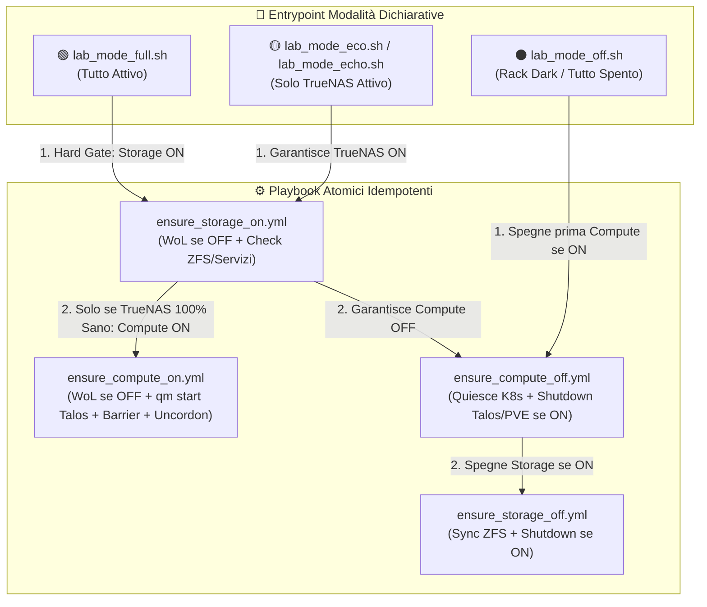

# Piano: Script Idempotenti di Convergenza Stato Homelab (`lab_mode_full`, `lab_mode_eco`, `lab_mode_off`)

Questo piano definisce la rifattorizzazione architetturale e l'implementazione dei tre entrypoint dichiarativi ("State-Driven") in `scripts/infrastructure/` per portare l'infrastruttura Homelab nello stato desiderato **partendo da qualsiasi configurazione iniziale** (Rack Spento, Modalità Eco, Full Mode o stato parziale/ibrido).

---

## 🏛️ Pattern Architetturali Attivi Adottati

In conformità alle regole di governance del repository (`<routing_rules_patterns>`), il piano adotta i seguenti due pattern attivi e certificati nel Wiki:

1. **[[hierarchical-automation-alerting-pattern]]** ([`hierarchical-automation-alerting-pattern.md`](file:///Users/olindo/prj/k8s-lab/wiki/patterns/hierarchical-automation-alerting-pattern.md)):
   - I nuovi script `lab_mode_*` operano come **Orchestratori Root** tramite [`procedure_scope.sh`](file:///Users/olindo/prj/k8s-lab/scripts/infrastructure/procedure_scope.sh), gestendo l'ambiente di processo e deduplicando automaticamente le notifiche.
   - **Zero start emails**: all'avvio viene inviato solo un breve ping Telegram se la procedura è Root.
   - **Single summary alert**: una sola email HTML riassuntiva e un messaggio Telegram a fine convergenza emessi solo dall'orchestratore Root.
   - **Universal error visibility**: `trap ERR` con invio immediato di allarme Telegram ed Email con log completo allegato (`logs/automation/`), evitando alert duplicati tramite token marker `has_error_been_reported`.
2. **[[go-launcher-script-pattern]]** ([`go-launcher-script-pattern.md`](file:///Users/olindo/prj/k8s-lab/wiki/patterns/go-launcher-script-pattern.md)):
   - Intestazione descrittiva sulla riga 2, risoluzione dinamica di `ROOT_DIR` (CWD independence) e permessi `chmod +x` per l'integrazione immediata nel launcher [`scripts/go.py`](file:///Users/olindo/prj/k8s-lab/scripts/go.py).

---

## 🏗️ Architettura Rifattorizzata: I 2 Livelli Fisici e i 4 Mattoni Atomici

Per eliminare l'accoppiamento rigido e i fallimenti da configurazioni inattese, l'infrastruttura viene disaccoppiata in **due livelli fisici indipendenti**:
- **Layer Storage**: TrueNAS SCALE Bare Metal (`10.10.20.50`, ZFS `stripe` e `oliraid`, share NFS e servizi container).
- **Layer Compute**: Hypervisor Proxmox VE (`pve1`, `pve2`, `pve3`) e Cluster Kubernetes Talos (`cp-01`, `cp-02`, `cp-03`).

### I 4 Playbook Atomici Idempotenti (`ansible/playbooks/infrastructure/`)

1. **`ensure_storage_on.yml`** (Garantisce Storage TrueNAS ONLINE):
   - Probe porta 22 su `10.10.20.50` (timeout 2s).
   - Se spento: invio Magic Packet WoL via `scripts/network/wake_node.py truenas`.
   - Se già online: salta il WoL (`SKIP WoL`).
   - Gate bloccanti: SSH 22, WebUI 443, integrità ZFS (`zpool status -x`: `all pools are healthy`) e servizi (3000, 8080, 8096, NFS).
2. **`ensure_storage_off.yml`** (Garantisce Storage TrueNAS OFFLINE):
   - Probe porta 22 su `10.10.20.50` (timeout 2s).
   - Se già offline: skip immediato in 1 secondo.
   - Se online: flush preventivo buffer ZFS (`sync`), comando spegnimento `shutdown -h now`, polling porta 22 chiusa (`state: stopped`).
3. **`ensure_compute_on.yml`** (Garantisce Hypervisor PVE e Cluster Talos ONLINE):
   - Probe porta 22 su `pve1`, `pve2`, `pve3` $\rightarrow$ WoL inviato solo ai nodi spenti.
   - Sui nodi PVE già online: verifica via SSH `qm status <vmid>` su VM `1300` (pve1), `2300` (pve2), `3200` (pve3); se `stopped`, avvio automatico (`qm start <vmid>`).
   - Gate bloccanti: SSH 22 e WebUI 8006 PVE, Talos API porta 50000, K8s API VIP `10.10.20.55:6443`.
   - Sync Barrier: attesa contemporanea `Ready=True` su tutti e 3 i nodi Talos, pausa di stabilizzazione CNI Flannel (10s), `kubectl uncordon` atomico parallelo, verifica Traefik VIP `10.10.20.56:443` e database PostgreSQL CNPG.
4. **`ensure_compute_off.yml`** (Garantisce Hypervisor PVE e Cluster Talos OFFLINE):
   - Probe K8s VIP `10.10.20.55:6443` $\rightarrow$ se online: Cordon globale nodi, CNPG `CHECKPOINT;`, `talosctl shutdown`, attesa chiusura porte 50000, 6443, 443. Se offline: skip K8s.
   - Probe PVE nodi 22 $\rightarrow$ se online: invio `shutdown -h now` ACPI (PVE3, PVE2, PVE1), attesa porte 22 e 8006 chiuse. Se offline: skip PVE.
   - *Completamente disaccoppiato da TrueNAS: zero chiamate SSH a TrueNAS, nessun rischio di fallimento a rack spento!*

---

## 🧭 Matrice degli Script Dichiarativi (`scripts/infrastructure/`)

### Regole Vincolanti di Sequenza & Protezione Storage:
1. **TrueNAS come Hard Gate su `lab_mode_full`**: Proxmox e Talos NON vengono toccati né svegliati se il Gate TrueNAS (`ensure_storage_on`) non supera il 100% dei controlli (SSH, WebUI, pool `stripe` e `oliraid` sani, export NFS).
2. **TrueNAS spento per ultimo su `lab_mode_off`**: K8s e Proxmox vengono spenti prima, permettendo ai mount NFS di rilasciare i file in modo pulito mentre TrueNAS è ancora operativo. Solo a PVE spento TrueNAS effettua il flush ZFS e lo shutdown.

---

## 📋 Fasi Operative di Esecuzione

### FASE 1: Creazione dei 4 Playbook Atomici Ansible
- [x] Creare `ansible/playbooks/infrastructure/ensure_storage_on.yml` (rifattorizzato da `startup_truenas_only.yml`).
- [x] Creare `ansible/playbooks/infrastructure/ensure_storage_off.yml` (rifattorizzato da `shutdown_all_lab.yml` tag truenas).
- [x] Creare `ansible/playbooks/infrastructure/ensure_compute_on.yml` (rifattorizzato da `startup_from_truenas_only.yml` con aggiunta del check idempotente `qm status` / `qm start` per VM Talos `1300`, `2300`, `3200`).
- [x] Creare `ansible/playbooks/infrastructure/ensure_compute_off.yml` (rifattorizzato da `shutdown_to_truenas_only.yml` privo di task TrueNAS).
- [x] Verifica sintattica: `ansible-playbook --syntax-check` su tutti i 4 playbook.

### FASE 2: Creazione dei 3 Script Dichiarativi e Alias
- [x] Creare `scripts/infrastructure/lab_mode_full.sh` con pattern [[hierarchical-automation-alerting-pattern]] e [[go-launcher-script-pattern]].
- [x] Creare `scripts/infrastructure/lab_mode_eco.sh` (con symlink `lab_mode_echo.sh` in `scripts/infrastructure/` per supportare al 100% entrambi i comandi).
- [x] Creare `scripts/infrastructure/lab_mode_off.sh`.
- [x] Permessi `chmod +x` sugli script.
- [x] Verifica sintattica: `bash -n scripts/infrastructure/lab_mode_*.sh`.

### FASE 3: Allineamento Script Legacy & Launcher `scripts/go.py`
- [x] Riconfigurare i vecchi playbook e script per puntare ai nuovi mattoni atomici o delegare direttamente ai `lab_mode_*`, evitando duplicazioni di logica.
- [x] Verifica menu interattivo: test di rendering del menu in `scripts/go.py`.

### FASE 4: Consolidamento Documentale & Wiki
- [x] Aggiornare `wiki/workflows/Power_Sequence.md` con i nuovi 3 comandi `lab_mode_*` e la matrice degli stati.
- [x] Aggiornare `in_use_by` nei pattern [[hierarchical-automation-alerting-pattern]] e [[go-launcher-script-pattern]].
- [x] Esecuzione validazione e build contesto Wiki: `python3 scripts/network/validate_network.py && python3 scripts/wiki/build_wiki_context.py`.
- [x] Chiusura task in `todo.md`.

---

## 💾 Stato di Ripristino (AI Save-State)
- **Fase Attiva**: [x] COMPLETATO (100% Task Eseguiti e Convalidati)
- **Ultima Azione Completata**: Implementati i 4 playbook atomici Ansible, i 3 script shell `lab_mode_*` (con alias `lab_mode_echo.sh`), allineati gli script legacy, aggiornati `Power_Sequence.md`, `in_use_by` nei pattern e compilato il contesto Wiki.
- **Prossimo Passo Operativo**: Nessuno. Pieno supporto e convergenza idempotente attiva per `lab_mode_full`, `lab_mode_eco` e `lab_mode_off`.
- **Blocchi/Decisioni Pendenti**: Nessuno.
