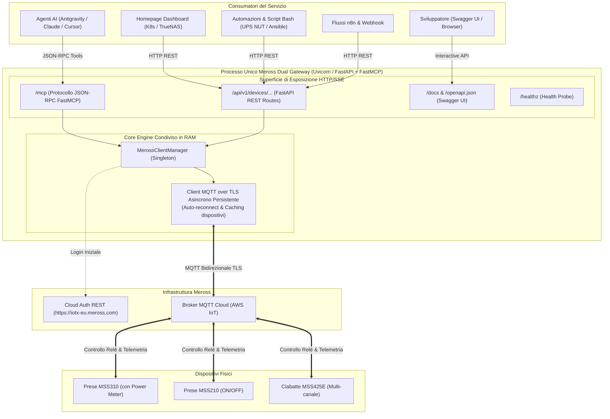

# Piano: Creazione Progetto Git Standalone & Sviluppo Meross Dual Gateway (MCP + REST API)

Questo documento definisce il piano architetturale e operativo per la realizzazione di un progetto **GitHub autonomo Open-Source** (`pindaroli/meross-mcp` ospitato localmente in `/Users/olindo/prj/meross-mcp`), conforme al pattern canonico [[zero-install-executable-package-pattern]].

Il progetto adotta un'architettura **Dual Gateway**: un unico processo asincrono basato su **FastAPI** e **FastMCP** che condivide in memoria un pool di connessione MQTT persistente verso i broker Meross, esponendo simultaneamente:
1. **Interfaccia MCP (Model Context Protocol)**: per agenti AI (Google Antigravity, Claude Desktop, Cursor) sia via `stdio` locale sia via endpoint HTTP/SSE `/mcp`.
2. **Interfaccia REST API completa**: per automazioni tradizionali (dashboard Homepage K8s/TrueNAS, n8n, webhook, script di shutdown UPS NUT, chiamate `curl`), con documentazione interattiva OpenAPI / Swagger su `/docs`.
3. **Libreria Python Standard**: installabile via `pip install meross-mcp` o `uv add meross-mcp` per essere importata in altri script applicativi (`from meross_mcp import MerossClientManager`).

---

## 🗺️ Mappe Concettuali e Relazioni
- [[zero-install-executable-package-pattern]] (Standard architetturale per pacchetti zero-install on-demand ed esecuzione effimera)
- [[MCP_Platform]] (Piattaforma e client MCP del lab)
- [[Homepage]] (Integrazione pulsanti e widget di monitoraggio energetico)
- [[mcp-secret-projection-pattern]] (Proiezione sicura delle credenziali `MEROSS_*`)
- [[SCHEMA]] (Regole di compilazione e governance del Wiki)

---

## 1. Architettura del Dual Gateway (MCP + REST)



---

## 2. Specifica delle Interfacce

### A. Catalogo Strumenti MCP (per Client AI)
| Nome Tool | Parametri | Descrizione |
| :--- | :--- | :--- |
| `meross_list_devices` | *nessuno* | Elenca tutte le prese/ciabatte Meross censite (UUID, nome, modello, canali, stato online). |
| `meross_get_device_state` | `device_id_or_name: str` | Stato approfondito del dispositivo (canali ON/OFF, Wi-Fi, firmware). |
| `meross_turn_on` | `device_id_or_name: str`, `channel: int = 0` | Accende la presa o un canale specifico. |
| `meross_turn_off` | `device_id_or_name: str`, `channel: int = 0` | Spegne la presa o un canale specifico. |
| `meross_toggle` | `device_id_or_name: str`, `channel: int = 0` | Inverte lo stato ON/OFF attuale. |
| `meross_get_electricity` | `device_id_or_name: str` | Lettura telemetria istantanea ($W$, $V$, $A$) per modelli con misuratore di potenza. |

### B. Specifica REST API (per Homepage, Script e Automazioni)
| Metodo | Endpoint | Descrizione | Utilizzo Tipico |
| :--- | :--- | :--- | :--- |
| `GET` | `/healthz` | Health check probe (200 OK) | Uptime Kuma, Docker healthcheck |
| `GET` | `/docs` | Interfaccia grafica interattiva Swagger UI | Debug e test manuale da browser |
| `GET` | `/api/v1/devices` | Lista completa delle prese e stati correnti | Widget Homepage, discovery |
| `GET` | `/api/v1/devices/{id}` | Dettaglio stato singola presa/ciabatta | Ispezione di stato |
| `POST` | `/api/v1/devices/{id}/on` | Accensione (`?channel=0`) | Script di avvio macchine / carichi |
| `POST` | `/api/v1/devices/{id}/off` | Spegnimento (`?channel=0`) | Script shutdown UPS NUT |
| `POST` | `/api/v1/devices/{id}/toggle` | Inversione stato (`?channel=0`) | Pulsante rapido card Homepage |
| `GET` | `/api/v1/devices/{id}/power` | Metriche energetiche istantanee (Watt, Volt, Ampere) | Widget telemetria Homepage |

---

## 3. Struttura del Repository Standalone (`/Users/olindo/prj/meross-mcp/`)

```
/Users/olindo/prj/meross-mcp/
├── .git/
├── .github/
│   └── workflows/
│       ├── test.yml          # CI: Test matrix su Python 3.10-3.13 con pytest e ruff
│       └── publish.yml       # CD: Pubblicazione automatica su PyPI e GitHub Releases a ogni tag v*
├── .env.example              # Template variabili d'ambiente (MEROSS_EMAIL, MEROSS_PASSWORD, API_KEY opzionale)
├── .gitignore                # Ignora cache, virtualenv, file .env, build artifacts
├── LICENSE                   # Licenza Open Source MIT
├── README.md                 # Guida completa: Uso Zero-Install, REST API con curl, MCP config e libreria
├── pyproject.toml            # PEP 621 con Hatchling, [project.scripts] console_scripts
├── Dockerfile                # Immagine OCI minimale multi-stage unprivileged (UID 1000)
├── docker-compose.yaml       # Compose pronto per esecuzione standalone o su TrueNAS (porta 8112)
├── src/
│   └── meross_mcp/
│       ├── __init__.py       # Esportazione pubblica classi libreria e versione (0.1.0)
│       ├── config.py         # Settings tipizzati Pydantic (lettura automatica env vars)
│       ├── client.py         # ClientManager asincrono (MerossHttpClient + MerossManager MQTT)
│       ├── devices.py        # Astrazione comandi, canali e parsing telemetria
│       ├── api.py            # Router FastAPI per le REST API (/api/v1/devices)
│       ├── server.py         # Server FastMCP con i tool per l'AI
│       └── app.py            # Applicazione aggregatrice FastAPI (monta sia FastMCP che le REST routes)
└── tests/
    ├── __init__.py
    ├── conftest.py           # Fixture mock per Meross Cloud e broker MQTT
    ├── test_client.py        # Test unitari della libreria Python
    ├── test_api.py           # Test delle route REST con httpx.AsyncClient
    └── test_server.py        # Test di contratto dei tool MCP
```

---

## 4. Modalità di Esecuzione e Consumo

### 1. Esecuzione On-Demand Zero-Install (Senza Installazione Permanente)
Chiunque può avviare il gateway completo (MCP + REST + Swagger) con una sola riga di comando:

```bash
# Da GitHub (pre-release immediata):
MEROSS_EMAIL="user@example.com" MEROSS_PASSWORD="password" \
uvx --from git+https://github.com/pindaroli/meross-mcp.git meross-mcp --port 8112

# Da PyPI (post-release):
MEROSS_EMAIL="user@example.com" MEROSS_PASSWORD="password" \
uvx meross-mcp --port 8112
```
Una volta avviato:
- Interfaccia MCP disponibile per Antigravity su `http://localhost:8112/mcp`
- REST API disponibile per script su `http://localhost:8112/api/v1/devices`
- Documentazione interattiva su `http://localhost:8112/docs`

### 2. Esecuzione Locale Stdio Dedicata ad Antigravity
Se si desidera eseguire il tool solo per l'AI tramite pipe stdio:
```bash
meross-mcp --transport stdio
```

### 3. Utilizzo come Libreria Python Tradizionale
```python
import asyncio
from meross_mcp import MerossClientManager, MerossSettings

async def main():
    settings = MerossSettings(email="...", password="...")
    async with MerossClientManager(settings) as client:
        devices = await client.list_devices()
        print(f"Prese connesse: {[d.name for d in devices]}")

asyncio.run(main())
```

---

## 5. Fasi Operative del Piano

### Fase 1: Scaffolding del Repository Git Standalone
- Creazione directory `/Users/olindo/prj/meross-mcp`.
- Inizializzazione Git (`git init -b main`).
- Creazione `LICENSE` (MIT), `.gitignore`, `.env.example`, `README.md`.
- Configurazione `pyproject.toml` (PEP 621 con Hatchling, dipendenze: `meross-iot==0.4.10.4`, `fastmcp>=0.4.0`, `fastapi>=0.115.0`, `uvicorn>=0.30.0`, `pydantic>=2.0.0`, `python-dotenv>=1.0.0` e console script `meross-mcp = "meross_mcp.app:main"`).

### Fase 2: Implementazione Core Libreria Asincrona (`src/meross_mcp/`)
- `config.py`: classe `MerossSettings` (Pydantic BaseSettings da env).
- `client.py`: classe `MerossClientManager` con pooling MQTT asincrono, lifecycle management e graceful teardown.
- `devices.py`: helper per comandi di commutazione, gestione canali e lettura telemetria elettrica.
- `__init__.py`: esportazione API pubblica per uso come libreria.

### Fase 3: Implementazione REST API & FastMCP Server
- `api.py`: router FastAPI (`/api/v1/devices`) con risposte JSON strutturate e gestione errori.
- `server.py`: istanza FastMCP che espone i 6 tool semantici per l'AI.
- `app.py`: applicazione principale che integra sia l'app FastAPI (REST + `/docs`) sia l'handler FastMCP (`/mcp`), con CLI argument parser (`--port`, `--host`, `--transport stdio|http`).

### Fase 4: Test Suite con Mocking Completo
- `tests/conftest.py`: fixture mock per `MerossHttpClient` e `MerossManager` (nessuna dipendenza da credenziali reali nei test unitari).
- `tests/test_client.py`: test della libreria.
- `tests/test_api.py`: test degli endpoint REST con `httpx.AsyncClient`.
- `tests/test_server.py`: test dei tool MCP.
- Esecuzione validata con `uv run pytest`.

### Fase 5: GitHub Actions CI/CD
- `.github/workflows/test.yml`: test automatici su matrice Python 3.10-3.13 e linting con `ruff`.
- `.github/workflows/publish.yml`: build automatizzata wheel/sdist e pubblicazione su PyPI e GitHub Releases al push di tag `v*`.

### Fase 6: Containerizzazione & Integrazione Homelab
- `Dockerfile` multi-stage unprivileged (`UID 1000`).
- Registrazione del server MCP in `~/.gemini/antigravity/mcp_config.json`.
- Esecuzione smoke test di verifica sia per i tool MCP che per una chiamata REST `curl`.

### Fase 7: Consolidamento Documentale & Knowledge Base Wiki
- Aggiornamento dell'elenco `in_use_by` in [[zero-install-executable-package-pattern]].
- Aggiornamento della documentazione [[MCP_Platform]].
- Chiusura task in `todo.md` e sincronizzazione del contesto wiki.

---

## 💾 Stato di Ripristino (AI Save-State)
- **Fase Attiva**: Fase 6 (Integrazione in Antigravity `mcp_config.json` & Validazione Zero-Install)
- **Ultima Azione Completata**: Fase 5 completata al 100% con commit `3c4274c` su GitHub ([pindaroli/meross-mcp](https://github.com/pindaroli/meross-mcp)): pipeline CI `test.yml` e CD `publish.yml`, `Dockerfile` multi-stage unprivileged (UID 1000) e `docker-compose.yaml` rilasciati.
- **Prossimo Passo Operativo**: Configurazione centralizzata del server `meross` in `~/.gemini/antigravity/mcp_config.json` con comando `uvx --from git+https://github.com/pindaroli/meross-mcp.git meross-mcp --transport stdio` e test di parsing JSON.
- **Blocchi/Decisioni Pendenti**: Attesa approvazione per avviare la Fase 6.
