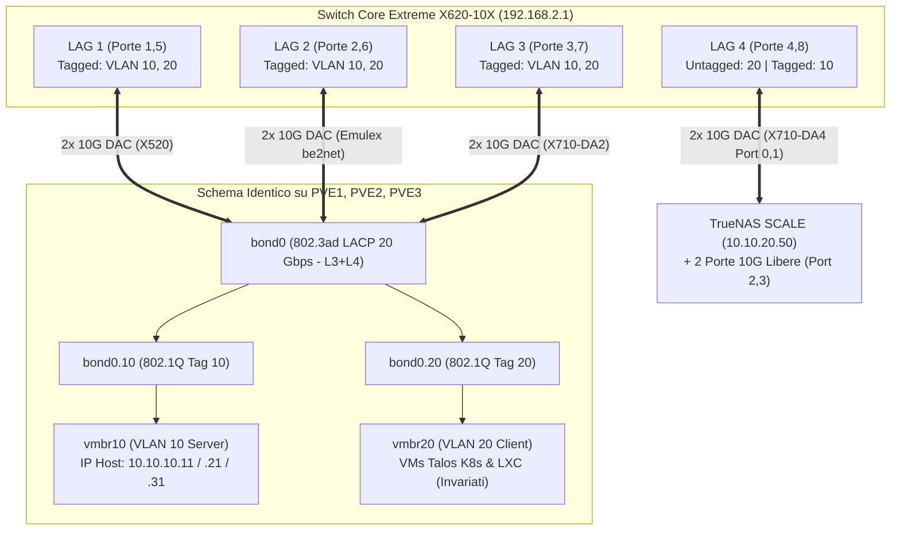

# Triangolo Schede 10G SFP+ (`pve1` $\rightarrow$ `truenas` $\rightarrow$ `opnsense`) & Bond LACP 802.3ad sui 3 Nodi Proxmox

Questo piano coordina in un'unica operazione ingegneristica due obiettivi complementari:
1. **LACP 802.3ad (`bond0` 20 Gbps) sui tre nodi Proxmox (`pve1`, `pve2`, `pve3`)**: unione delle due interfacce da 10 Gbps di ciascun nodo in un aggregato LACP `layer3+4` verso lo Switch Core Extreme X620-10X (`192.168.2.1`), **lasciando inalterati gli schemi delle VLAN e dei bridge (`vmbr10` su VLAN 10 e `vmbr20` su VLAN 20)** per tutte le VM e i container LXC.
2. **Il "Triangolo Perfetto" delle Schede 10G SFP+ (Zero Schede Avanzate)**: rotazione fisica ottimale delle 3 schede PCIe 10GbE tra `pve1`, `truenas` e `opnsense` per massimizzare l'efficienza termica, energetica e la densità di porte.

---

## 🔄 1. Architettura del "Triangolo Perfetto" (3 Nodi, Zero Schede Avanzate)

Dall'ispezione hardware live effettuata sui nodi (`lspci -nn`, `pciconf -lv`, `ifconfig`, `/usr/local/lib/systemd/network/`), ecco la mappa esatta di partenza e di arrivo delle 3 schede:

| Scheda Fisica 10G SFP+ | PCI ID / Chipset | Nodo Attuale | Nodo Finale | MAC Addresses Fisici Rilevati | Motivazione Ingegneristica & Termica |
| :--- | :--- | :--- | :--- | :--- | :--- |
| **Intel X710-DA4** *(Quad-Port 4x 10G)* | `8086:1572` (rev 01) | **`pve1`** | **`truenas`** (`10.10.20.50`) | Port 0: `3c:fd:fe:05:5e:a0`<br/>Port 1: `3c:fd:fe:05:5e:a2`<br/>Port 2: `3c:fd:fe:05:5e:a4`<br/>Port 3: `3c:fd:fe:05:5e:a6` | Su `pve1` 2 porte su 4 erano inutilizzate. Su **TrueNAS** mantiene il `bond0` LACP (Port 0 e Port 1) e rende disponibili **2 ulteriori porte 10G SFP+** (`enp1s0f2np2`, `enp1s0f3np3`) per future espansioni. |
| **Intel X710-DA2** *(Dual-Port 2x 10G)* | `8086:1572` (rev 02) | **`truenas`** | **`opnsense`** (`192.168.100.1`) | Port 0 (`ixl0`): `8c:fd:18:f7:f5:92`<br/>Port 1 (`ixl1`): `8c:fd:18:f7:f5:93` | Scheda ideale per **OPNsense**: driver nativo FreeBSD `if_ixl` già integrato nel kernel di OPNsense 26.1 (`pci/ixl`), consumo ~4W, calore nullo e pieno supporto VLAN 802.1Q. |
| **Emulex OneConnect** *(Dual-Port 2x 10G)* | `10df:0720` (Skyhawk) | **`opnsense`** | **`pve1`** (`10.10.10.11`) | Port 0 (`nic1`): `70:10:6f:ef:59:20`<br/>Port 1 (`nic2`): `70:10:6f:ef:59:28` | Su **`pve1`** dispone del supporto con **ventola dedicata puntata direttamente sul dissipatore** e del driver nativo Linux `be2net.ko`, fornendo esattamente le 2 porte 10G necessarie per il nuovo `bond0`. |

> [!TIP]
> **`pve2` e `pve3` non vengono toccati fisicamente**:
> - `pve2` (`10.10.10.21`) conserva la sua **Intel X710-DA2** (`enp1s0f0np0` `3c:fd:fe:d5:9c:cc` + `enp1s0f1np1` `3c:fd:fe:d5:9c:cd`).
> - `pve3` (`10.10.10.31`) conserva la sua **Intel X520-DA2** (`enp5s0f0` `f4:4c:7f:1d:a2:68` + `enp5s0f1` `f4:4c:7f:1d:a2:69`).

---

## 🔗 2. Architettura del Bond LACP 802.3ad sui 3 Nodi Proxmox & Switch Extreme

### Geometria Simmetrica sullo Switch Extreme X620-10X (`192.168.2.1`)
Attualmente ogni nodo Proxmox ha la Porta 1 in Access su VLAN 10 (`server`) e la Porta 2 in Access su VLAN 20 (`client`), senza ridondanza né aggregazione di banda.
Unendo le coppie verticali dello switch Extreme in 3 gruppi LACP 802.3ad (`L3_L4`), l'intero switch assume una simmetria perfetta su tutte le prime 8 porte:

| Gruppo LACP Extreme | Porta Master | Porta Membro | Host Connesso | Interfacce Slave sull'Host | VLAN sul Trunk LACP |
| :---: | :---: | :---: | :--- | :--- | :--- |
| **LAG `1`** | **Porta 1** | **Porta 5** | **`pve3`** (`10.10.10.31`) | `enp5s0f0` + `enp5s0f1` $\rightarrow$ `bond0` | **VLAN 10 (`server`) Tagged** + **VLAN 20 (`client`) Tagged** |
| **LAG `2`** | **Porta 2** | **Porta 6** | **`pve1`** (`10.10.10.11`) | `nic1` + `nic2` $\rightarrow$ `bond0` | **VLAN 10 (`server`) Tagged** + **VLAN 20 (`client`) Tagged** |
| **LAG `3`** | **Porta 3** | **Porta 7** | **`pve2`** (`10.10.10.21`) | `enp1s0f0np0` + `enp1s0f1np1` $\rightarrow$ `bond0` | **VLAN 10 (`server`) Tagged** + **VLAN 20 (`client`) Tagged** |
| **LAG `4`** *(Già attivo)* | **Porta 4** | **Porta 8** | **`truenas`** (`10.10.20.50`) | `enp1s0f0np0` + `enp1s0f1np1` $\rightarrow$ `bond0` | VLAN 20 (`client`) Untagged + VLAN 10 (`server`) Tagged |

### Preservazione Totale degli Schemi VLAN (`vmbr10` e `vmbr20`) su Proxmox VE
Su ciascuno dei tre nodi Proxmox (`pve1`, `pve2`, `pve3`), lo stack di rete viene strutturato a 3 livelli:
1. **Livello 1 — Aggregazione LACP (`bond0`)**:
   - Unisce le due porte 10G (`bond-mode 802.3ad`, `bond-miimon 100`, `bond-xmit-hash-policy layer3+4`).
2. **Livello 2 — Demuxing 802.1Q (`bond0.10` e `bond0.20`)**:
   - `bond0.10` estrae la VLAN 10 (`server`).
   - `bond0.20` estrae la VLAN 20 (`client`).
3. **Livello 3 — Bridge Proxmox Invariati (`vmbr10` e `vmbr20`)**:
   - **`vmbr10`** (`bridge-ports bond0.10`): mantiene l'IP statico del nodo (`10.10.10.11/24`, `10.10.10.21/24`, `10.10.10.31/24`) e il gateway `10.10.10.1`. Corosync e PBS continuano a operare senza modifiche.
   - **`vmbr20`** (`bridge-ports bond0.20`): resta un bridge untagged puro dedicato alla VLAN 20. **Nessuna VM (`talos-cp-01/02/03`, `olilab-worker`) e nessun LXC (`lxc-ollama`, `lxc-steam`) deve essere riconfigurato.**



> [!IMPORTANT]
> **Vantaggio Fisico durante il Cablaggio**:
> Poiché sia `pve1` (LAG 2: Porte 2 e 6) sia `truenas` (LAG 4: Porte 4 e 8) operano in **LACP `bond0`**, durante il ricollegamento fisico dei cavi DAC **l'ordine dei due cavi tra la Porta 0 e la Porta 1 della scheda è totalmente indifferente**!

---

## 🛠️ Piano Operativo Passo-Passo (Test-Driven)

### FASE 1: Unione in `bond0` LACP 802.3ad sui 3 Nodi Proxmox (`pve1`, `pve2`, `pve3`) & Switch Extreme (A Caldo via OOB)

Eseguiamo per prima cosa la trasformazione in `bond0` LACP a sistema acceso operando dalla rete **OOB VLAN 99 (`192.168.100.11`, `192.168.100.21`, `192.168.100.31`)**, così da validare immediatamente l'architettura LACP su tutti e 3 i nodi Proxmox prima ancora di spegnere le macchine per il cambio schede.

#### Step 1.1: Backup e Aggiornamento `/etc/network/interfaces` su `pve1`, `pve2`, `pve3` (via OOB)
1. **Su `pve1` (`192.168.100.11`)** — Slaves: `nic1 nic2` (con tuning preventivo `ethtool -K` per disabilitare il filtro VLAN hardware del driver Emulex `be2net` sotto bridge/bond):
   ```ini
   auto lo
   iface lo inet loopback

   auto nic0
   iface nic0 inet static
       address 192.168.100.11/24
       post-up ethtool -s nic0 wol g

   iface nic1 inet manual
       pre-up ethtool -K nic1 rxvlan off txvlan off rx-vlan-filter off 2>/dev/null || true

   iface nic2 inet manual
       pre-up ethtool -K nic2 rxvlan off txvlan off rx-vlan-filter off 2>/dev/null || true

   auto bond0
   iface bond0 inet manual
       bond-slaves nic1 nic2
       bond-miimon 100
       bond-mode 802.3ad
       bond-xmit-hash-policy layer3+4

   auto bond0.10
   iface bond0.10 inet manual

   auto bond0.20
   iface bond0.20 inet manual

   auto vmbr10
   iface vmbr10 inet static
       address 10.10.10.11/24
       gateway 10.10.10.1
       bridge-ports bond0.10
       bridge-stp off
       bridge-fd 0

   auto vmbr20
   iface vmbr20 inet manual
       bridge-ports bond0.20
       bridge-stp off
       bridge-fd 0
   ```
   > [!NOTE]
   > **Perché `rxvlan off txvlan off rx-vlan-filter off` su `pve1` (`be2net`)**:
   > Quando le porte Emulex OneConnect (`be2net`) sono slave di `bond0` con sotto-interfacce `bond0.10` / `bond0.20` collegate ai bridge Proxmox (`vmbr10` / `vmbr20`, dove transitano i MAC secondari delle VM come `talos-cp-01` e il VIP `10.10.20.55`), disabilitare il filtro e l'offload VLAN sull'ASIC Skyhawk impedisce che il chip scarti i tag 802.1Q destinati ai MAC delle VM in modalità promiscua, lasciando intatti RSS multi-coda e checksum TCP/IP.
2. **Su `pve2` (`192.168.100.21`)** — Slaves: `enp1s0f0np0 enp1s0f1np1`:
   - Stessa struttura identica con `bond-slaves enp1s0f0np0 enp1s0f1np1` e `address 10.10.10.21/24` su `vmbr10`.
3. **Su `pve3` (`192.168.100.31`)** — Slaves: `enp5s0f0 enp5s0f1`:
   - Stessa struttura identica con `bond-slaves enp5s0f0 enp5s0f1` e `address 10.10.10.31/24` su `vmbr10`.
4. **Test di Verifica Step 1.1**:
   - Eseguire `ifreload -a -n` (dry-run di `ifupdown2`) su `pve1`, `pve2`, `pve3` per verificare l'assenza di errori sintattici prima dell'attivazione.

#### Step 1.2: Esecuzione Playbook Ansible su Switch Extreme (`ansible/playbooks/exos_proxmox_lacp_bonds.yml`) & `ifreload -a`
1. **Azione Switch Extreme (`192.168.2.1`)**:
   - Esecuzione del playbook `ansible/playbooks/exos_proxmox_lacp_bonds.yml` che:
     - Allinea temporaneamente le porte membro `5, 6, 7` nella VLAN `server` per consentire il grouping EXOS.
     - Attiva LACP 802.3ad (`L3_L4`):
       - `enable sharing 1 grouping 1,5 algorithm address-based L3_L4 lacp` (`pve3`)
       - `enable sharing 2 grouping 2,6 algorithm address-based L3_L4 lacp` (`pve1`)
       - `enable sharing 3 grouping 3,7 algorithm address-based L3_L4 lacp` (`pve2`)
     - Rimuove `server` untagged da `1,2,3` e imposta sia `server` (VLAN 10) sia `client` (VLAN 20) come **tagged** sui master `1, 2, 3`.
     - Salva la configurazione in `primary.cfg` (`save configuration primary`).
2. **Azione Nodi Proxmox (via OOB `192.168.100.11/21/31`)**:
   - Esecuzione simultanea di `ifreload -a` su `pve1`, `pve2`, `pve3`.
3. **Test di Verifica Step 1.2**:
   - Su Switch Extreme: `show sharing` deve mostrare i 4 gruppi (`1`, `2`, `3`, `4`) con tutte le 8 porte `1..8` nello stato `Y / A` (Active).
   - Sui 3 nodi Proxmox: `cat /proc/net/bonding/bond0` (verifica `802.3ad` e 2 interfacce slave UP a 10 Gbps).
   - Verifica raggiungibilità IP VLAN 10 (`10.10.10.11`, `10.10.10.21`, `10.10.10.31`), quorum `pvecm status` (3/3) e nodi K8s VLAN 20 (`kubectl get nodes` 3/3 Ready).

---

### FASE 2: Pre-Configurazione Software "Zero-Console" per lo Scambio Schede (`pve1`, `opnsense`, `truenas`)

Prima di spegnere le macchine per lo scambio fisico delle 3 schede PCIe, prepariamo via SSH i mapping dei driver e dei MAC address affinché al riavvio tutte le macchine salgano direttamente in rete senza bisogno di monitor o tastiera.

#### Step 2.1: Pre-Mapping MAC Emulex (`nic1`, `nic2`) su `pve1` (`192.168.100.11`)
Su `pve1`, i nomi `nic1` e `nic2` usati in `bond0` sono governati dai file `/usr/local/lib/systemd/network/50-pmx-nic*.link`.
1. Aggiorniamo `50-pmx-nic1.link` con il MAC della Porta 0 della Emulex OneConnect (`70:10:6f:ef:59:20`):
   ```ini
   [Match]
   MACAddress=70:10:6f:ef:59:20
   Type=ether

   [Link]
   Name=nic1
   ```
2. Aggiorniamo `50-pmx-nic2.link` con il MAC della Porta 1 della Emulex OneConnect (`70:10:6f:ef:59:28`):
   ```ini
   [Match]
   MACAddress=70:10:6f:ef:59:28
   Type=ether

   [Link]
   Name=nic2
   ```
3. Rimuoviamo `50-pmx-nic3.link` e `50-pmx-nic4.link` (relativi alle porte 3 e 4 della vecchia X710-DA4) e rigeneriamo l'initramfs:
   ```bash
   rm -f /usr/local/lib/systemd/network/50-pmx-nic3.link /usr/local/lib/systemd/network/50-pmx-nic4.link
   update-initramfs -u -k all
   ```
4. **Test di Verifica Step 2.1**:
   - Verifica contenuto di `/usr/local/lib/systemd/network/50-pmx-nic1.link` e `50-pmx-nic2.link` e presenza di `be2net.ko` nell'initramfs (`lsinitramfs /boot/initrd.img-$(uname -r) | grep be2net`).

#### Step 2.2: Pre-Conversione Interfacce `oce0` $\rightarrow$ `ixl0` su `opnsense` (`192.168.100.1`)
Su OPNsense 26.1, il driver Intel Fortville `if_ixl` (`pci/ixl`) è già compilato nativamente nel kernel FreeBSD: la scheda Intel X710-DA2 proveniente da TrueNAS verrà enumerata come **`ixl0`** (Porta 0, MAC `8c:fd:18:f7:f5:92`) e **`ixl1`** (Porta 1, MAC `8c:fd:18:f7:f5:93`).
1. Backup di sicurezza di `/conf/config.xml` in `/conf/config.xml.bak_pre_ixl` e in locale sul Mac Studio.
2. Conversione automatica di `/conf/config.xml` su OPNsense:
   - Nelle definizioni `<vlans>`: `<if>oce0</if>` $\rightarrow$ `<if>ixl0</if>` e `<vlanif>oce0_vlanXX</vlanif>` $\rightarrow$ `<vlanif>ixl0_vlanXX</vlanif>` (per i tag `10`, `20`, `30`, `99`).
   - Nelle assegnazioni `<interfaces>`:
     - `<lan><if>` (`ADMIN_LAN` `192.168.100.1/24`) $\rightarrow$ `ixl0_vlan99`
     - `<opt1><if>` (`LAN_SERVER`) $\rightarrow$ `ixl0_vlan10`
     - `<opt2><if>` (`LAN_CLIENT`) $\rightarrow$ `ixl0_vlan20`
     - `<opt3><if>` (`LAN_IOT`) $\rightarrow$ `ixl0_vlan30`
     - `<opt4><if>` (`TRANSIT` `192.168.2.254/24`) $\rightarrow$ `ixl0`
     - `<wan><if>` resta invariato su `re0`.
3. Pulizia di `/boot/loader.conf.local` rimuovendo `if_oce_load="YES"`.
4. **Test di Verifica Step 2.2**:
   - Validazione XML con `php -r 'simplexml_load_file("/conf/config.xml") or exit(1); echo "XML_OK\n";'` e verifica diff delle sole righe `<if>` e `<vlanif>`.

#### Step 2.3: Verifica Pre-Flight su `truenas` (`10.10.20.50`)
- Su TrueNAS, `bond0` utilizza i nomi interfaccia prevedibili PCIe `enp1s0f0np0` (`01:00.0`) e `enp1s0f1np1` (`01:00.1`), senza vincoli di MAC address sui membri fisici.
- Installando la X710-DA4 nello stesso slot PCIe (`01:00.0..3`), le prime due porte manterranno esattamente i nomi `enp1s0f0np0` e `enp1s0f1np1`, mentre le porte 3 e 4 compariranno come `enp1s0f2np2` e `enp1s0f3np3`. Non occorre alcuna modifica software preventiva su TrueNAS.

---

### FASE 3: Spegnimento Ordinato, Scambio Fisico delle 3 Schede e Riaccensione

#### Step 3.1: Spegnimento Controllato dell'Infrastruttura
Poiché lo scambio fisico coinvolge contemporaneamente **TrueNAS** (storage NFS del cluster), **PVE1** e **OPNsense**:
1. Eseguire lo spegnimento ordinato del lab tramite `./scripts/infrastructure/shutdown_all_lab.sh` (che ferma in sicurezza i workload K8s, i nodi Talos, le VM/LXC, i nodi Proxmox, PBS e TrueNAS).
2. Spegnere infine OPNsense via SSH:
   ```bash
   ssh root@192.168.100.1 "poweroff"
   ```

#### Step 3.2: Esecuzione Fisica del "Triangolo Perfetto" (A Cura dell'Utente)
A macchine spente e scollegate dalla corrente:
1. **`pve1` $\rightarrow$ `truenas` (Intel X710-DA4 4 porte)**:
   - Smontare la **Intel X710-DA4 (4 porte)** da `pve1` e installarla nello slot PCIe di **`truenas`**.
   - Collegare i due cavi DAC di TrueNAS (Switch Extreme **Porte 4 e 8**) nelle prime due porte (**Porta 0** e **Porta 1**) della X710-DA4.
2. **`truenas` $\rightarrow$ `opnsense` (Intel X710-DA2 2 porte)**:
   - Smontare la **Intel X710-DA2 (2 porte)** da `truenas` e installarla nello slot PCIe di **`opnsense`**.
   - Collegare il cavo DAC 10G proveniente dalla **Porta 9 di `switch-25g-server`** nella **Porta 0 (`ixl0`)** della X710-DA2.
3. **`opnsense` $\rightarrow$ `pve1` (Emulex OneConnect 10G 2 porte)**:
   - Smontare la **Emulex OneConnect 10G (2 porte)** da `opnsense` e installarla nello slot PCIe di **`pve1`** (verificando il posizionamento della ventola dedicata sul dissipatore).
   - Collegare i due cavi DAC di `pve1` (Switch Extreme **Porte 2 e 6**) nelle due porte della Emulex (in qualsiasi ordine, grazie al LACP `bond0`).

#### Step 3.3: Riaccensione Ordinata
1. Accendere **OPNsense** e attendere ~45 secondi che `ixl0` (`192.168.2.254`) e `ixl0_vlan99` (`192.168.100.1`) siano online.
2. Avviare l'intero homelab tramite `./scripts/infrastructure/startup_all_lab.sh` (oppure accendere `truenas` e i nodi Proxmox `pve1`, `pve2`, `pve3`).

---

### FASE 4: Validazione Test-Driven End-to-End & Allineamento Documentale

1. **Verifica OPNsense (`Intel X710-DA2` - `ixl0`)**:
   - `ssh root@192.168.100.1 "ifconfig ixl0; pciconf -lv | grep -B3 -A1 network"`
   - Esecuzione `./scripts/infrastructure/test_internet.sh`, `./scripts/network/test_dns.sh`, `./scripts/network/test_dhcp.sh`.
2. **Verifica TrueNAS (`Intel X710-DA4` - 4 porte 10G)**:
   - `ssh olindo@10.10.20.50 "lspci -nn | grep X710; ip -br link; cat /proc/net/bonding/bond0"`
   - Verifica presenza delle 4 interfacce `enp1s0f0np0..enp1s0f3np3`, stato `bond0` su `10.10.20.50` e raggiungibilità PBS `10.10.10.100`.
3. **Verifica `pve1` (`Emulex OneConnect` - `be2net`) e Bond LACP `pve1`, `pve2`, `pve3`**:
   - `ssh root@10.10.10.11 "lspci -nn | grep -i emulex; ip -br link; cat /proc/net/bonding/bond0"`
   - Su Switch Extreme (`192.168.2.1`): `show sharing` e `show fdb` (verifica tutti i 4 LAG `1`, `2`, `3`, `4` attivi con 8 porte `Y / A`).
   - Verifica salute cluster Proxmox (`pvecm status`) e Kubernetes Talos (`kubectl get nodes`, `kubectl get pods -A`).
4. **Allineamento Registri e Documentazione**:
   - Aggiornamento `rete.json` (nuove schede PCIe, MAC address, LAG `1, 2, 3` su Extreme Switch, `bond0` su `pve1`, `pve2`, `pve3`, `ixl0` su `opnsense`, 4 porte su `truenas`).
   - Aggiornamento `istruzioni/interfaces_pve.txt`, `istruzioni/interfaces_pve2.txt`, `istruzioni/interfaces_pve3.txt`.
   - Aggiornamento `wiki/entities/OPNsense.md`, `wiki/entities/TrueNAS.md`, `wiki/entities/Network_Registry.md`.
   - Esecuzione obbligatoria di `python3 scripts/network/validate_network.py && python3 scripts/wiki/build_wiki_context.py`.

---

## 💾 Stato di Ripristino (AI Save-State)
- **Fase Attiva**: Fase 1 — Attivazione LACP `bond0` sui 3 Nodi Proxmox (`pve1`, `pve2`, `pve3`) e Switch Extreme (`192.168.2.1`)
- **Ultima Azione Completata**: Ispezione live hardware/MAC/switch completata, piano materializzato in `wiki/plans/nic-10g-triangle-swap-and-proxmox-lacp-bond.md` e playbook `ansible/playbooks/exos_proxmox_lacp_bonds.yml` predisposto.
- **Prossimo Passo Operativo**: Attendere l'approvazione dell'utente per avviare lo **Step 1.1** (configurazione `/etc/network/interfaces` con `bond0`, `bond0.10`, `bond0.20` su `pve1`, `pve2`, `pve3` via OOB e dry-run `ifreload -a -n`).
- **Blocchi/Decisioni Pendenti**: In attesa di autorizzazione dell'utente per iniziare l'esecuzione della Fase 1.
