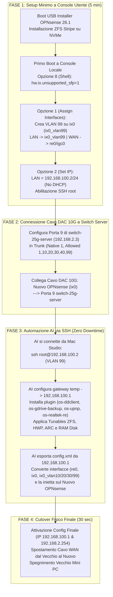

# Migrazione Macchina OPNsense su i3-12100 con MSI PRO H610M-E DDR4, NVMe, ZFS e Intel X520

Questo piano definisce la strategia operativa **Side-by-Side (Zero Conflitti & Delega Totale all'AI via SSH)** per migrare il firewall OPNsense dall'attuale Mini PC (4x 2.5GbE Intel i225/i226) alla nuova macchina con processore **Intel Core i3-12100**, scheda madre **MSI PRO H610M-E DDR4**, **16 GB di RAM**, storage **NVMe ZFS** e scheda di rete **Intel X520 Dual-Port 10G SFP+**.

### 💡 Il Paradigma Operativo: Staging Parallelo su VLAN 99 OOB (`192.168.100.2`) + Migrazione AI via SSH
Invece di importare subito il vecchio `config.xml` via USB (che causerebbe un conflitto IP immediato se collegato allo switch mentre il vecchio firewall è acceso), la procedura si divide in due parti nettissime:
1. **Setup Minimo Utente a Console (5 minuti)**:
   - Installazione pulita di OPNsense 26.1 su ZFS NVMe.
   - Configurazione della sola **VLAN 99 OOB (`ix0_vlan99`)** con IP temporaneo di staging **`192.168.100.2/24`** e attivazione di **SSH per `root`**.
   - Collegamento del cavo DAC 10G (`ix0`) alla **Porta 9 di `switch-25g-server`** (`192.168.2.3`).
2. **Migrazione Completamente Automatizzata dall'AI via SSH (`root@192.168.100.2`)**:
   - Mentre il vecchio OPNsense (`192.168.100.1` / `192.168.2.254`) continua a erogare Internet e servizi a tutto l'homelab senza interruzioni, **l'AI si collega via SSH al nuovo OPNsense (`192.168.100.2`)** attraverso la VLAN 99.
   - L'AI installa i plugin necessari (usando il vecchio OPNsense `192.168.100.1` come gateway internet temporaneo), applica il tuning ZFS/FreeBSD, esporta il `config.xml` live dal vecchio OPNsense, **converte automaticamente tutte le interfacce (`igc0` $\rightarrow$ WAN onboard, `igc1` + `igc3` $\rightarrow$ Trunk `ix0` + VLAN)** e prepara il sistema per il cutover finale di 30 secondi.

---

## 🗺️ Configurazione di Rete Finale & Mappatura VLAN

### 1. Confronto Vecchio OPNsense vs Nuovo OPNsense

Dal controllo del file di configurazione attuale (`opnsense_backup_pre_zfs_recovery_20261016.xml`) e di `rete.json`, ecco cosa esce oggi dal vecchio OPNsense e come viene consolidato sul nuovo:

| Ruolo Logico OPNsense | Nome Interno XML | Vecchio OPNsense (4x 2.5G) | Nuovo OPNsense (Onboard RJ45 + Emulex OneConnect 10G) | VLAN / Indirizzamento IP |
| :--- | :--- | :--- | :--- | :--- |
| **`WAN`** (Modem Internet) | `<wan>` | Porta fisica `igc0` (RJ45) $\rightarrow$ Modem | **Porta RJ45 Onboard** (`re0`) $\rightarrow$ Modem | **Untagged** — `DHCP` / `DHCPv6` (`blockpriv`, `blockbogons`) |
| **`TRANSIT`** (LAN Core L3) | `<opt4>` | Porta `igc1` (**Untagged VLAN 1**) su Porta 7 `switch-25g-server` | **Emulex `oce0` (Untagged VLAN 1)** su **Porta 9 SFP+ `switch-25g-server`** | **VLAN 1 Nativa (Untagged)** — IP **`192.168.2.254/24`** (Dialoga con Switch L3 Extreme `192.168.2.1`, eroga DNS Unbound, riceve DHCP Relay e instrada VLAN 10 e 20) |
| **`LAN` / `ADMIN_LAN` (OOB)** | `<lan>` | Porta dedicata `igc3` (Untagged su Porta 4 Access VLAN 99) | **Emulex `oce0_vlan99` (Tagged VLAN 99)** sul Trunk 10G (`oce0` $\rightarrow$ Porta 9 `switch-25g-server`) | **VLAN 99 Tagged** — IP di Staging: **`192.168.100.2/24`** $\rightarrow$ IP Finale al Cutover: **`192.168.100.1/24`** |
| **`LAN_SERVER`** | `<opt1>` | `igc1_vlan10` (Tagged VLAN 10) | **Emulex `oce0_vlan10` (Tagged VLAN 10)** sul Trunk 10G (`oce0`) | **VLAN 10 Tagged** — IP: `None` (Symmetric Routing L3 via `TRANSIT` `192.168.2.1`) |
| **`LAN_CLIENT`** | `<opt2>` | `igc1_vlan20` (Tagged VLAN 20) | **Emulex `oce0_vlan20` (Tagged VLAN 20)** sul Trunk 10G (`oce0`) | **VLAN 20 Tagged** — IP: `None` (Symmetric Routing L3 via `TRANSIT` `192.168.2.1`) |
| **`LAN_IOT`** | `<opt3>` | `igc1_vlan30` (Tagged VLAN 30) | **Emulex `oce0_vlan30` (Tagged VLAN 30)** sul Trunk 10G (`oce0`) | **VLAN 30 Tagged** — IP: **`10.10.30.1/24`** |
| **Seconda Porta 10G SFP+** | *(Libera)* | `igc2` (Non usata) | **Emulex `oce1` (10G SFP+)** | **Spenta / Cold-Spare** (Zero watt, zero calore) |

> [!IMPORTANT]
> **Prerequisito Switch Server (`switch-25g-server` - Horaco `192.168.2.3`, Porta 9 SFP+ 10G)**:
> In `rete.json`, la **Porta 9 (10G SFP+)** di `switch-25g-server` era lasciata come `Free / Spare` in modalità `ACCESS` (PVID 1).
> Prima di collegare il cavo DAC 10G da `ix0` del nuovo OPNsense alla **Porta 9**, verificare/impostare nella WebGUI dello switch (`http://192.168.2.3`) che la **Porta 9** abbia la **stessa identica configurazione Trunk della Porta 7 e della Porta 10**:
> - **Mode**: `Trunk`
> - **PVID / Native VLAN**: `1` (Untagged — trasporta la rete `TRANSIT` `192.168.2.0/24`)
> - **Allowed / Tagged VLANs**: `1, 10, 20, 30, 40, 99`

### 2. Mappa Indirizzi IP sulla VLAN 99 OOB (`192.168.100.0/24`)

Dalla verifica su `rete.json`, gli indirizzi IP della subnet OOB `192.168.100.0/24` (VLAN 99) sono:
- `192.168.100.1` $\rightarrow$ **Vecchio OPNsense** (attivo in produzione durante lo staging; passerà al Nuovo OPNsense al momento del cutover finale).
- **`192.168.100.2`** $\rightarrow$ **Nuovo OPNsense (IP OOB di Staging)** per l'accesso SSH dell'AI dal Mac Studio mentre entrambi i firewall sono collegati allo switch.
- `192.168.100.11` $\rightarrow$ `pve1` (`nic0`)
- `192.168.100.21` $\rightarrow$ `pve2` (`nic0`)
- `192.168.100.31` $\rightarrow$ `pve3` (`nic0`)
- `192.168.100.99` $\rightarrow$ **Mac Studio** (`vlan0` tagged 99 su `en0`)

---

## 🍃 Profilo Efficienza Energetica & Tuning BIOS (MSI Click BIOS 5)

Prima di avviare l'installer USB di OPNsense, entrare nel BIOS della **MSI PRO H610M-E DDR4** (tasto `Canc` / `Del`):

1. **Power Limits (`OC > Advanced CPU Configuration`)**:
   - **Long Duration Power Limit (PL1)**: `30` W (o `25` W).
   - **Short Duration Power Limit (PL2)**: `40` W (o `35` W).
2. **Downvolting Stabile (`OC > CPU Lite Load Control`)**:
   - **CPU Lite Load**: impostare su **`Mode 4`** (sweet spot ideale su chipset H610 per ridurre il Vcore di ~50 mV senza rischi di Vdroop nei transienti C-State; non aggiungere offset negativi manuali).
3. **C-States & Speed Shift (`OC > Advanced CPU Configuration`)**:
   - **Intel C-State**: `Enabled` (`C-State Limit` = `C10` / `Auto`).
   - **Intel Speed Shift Technology (HWP)**: `Enabled`.
   - In **Settings > Advanced > PCI Subsystem Settings**: lasciare **PCIe ASPM** = `Disabled` (garantisce stabilità DMA assoluta con il controller PCIe 2.0 Intel 82599ES della X520).
4. **Affidabilità Headless & Periferiche**:
   - **Settings > Advanced > Power Management Setup > Restore after AC Power Loss**: **`Power On`**.
   - **Settings > Advanced > Integrated Peripherals > HD Audio Controller**: **`Disabled`**.
   - **Settings > Security > Secure Boot**: **`Disabled`**.
   - **Hardware Monitor (F6)**: Ventole CPU e SYS_FAN in **PWM Smart Fan Mode** (minimo 30–35% per ventilare il dissipatore passivo della Intel X520).
5. Premere **`F10`** (*Save & Exit*).

---

## 🏗️ Procedura Passo-Passo: Dal Primo Avvio al Controllo Totale dell'AI



---

### FASE 1: Installazione OPNsense 26.1 e Configurazione Minima a Console (A Cura dell'Utente)

> [!TIP]
> **Non serve la seconda chiavetta USB (`config.xml`)!**
> Effettua un'installazione **pulita** con la sola chiavetta USB di OPNsense 26.1. Tutta la configurazione complessa verrà trasferita e adattata dall'AI via SSH non appena la macchina sarà raggiungibile su `192.168.100.2`.

#### Step 1.1: Installazione su Disco NVMe con ZFS
1. Inserire la chiavetta USB di installazione di **OPNsense 26.1 (`amd64`)** nella nuova macchina e avviare da UEFI.
2. Quando appare il prompt di login del live system, accedere come:
   - **login**: `installer`
   - **password**: `opnsense`
3. Nell'interfaccia guidata di installazione:
   - **Keymap**: selezionare `Italian` (o lasciare default `US`).
   - **Install Mode**: selezionare **`Install (ZFS)`**.
   - **Virtual Device Type**: selezionare **`stripe`** (singolo disco senza ridondanza).
   - **Disk Selection**: premere `Barra Spaziatrice` per selezionare con `[*]` il disco NVMe interno (`nda0` o `nvd0`) e premere `Invio`.
   - **Swap Size**: impostare `8g` (8 GB).
   - Confermare con **`YES`** la formattazione del disco NVMe.
4. Al termine della copia dei pacchetti:
   - Impostare la **Root Password** (puoi mettere la stessa del vecchio OPNsense o `opnsense` temporanea).
   - Selezionare **`Complete Install` / `Reboot`** e **rimuovere la chiavetta USB**.

---

#### Step 1.2: Sblocco Cavo DAC 10G sulla Scheda Intel X520 (`hw.ix.unsupported_sfp`)
Al primo avvio dal disco NVMe, comparirà il menu testuale di OPNsense (`0) Logout ... 8) Shell`).
Effettua il login come `root` e segui questi passaggi esatti:

1. Digita **`8`** e premi `Invio` per entrare nella **Shell** di FreeBSD.
2. Abilita il supporto a qualsiasi cavo DAC SFP+ sulla scheda Intel X520 e ricarica il driver `ixgbe` digitando:

```sh
echo 'hw.ix.unsupported_sfp="1"' >> /boot/loader.conf.local
kldunload if_ixgbe 2>/dev/null; kldload if_ixgbe
```

3. Verifica il nome esatto delle schede di rete viste dal kernel:

```sh
ifconfig -l
```
*(Vedrai **`ix0`** e **`ix1`** per le due porte 10G SFP+ della Intel X520, e **`re0`** — oppure `igc0`/`rge0` — per la porta RJ45 onboard della scheda madre).*

4. Torna al menu principale di OPNsense digitando:

```sh
exit
```

---

#### Step 1.3: Creazione della VLAN 99 OOB (`ix0_vlan99`) dal Menu Console
Dal menu numerato di OPNsense:

1. Digita **`1`** (*Assign interfaces*) e premi `Invio`:
   - Alla domanda **`Do you want to configure LAGGs now? [y/N]`**: digita **`n`** e premi `Invio`.
   - Alla domanda **`Do you want to configure VLANs now? [y/N]`**: digita **`y`** e premi `Invio`:
     - **Parent interface**: digita **`ix0`** (la Porta 1 10G SFP+ della Intel X520 dove hai inserito il cavo DAC) e premi `Invio`.
     - **VLAN tag**: digita **`99`** e premi `Invio`.
     - Quando ti chiede nuovamente *Parent interface (or nothing if finished)*: premi semplicemente **`Invio`** (vuoto) per terminare la creazione delle VLAN.
   - **Enter the WAN interface name**: digita il nome della porta RJ45 onboard (es. **`re0`**) e premi `Invio`.
   - **Enter the LAN interface name**: digita **`ix0_vlan99`** e premi `Invio`.
   - **Enter the Optional interface 1 name**: premi semplicemente **`Invio`** (vuoto).
   - Alla domanda **`Do you want to proceed? [y/N]`**: digita **`y`** e premi `Invio`.

---

#### Step 1.4: Assegnazione dell'Indirizzo IP OOB di Staging (`192.168.100.2/24`)
Sempre dal menu numerato di OPNsense:

1. Digita **`2`** (*Set interface IP address*) e premi `Invio`:
   - Seleziona il numero corrispondente a **`LAN`** (solitamente **`1`**) e premi `Invio`.
   - **Configure IPv4 address LAN interface via DHCP? [y/N]**: digita **`n`** e premi `Invio`.
   - **Enter the new LAN IPv4 address**: digita **`192.168.100.2`** e premi `Invio`.
   - **Enter the new LAN IPv4 subnet bit count**: digita **`24`** e premi `Invio`.
   - **For a WAN, enter the new LAN IPv4 upstream gateway address. For a LAN, press <ENTER> for none**: premi semplicemente **`Invio`** (nessuno).
   - **Configure IPv6 address LAN interface via WAN tracking? [y/N]**: digita **`n`** e premi `Invio`.
   - **Enter the new LAN IPv6 address (press <ENTER> for none)**: premi **`Invio`**.
   - **Do you want to enable the DHCP server on LAN? [y/N]**: digita tassativamente **`n`** (NO!) e premi `Invio`.
   - **Restore web GUI access defaults (http/https)? [y/N]**: digita **`n`** e premi `Invio`.

---

#### Step 1.5: Abilitazione Immediata di SSH per `root` (da Shell Locale)
Per permettere all'AI di entrare subito via SSH su `192.168.100.2` senza nemmeno doverti far aprire il browser:

1. Dal menu console di OPNsense, digita **`8`** (*Shell*) e premi `Invio`.
2. Esegui questo singolo comando che abilita il demone SSH e il login di `root` su OPNsense:

```sh
php -r '$c = simplexml_load_file("/conf/config.xml"); $c->system->ssh->enabled = "enabled"; $c->system->ssh->permitrootlogin = "1"; $c->system->ssh->passwordauth = "1"; $c->asXML("/conf/config.xml");' && configctl openssh restart
```

*(In alternativa, dopo aver collegato il cavo allo switch nella Fase 2, puoi anche aprire `https://192.168.100.2` dal browser del Mac Studio, andare in **System > Settings > Administration** e spuntare **Enable Secure Shell**, **Permit root user login** e **Permit password login**).*

---

### FASE 2: Connessione Cavo DAC 10G & Configurazione Porta 9 su `switch-25g-server` (COMPLETATA ✅)

1. **[x] Configurazione Porta 9 su `switch-25g-server` (`192.168.2.3` — Horaco ZX-310S-8T2XS)**:
   - Nella sezione **Tagged VLAN** dello switch (`http://192.168.2.3`, con interfaccia in **English** senza traduzione automatica di Chrome):
     - **`BP_21`**: `Enabled = ✅`, `Tag Type = SglTag`, `Port = 9`, `Bridge ID = 1`, `External VLAN = 99`, `Internal VLAN = 0` (Trasporto VLAN 99 OOB per il nuovo OPNsense).
     - **Nota Isolamento Multicast KVM (`VLAN 40` / `Bridge ID 2`)**: A OPNsense la VLAN 40 non serve. Per evitare che il chip MaxLinear dello switch Horaco disturbi il flusso multicast dell'IP Streamer (`AV Access 4KIP100-KVM`), lasciare **`BP_22` (e `BP_18`) NON spuntate**, mantenendo sul `Bridge ID 2` esclusivamente la **`Port_8`** (in `Port VLAN`) e **`BP_20` (`Port = 10`, `Bridge ID = 2`, `External VLAN = 40`)** verso lo Switch Extreme.
     - **Port VLAN**: `Port_9` su `Bridge ID = 0` (passaggio nativo VLAN 1 `TRANSIT` untagged e VLAN 10/20/30 tagged).
2. **[x] Collegamento Fisico Cavo DAC 10G**:
   - Cavo DAC SFP+ collegato dalla porta **`ix0`** (Intel X520 Porta 1) del nuovo OPNsense alla **Porta 9 (10G SFP+)** di `switch-25g-server`.
   - Il vecchio OPNsense resta collegato e acceso senza alcuna interruzione di rete.

---

### FASE 3: Migrazione Completamente Automatizzata da Parte dell'AI (via SSH & MCP)

Non appena il nuovo OPNsense risponde a `192.168.100.2` sulla VLAN 99, **l'AI prende il controllo completo da remoto** dal Mac Studio (`192.168.100.99`) ed esegue autonomamente tutti i passaggi seguenti (seguendo il protocollo Test-Driven):

#### Step 3.1: Verifica Connettività SSH & Iniezione Chiavi Pubbliche Passwordless
- L'AI verifica il ping su `192.168.100.2` e installa la chiave pubblica SSH (`~/.ssh/id_ed25519.pub`) sul nuovo OPNsense per operare in modalità `BatchMode=yes` (Passwordless SSH Mandate).
- Ispeziona con certezza assoluta i nomi delle interfacce hardware (`ifconfig -l`, `pciconf -lv`) e lo stato del pool ZFS (`zpool status zroot`).

#### Step 3.2: Navigazione Temporanea via Vecchio OPNsense & Installazione Plugin
- Poiché il vecchio OPNsense (`192.168.100.1`) è ancora attivo e connesso a Internet, l'AI imposta temporaneamente sul nuovo OPNsense (`192.168.100.2`):
  ```sh
  route add default 192.168.100.1
  echo "nameserver 192.168.100.1" > /etc/resolv.conf
  ```
- In questo modo il nuovo OPNsense naviga su Internet **attraverso il vecchio OPNsense** e l'AI installa via SSH tutti i plugin richiesti dalla configurazione (verificati da `<plugins>` nel `config.xml`):
  - `os-ddclient`
  - `os-gdrive-backup`
  - `os-upnp`
  - `os-realtek-re` *(se la scheda onboard RJ45 è Realtek `re0`)*

#### Step 3.3: Hardening ZFS Anti-Usura NVMe & RAM Disk (Zero Wearing)
Con 16 GB di RAM DDR4 disponibili sul nuovo hardware, il sistema operativo e i log volatili possono risiedere interamente in memoria, preservando l'SSD NVMe da scritture continue e wearing prematuro:
1. **Hardening ZFS su Pool `zroot`**:
   - Disattivazione totale aggiornamento access time (`atime=off`) per azzerare le scritture su ogni lettura file.
   - Compressione attiva (`compression=lz4`) per minimizzare il quantitativo fisico di blocchi scritti su disco.
   ```sh
   zfs set atime=off zroot
   zfs set compression=lz4 zroot
   ```
2. **Bootloader FreeBSD (`/boot/loader.conf.local`)**:
   - Limitazione ARC ZFS per evitare contesa di memoria con i servizi di rete (`vfs.zfs.arc.max="4294967296"` - 4 GB).
   - Driver Emulex permanente (`if_oce_load="YES"`).
3. **RAM Disk MFS per `/var` e `/tmp`**:
   - Attivazione dei RAM disk in memoria volatile per `/var` e `/tmp` (`use_mfs_tmpvar` abilitato in OPNsense), spostando tutti i log di sistema (filter log, circular logging, lockfile, cache DHCP e DNSBL) direttamente in RAM senza toccare le celle NAND dell'NVMe.
   - Dimensionamento generoso: RAM disk `/var` = 2048 MB (2 GB), `/tmp` = 1024 MB (1 GB).

#### Step 3.4: Esportazione Live `config.xml` dal Vecchio OPNsense e Traduzione Automatica Interfacce
- L'AI scarica via SSH l'ultimo `/conf/config.xml` aggiornato dal vecchio OPNsense (`root@192.168.100.1`).
- Tramite uno script Python validato (in `scratch/migrate_opnsense_config.py`), l'AI trasforma il `config.xml` per la nuova architettura senza perdere **nessuna** regola firewall, prenotazione Kea DHCP, override Unbound DNSBL, certificato TLS, chiave API o backup GDrive:
  1. **Sezione `<vlans>`**:
     - `igc1` tag `10` (`igc1_vlan10`) $\rightarrow$ `oce0` tag `10` (`oce0_vlan10`)
     - `igc1` tag `20` (`igc1_vlan20`) $\rightarrow$ `oce0` tag `20` (`oce0_vlan20`)
     - `igc1` tag `30` (`igc1_vlan30`) $\rightarrow$ `oce0` tag `30` (`oce0_vlan30`)
     - Aggiunta nuova voce `<vlan>`: `<if>oce0</if>`, `<tag>99</tag>`, `<vlanif>oce0_vlan99</vlanif>`
  2. **Sezione `<interfaces>`**:
     - `<wan><if>` $\rightarrow$ `re0` (NIC Realtek RJ45 onboard)
     - `<lan><if>` (`ADMIN_LAN` `192.168.100.1/24`) $\rightarrow$ `oce0_vlan99`
     - `<opt1><if>` (`LAN_SERVER`) $\rightarrow$ `oce0_vlan10`
     - `<opt2><if>` (`LAN_CLIENT`) $\rightarrow$ `oce0_vlan20`
     - `<opt3><if>` (`LAN_IOT` `10.10.30.1/24`) $\rightarrow$ `oce0_vlan30`
     - `<opt4><if>` (`TRANSIT` `192.168.2.254/24`) $\rightarrow$ `oce0`
  3. **Sezione `<sysctl>` (Tunables) & `<system>`**:
     - Aggiunta `dev.hwpstate_intel.0..3.epp = 80` (Intel Speed Shift HWP su Alder Lake).
     - Attivazione formale RAM Disk `<use_mfs_tmpvar>1</use_mfs_tmpvar>` per azzerare l'usura NVMe.
- Il file tradotto viene caricato via SSH sul nuovo OPNsense in `/conf/config.xml.ready_for_cutover` e validato sintatticamente con `xmllint` / `php -r 'simplexml_load_file(...)'`.

---

### FASE 4: Cutover Finale (Downtime < 60 Secondi) & Validazione Post-Migrazione

Quando tutta la preparazione in Fase 3 è completata e verificata al 100%:

1. **Attivazione Configurazione Finale via SSH**:
   - L'AI copia `/conf/config.xml.ready_for_cutover` in `/conf/config.xml` sul nuovo OPNsense e lancia `reboot` (o `configctl service reload all`).
2. **Switch Fisico dei Cavi**:
   - Scollegare il vecchio OPNsense (Porte 4 e 7 di `switch-25g-server`) e spegnerlo (lasciandolo intatto come backup fisico pronto all'uso).
   - Spostare il **cavo RJ45 WAN (Modem)** dalla porta `igc0` del vecchio OPNsense alla **porta RJ45 onboard (`re0`)** del nuovo OPNsense.
3. **Validazione Automatica Post-Cutover (Eseguita dall'AI)**:
   - Verifica raggiungibilità nuovo OPNsense sugli IP definitivi **`192.168.100.1`** (VLAN 99 su `ix0_vlan99`) e **`192.168.2.254`** (`TRANSIT` su `ix0`).
   - Esecuzione suite di test di rete dell'homelab:
     - `./scripts/infrastructure/test_internet.sh`
     - `./scripts/network/test_dns.sh`
     - `./scripts/network/test_dhcp.sh`
     - `python3 scripts/opnsense/check_opnsense_plugins.py`
   - Verifica stato ZFS, RAM Disk e temperature CPU/X520 via SSH (`zpool status zroot`, `sysctl dev.cpu | grep temperature`).
   - Aggiornamento finale di `rete.json` e `wiki/entities/OPNsense.md` con la nuova topologia su Porta 9 di `switch-25g-server`.

---

## 💾 Stato di Ripristino (AI Save-State)
- **Fase Attiva**: **Fase 3 — Migrazione Automatizzata via SSH (Step 3.2: Gateway Internet Temporaneo & Plugin)**
- **Ultima Azione Completata**:
  - **Fasi 1 e 2 Completate al 100% ✅**: 
    - Scheda 10G identificata come **Emulex OneConnect Skyhawk** (driver `if_oce`, interfacce `oce0` e `oce1`).
    - Modulo `if_oce_load="YES"` reso persistente in `/boot/loader.conf.local`.
    - Collegamento DAC 10G su Porta 9 SFP+ di `switch-25g-server` (`192.168.2.3`) agganciato con successo (`status: active` / `10GbpsFull` su `oce0`).
    - VLAN 99 OOB (`oce0_vlan99`) configurata con IP `192.168.100.2/24`.
    - **Step 3.1 Completato ✅**: Chiave SSH del Mac Studio iniettata con successo. Accesso SSH `BatchMode=yes` (passwordless) verificato al 100% da remoto.
- **Prossimo Passo Operativo**:
  - **Step 3.2**: Impostare gateway temporaneo `route add default 192.168.100.1` sul nuovo OPNsense per scaricare e installare i plugin (`os-ddclient`, `os-gdrive-backup`, `os-upnp`, `os-realtek-re`) prima del cutover.
- **Blocchi/Decisioni Pendenti**: In attesa di approvazione esplicita dell'utente per eseguire lo Step 3.2.
