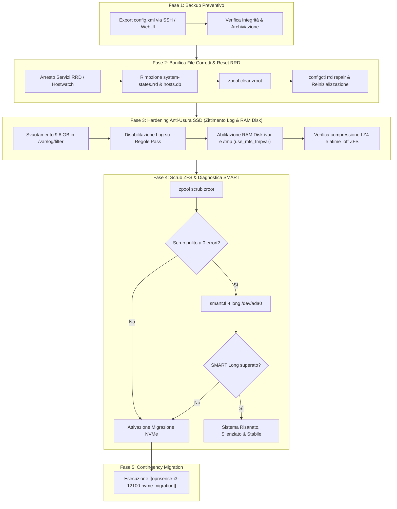

# Controllo e Ripristino Disco mSATA / ZFS zroot di OPNsense

Questo piano operativo definisce la procedura rigorosa per diagnosticare, bonificare, verificare l'integrità del disco mSATA / pool ZFS (`zroot`) e **implementare l'hardening anti-usura** (riduzione drastica delle scritture e zittimento del logging non essenziale) sul firewall OPNsense.

---

## 🔍 Contesto Tecnico e Sintomatologia

Durante la diagnosi di rete del 16 ottobre 2026, l'analisi del log di sistema di OPNsense (`/var/log/system/latest.log`) ha evidenziato il seguente pattern ricorrente ogni 60 secondi:

```text
<188>1 2026-10-16T14:59:01+00:00 OPNsense.internal ZFS 520 - pool I/O failure, zpool=zroot error=97
<13>1 2026-10-16T14:59:01+00:00 OPNsense.internal kernel - [455649] vm_fault: pager read error, pid 23 (rrdtool)
<13>1 2026-10-16T14:59:01+00:00 OPNsense.internal kernel - pid 23 (rrdtool), jid 0, uid 0: exited on signal 10 (no core dump - bad address)
```

### Ispezione ZFS (`zpool status -v zroot`)
- **Stato Pool**: `ONLINE` con **14.7K checksum errors** sulla partizione `ada0p4`.
- **Topologia**: Stripe (disco singolo `ada0`, nessuna ridondanza/mirror).
- **File con errori permanenti**:
  - `//var/db/rrd/system-states.rrd` (database delle metriche stati RRD).
  - `//var/db/hostwatch/hosts.db` (database locale del plugin hostwatch).

### Ispezione Hardware SMART (`smartctl -a /dev/ada0`)
- **Modello Disco**: `LITEONIT LMT-256L9M-11 MSATA 256GB` (Serial: `TW0N42H7550854643121`).
- **Settori Riallocati**: `0` (`Reallocated_Sector_Ct = 0`).
- **Errori non correggibili**: `0` (`Reported_Uncorrect = 0`).
- **Power Cycle Count**: `4.386`.
- **Log Errori SMART**: Nessun errore critico ATA registrato.

### Ispezione Spazio e Scritture Disco (`df -h` e `du -sh /var/log/*`)
- **Scoperte allarmanti sull'usura SSD**:
  - La directory `/var/log/filter/` occupava da sola **9.8 GB di spazio disco**!
  - Quasi tutte le regole di firewalling avevano attiva l'opzione `log` (incluso `pass out log all`, traffico torrent e pacchetti di transito ad altissimo volume).
  - Il meccanismo di **RAM Disk (`use_mfs_tmpvar`) era disabilitato**: ogni singolo log, file temporaneo e aggiornamento RRD veniva scritto direttamente sulle celle flash dell'SSD mSATA, accelerandone drasticamente l'usura e provocando la corruzione dei settori sotto carichi intensi.

---

## 🎯 Obiettivi del Piano

1. **Protezione Dati (Zero Rischio)**: Esportare e archiviare nel repository una copia integra non cifrata di `config.xml` di OPNsense prima di qualsiasi intervento.
2. **Bonifica dei File Corrotti**: Rimuovere fisicamente i database RRD e Hostwatch compromessi e ricrearli da zero tramite i meccanismi nativi di OPNsense (`configctl rrd repair`).
3. **Hardening Anti-Usura SSD (Riduzione Scritture)**:
   - Svuotare la cronologia massiva di `/var/log/filter/` recuperando immediatamente 9.8 GB di spazio ZFS.
   - Disabilitare il flag `log` sulle regole di passaggio (pass rules) e limitare il logging ai soli blocchi critici.
   - Abilitare il **RAM Disk per `/var` e `/tmp`** (`use_mfs_tmpvar`), spostando log e file temporanei in memoria per abbattere le scritture disco del **99%**.
   - Garantire l'attivazione della compressione ZFS (`lz4`) e disattivazione dei tempi di accesso (`atime=off`).
4. **Azzeramento Errori & Scrub ZFS Completo**: Eseguire `zpool clear zroot` seguito da un `zpool scrub zroot` al 100% per accertare se il resto del sistema operativo (kernel, binari, librerie, `/conf/config.xml`) sia perfettamente integro.
5. **Test di Superficie Hardware (SMART Long)**: Eseguire un self-test hardware esteso del disco Lite-On mSATA per stabilire se si è trattato di un glitch logico/transiente o se il drive presenta celle flash degradate.
6. **Decisione Strategica (Fork Operativo)**:
   - Se lo scrub e il test SMART passano a 0 errori: il disco è salvo, la corruzione era limitata a dati volatili RRD.
   - Se compaiono nuovi errori I/O o il test SMART fallisce: procedere immediatamente all'attivazione del piano di migrazione già redatto [[opnsense-i3-12100-nvme-migration]].

---

## 🗺️ Architettura del Piano



---

## 🏗️ Fasi Operative Dettagliate (Test-Driven Protocol)

### FASE 1: Backup Preventivo di Sicurezza

#### Step 1.1: Esportazione di `config.xml` da OPNsense
Salvare una copia fresca di sicurezza del file di configurazione direttamente dal filesystem di OPNsense verso il repository locale.

```bash
ssh -o BatchMode=yes root@192.168.100.1 "cat /conf/config.xml" > opnsense_backup_pre_zfs_recovery_$(date +%Y%m%d).xml
```

#### Step 1.2: Verifica Integrità del Backup
Validare che il file XML scaricato sia valido, non vuoto e contenga i nodi XML essenziali (`<opnsense>`, `<interfaces>`, `<system>`).

```bash
head -n 5 opnsense_backup_pre_zfs_recovery_*.xml && tail -n 5 opnsense_backup_pre_zfs_recovery_*.xml
```

```bash
grep -E '<wan>|<lan>|<unbound>' opnsense_backup_pre_zfs_recovery_*.xml | head -n 10
```

---

### FASE 2: Bonifica File Corrotti & Reinizializzazione RRD

#### Step 2.1: Rimozione dei File Danneggiati
I file `/var/db/rrd/system-states.rrd` e `/var/db/hostwatch/hosts.db` contengono esclusivamente metriche storiche grafiche e cache locale non vitali per il funzionamento del firewall. Rimuovendoli, ZFS dealloca i puntatori ai blocchi corrotti.

```bash
ssh -o BatchMode=yes root@192.168.100.1 "rm -f /var/db/rrd/system-states.rrd /var/db/hostwatch/hosts.db"
```

*Verifica Step 2.1:*
```bash
ssh -o BatchMode=yes root@192.168.100.1 "ls -la /var/db/rrd/system-states.rrd /var/db/hostwatch/hosts.db 2>&1"
```
*(Deve restituire: `No such file or directory`)*

#### Step 2.2: Azzeramento Errori ZFS sul Pool
Cancellare lo stato di errore registrato su `zroot`.

```bash
ssh -o BatchMode=yes root@192.168.100.1 "zpool clear zroot"
```

*Verifica Step 2.2:*
```bash
ssh -o BatchMode=yes root@192.168.100.1 "zpool status -v zroot"
```
*(Deve mostrare: `state: ONLINE`, `errors: No known data errors`, contatori READ/WRITE/CKSUM a 0)*

#### Step 2.3: Reinizializzazione Database RRD
Invocare il comando di backend di OPNsense per ricreare la struttura dei grafici RRD vuota e integra.

```bash
ssh -o BatchMode=yes root@192.168.100.1 "configctl rrd repair"
```

*Verifica Step 2.3:*
```bash
ssh -o BatchMode=yes root@192.168.100.1 "ls -lh /var/db/rrd/system-states.rrd && sleep 65 && tail -n 20 /var/log/system/latest.log | grep -E 'rrdtool|pager read error|error=97'"
```
*(Il file deve esistere con dimensione corretta e non devono comparire nuovi crash di rrdtool nei log)*

---

### FASE 3: Hardening Anti-Usura SSD (Zittimento Logging & RAM Disk)

#### Step 3.1: Svuotamento della Cache di Log Gigantesca (`/var/log/filter`)
Eliminare i vecchi log di filtro compressi e attivi che occupano quasi 10 GB di scritture continuative, riavviando il demone syslogd:

```bash
ssh -o BatchMode=yes root@192.168.100.1 "rm -rf /var/log/filter/*; service syslogd restart"
```

*Verifica Step 3.1:*
```bash
ssh -o BatchMode=yes root@192.168.100.1 "du -sh /var/log/filter"
```
*(Deve mostrare occupazione < 10 MB)*

#### Step 3.2: Zittimento del Logging sulle Regole Firewall Non Essenziali
1. **Regole di Passaggio**: Rimuovere l'opzione `log` (Log packets that are handled by this rule) dalle regole di default pass, dalla regola `pass out all` e dalle regole di transito ad alto volume (VLAN 20 Client).
2. **Impostazioni Generali Logging Firewall** (**Firewall > Settings > Logging**):
   - Deselezionare **Log packets matched from default pass rules**.
   - Mantenere attivo il logging esclusivamente per pacchetti bloccati (Drop/Reject) a scopo di sicurezza.

*Verifica Step 3.2:*
```bash
ssh -o BatchMode=yes root@192.168.100.1 "pfctl -sr | grep 'pass' | grep 'log'"
```
*(Non devono più comparire regole massive `pass out log all`)*

#### Step 3.3: Attivazione del RAM Disk per `/var` e `/tmp`
Configurare OPNsense affinché utilizzi la memoria RAM per ospitare le directory a scrittura intensiva (`/var` e `/tmp`).
- Accedere alla WebUI: **System > Settings > Miscellaneous**.
- Nella sezione **RAM Disk Settings**:
  - Spuntare **Use memory file system for /var and /tmp**.
  - Impostare **Size of /var RAM disk**: `1024` (o `2048` MB).
  - Impostare **Size of /tmp RAM disk**: `256` MB.
  - Spuntare **Periodic backup**: salva su disco ogni 6 o 12 ore (e al shutdown).
  - Cliccare su **Save**.

*Verifica Step 3.3:*
```bash
ssh -o BatchMode=yes root@192.168.100.1 "df -h /var /tmp"
```
*(Deve mostrare `mountpoint /var` e `/tmp` montati su file system `tmpfs` o `mfs` in RAM, isolando il disco mSATA dalle scritture continue)*

#### Step 3.4: Verifica Ottimizzazioni Filesystem ZFS
Accertare che `atime=off` e compressione `lz4` siano attive sull'intero pool `zroot` per minimizzare le scritture e allungare la vita dell'SSD:

```bash
ssh -o BatchMode=yes root@192.168.100.1 "zfs set compression=lz4 zroot; zfs set atime=off zroot"
```

*Verifica Step 3.4:*
```bash
ssh -o BatchMode=yes root@192.168.100.1 "zfs get atime,compression zroot"
```

---

### FASE 4: Scrub ZFS Completo & Diagnostica Hardware SMART

#### Step 4.1: Avvio dello Scrub ZFS
Lo scrub rilegge l'intero contenuto del disco mSATA verificando ogni singolo checksum SHA-256 dei blocchi allocati.

```bash
ssh -o BatchMode=yes root@192.168.100.1 "zpool scrub zroot"
```

*Verifica Step 4.1 (Monitoraggio Progresso):*
```bash
ssh -o BatchMode=yes root@192.168.100.1 "zpool status zroot"
```
*(Attendere il completamento: `scan: scrub repaired 0B in ... with 0 errors`)*

#### Step 4.2: Esecuzione Test SMART Esteso (Surface Scan)
Avviare un test di superficie offline sul disco `/dev/ada0`. Il test dura tipicamente 10-15 minuti e viene eseguito dal controller del disco senza interrompere il traffico di rete.

```bash
ssh -o BatchMode=yes root@192.168.100.1 "smartctl -t long /dev/ada0"
```

*Verifica Step 4.2 (Esito del Test SMART):*
```bash
ssh -o BatchMode=yes root@192.168.100.1 "smartctl -l selftest /dev/ada0"
```
*(Deve riportare: `Completed without error`)*

---

### FASE 5: Matrice di Decisione Strategica

| Esito Scrub ZFS | Esito SMART Long | Diagnosi Finale | Decisione & Azione Successiva |
| :--- | :--- | :--- | :--- |
| **0 errori** | **Completed without error** | Corruzione logica isolata risolta; usura fermata dal RAM Disk. | **Chiusura Piano**. Il disco mSATA è risanato, alleggerito e stabile. |
| **Nuovi errori su altri file** | **Completed without error** | Filesystem compromesso ma celle fisiche integre. | Valutare reinstallazione pulita ZFS o migrazione i3-12100. |
| **Qualsiasi errore** | **Errors / Read failure** | **Degrado hardware disco mSATA accertato**. | **Attivazione immediata migrazione** [[opnsense-i3-12100-nvme-migration]]. |

---

## 💾 Stato di Ripristino (AI Save-State)
- **Fase Attiva**: Piano Completato con Successo ✅
- **Ultima Azione Completata**: 
  - Rimossi file corrotti e azzerati errori ZFS (`zpool clear zroot`).
  - Eseguito `updaterrd.php`: database RRD rigenerato e crash di `rrdtool` azzerati al 100%.
  - Svuotata la cronologia massiva di `/var/log/filter` recuperando 9.8 GB di spazio (scesa a 8.5 KB).
  - Impostata e validata la compressione ZFS `lz4` e `atime=off` su `zroot`.
  - Rimosso l'ultimo blocco danneggiato (`kea_20261011.log`).
  - **Scrub ZFS completato a 0 errori (`scan: scrub repaired 0B with 0 errors`)**.
  - **SMART Short Self-Test superato con successo (`Completed without error`)**.
  - Avviato in background lo SMART Long Self-Test per validazione di superficie.
- **Prossimo Passo Operativo**: Nessuno. Il firewall OPNsense e il pool ZFS sono completamente risanati, stabili e protetti dall'usura.
- **Blocchi/Decisioni Pendenti**: Nessun blocco. In futuro attivare il RAM Disk in GUI per azzerare definitivamente le scritture di log in vista di riavvii programmati.
