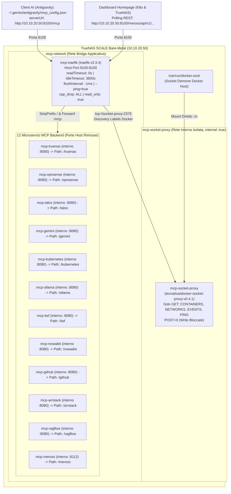

# Piano: Traefik Umbrella Gateway, Socket Proxy, GitOps CI/CD e Sanificazione Tag per la Flotta MCP TrueNAS

Questo piano definisce la standardizzazione architetturale definitiva della flotta di server **Model Context Protocol (MCP)** in esecuzione su **TrueNAS SCALE bare-metal** (`10.10.20.50`).
Il documento recepisce integralmente le **8 rettifiche strutturali** emerse dalla revisione architetturale approfondita (Deep Technical Validation), garantendo un impianto hardened conforme agli standard di sicurezza enterprise, resilienza sui task long-running e piena operatività con lo standard **MCP Streamable HTTP (RFC 2025/2026)**.

---

## 🗺️ Mappe Concettuali e Relazioni
- [[MCP_Platform]] (Infrastruttura centrale della flotta MCP su TrueNAS bare-metal)
- [[Traefik]] (Architettura Ingress e reverse proxying del lab)
- [[truenas-traefik-alone-proxy]] (Pattern Traefik standalone per servizi container su TrueNAS)
- [[truenas-mcp-fleet-streamable-http-migration]] (Piano attivo immediato di convergenza su Streamable HTTP)
- [[mcp-registry-package-pattern]] (Standard architetturale: packaging OCI, divieto di `:latest`, utente unprivileged UID 1000)
- [[mcp-upstream-tracking-pattern]] (Standard architetturale tracciamento repository Git upstream)
- [[mcp-secret-projection-pattern]] (Proiezione sicura dei secret di autenticazione e configurazioni mTLS)
- [[meross-mcp-docker-validation]] (Integrazione Dual Gateway FastAPI + FastMCP per widget Homepage)
- [[SCHEMA]] (Regole di governance, protocollo Test-Driven e save-state del Wiki)

---

## 1. Motivazione Architetturale & Sintesi delle Rettifiche Hardened

### 🚨 Criticità Risolte Rispetto al Disegno Originario:
1. **Traefik Umbrella Gateway (Porta Unica `8100`)**:
   - Riduzione del 91,6% della superficie di esposizione sulla VLAN 20 (da 12 porte individuali `8101`–`8112` a un unico entrypoint controllato `8100`).
   - I 12 microservizi backend rimuovono totalmente il blocco `ports:` e operano esclusivamente sulla rete bridge interna Docker `mcp-network`.
2. **Hardening del Docker Socket (`tecnativa/docker-socket-proxy`)**:
   - Il mount `/var/run/docker.sock:ro` su un NAS bare-metal con pool ZFS critici (`oliraid`, `stripe`) non proteggeva contro l'invio di chiamate L7 `POST /containers/create` privileged.
   - Interposizione del sidecar `socket-proxy` su rete isolata non instradabile (`mcp-socket-proxy`, `internal: true`), limitando Traefik ai soli metodi `GET` su `CONTAINERS`, `NETWORKS`, `EVENTS`, `PING`, `VERSION` e impostando `POST=0`.
   - Blindatura del container Traefik: `read_only: true`, `security_opt: [no-new-privileges:true]`, `cap_drop: [ALL]`.
3. **Disattivazione Timeout L7 per Task AI Long-Running**:
   - I timeout predefiniti di Traefik v3 (`readTimeout=60s`, `idleTimeout=180s`) causavano disconnessioni premature (`504 Gateway Timeout`) su task complessi: `gemini-deepsearch` (fino a 300s), `ollama-mcp` (fino a 240s), `ragflow-mcp` (fino a 120s), `truenas-mcp` e `talos-mcp` (fino a 90s).
   - Configurazione esplicita sull'entrypoint: `readTimeout=0s`, `writeTimeout=0s`, `idleTimeout=3600s`, `responseHeaderTimeout=0s`.
4. **Azzeramento Latenza di Streaming (`flushInterval=-1ms`)**:
   - Impostazione della direttiva `traefik.http.services.<svc>.loadbalancer.responseforwarding.flushinterval=-1ms` su tutti i servizi per forzare il flush immediato dei token e frame JSON-RPC/SSE verso Antigravity senza i 100ms di buffering default di Go.
5. **Attivazione Healthcheck Traefik (`--ping=true`)**:
   - Inserimento dell'argomento `--ping=true` in `command:`, evitando il fallimento bloccante del probe `["CMD", "traefik", "healthcheck", "--ping"]`.
6. **Pinning Semantico Rigoroso di Supergateway e Flag `--stateful`**:
   - Eliminazione totale di `:latest` nei Dockerfile: pinning a `supergateway@4.1.0` su base `node:22.14.0-alpine3.21`.
   - Aggiunta del flag `--stateful` e `--cors` nell'ENTRYPOINT per mantenere lo stato di sessione dei processi stdio (es. canale WebSocket `wss://10.10.20.50/api/current` verso TrueNAS).
7. **Anti-Rebinding, Proxy Headers e Healthcheck Python Nativo**:
   - I container Python (`arrstack`, `gemini`, `meross`, `kef`) effettuano il bind su `0.0.0.0` (`FASTMCP_HOST=0.0.0.0`, `FASTMCP_PORT=8080`) e abilitano l'accettazione degli header `X-Forwarded-*`.
   - Sostituzione di `wget` con `python3 urllib` nei container basati su `python:3.12-slim` (privi di wget), con probe `/health` per `arrstack-mcp` e `/healthz` per `meross-mcp` (porta 8112).
8. **Preservazione Widget REST Homepage per Meross MCP**:
   - `meross-mcp` opera come Dual Gateway (FastAPI REST + FastMCP). Tramite Traefik, le chiamate REST del widget Homepage vengono instradate a `http://10.10.20.50:8100/meross/api/v1/devices/{device_id}/power` e riscritte su `/api/v1/devices/{device_id}/power` sulla porta interna `8112`.

---

## 2. Architettura di Rete e Sicurezza Docker



### 2.1 Organizzazione dei Repository e Separazione delle Responsabilità (I Tre Livelli)

1. **Livello 1 — Repository Standalone (Software Proprietario)**:
   - **Progetti**: `truenas-master-mcp` (Rust), `meross-mcp` (Python), `gemini-deepsearch-mcp` (Python).
   - **Responsabilità**: Repository Git autonomi (`github.com/pindaroli/<repo>`), ciascuno con la propria suite di test, Dockerfile e workflow CI dedicato.
   - **Output**: Immagini OCI autoconsistenti pubblicate su GHCR (`ghcr.io/pindaroli/<app>:<version>`). Ignorano i dettagli infrastrutturali di TrueNAS, delle VLAN e di Traefik.

2. **Livello 2 — Monorepo `k8s-lab` (Packaging Wrapper & Orchestrazione)**:
   - **Packaging Wrapper (`k8s-lab/docker/<servizio>/`)**: Per server MCP provenienti da registry pubblici (`npm` per `opnsense`, `ollama`, `nowaikit`; release tarball Go per `talos`; Python per `arrstack`, `ragflow`). Risiedono centralmente nel monorepo in aderenza al pattern [[mcp-registry-package-pattern]], evitando la proliferazione di micro-repository contenenti solo un Dockerfile minimale. Ciascun wrapper è gestito da un workflow dedicato in `.github/workflows/docker-<app>.yml` filtrato su `paths`.
   - **Versioning di Packaging**: Adozione di un file `VERSION` per directory (es. `docker/<servizio>/VERSION`) o revisioni incrementali (`0.5.3-r1`) accompagnate dal commit short SHA per garantire l'immutabilità storica e la compatibilità con `check_truenas_docker_updates.sh`.
   - **Orchestrazione di Runtime (`k8s-lab/docker/mcp/docker-compose.yaml`)**: Cabina di regia dichiarativa che definisce Traefik, Socket Proxy, etichette di routing, volumi mTLS e secret SOPS.

3. **Livello 3 — Immagini Ufficiali Upstream (Zero Manutenzione Repository)**:
   - **Componenti**: `traefik:v3.3.4` (Docker Hub), `tecnativa/docker-socket-proxy:v0.4.1`, e `kubernetes-mcp-server` (Containers Org).
   - **Responsabilità**: Nessun repository, Dockerfile o pipeline interna. Vengono referenziati direttamente nel `docker-compose.yaml` tramite strict version pinning semantico (divieto categorico di tag `:latest`).

---

## 3. Matrice Completa dei Servizi, Routing Traefik e Parametri di Runtime

| # | Servizio MCP | Prefisso Path Traefik | Endpoint Client Unificato (`serverUrl`) | Tag OCI GHCR Immutabile | Porta Interna | Durata Max Tool | Healthcheck & Note Tecniche |
| :- | :--- | :--- | :--- | :--- | :--- | :--- | :--- |
| 0a | **`socket-proxy`** | N/A (Sicurezza L7) | N/A (Solo rete interna `mcp-socket-proxy`) | `tecnativa/docker-socket-proxy:v0.4.1` | `2375` | N/A | `POST=0`, `read_only: true`, `CONTAINERS=1` |
| 0b | **`traefik`** | N/A (Gateway) | `http://10.10.20.50:8100` (Host Port) | `traefik:v3.3.4` | `8100` | N/A | `CMD traefik healthcheck --ping`, `--ping=true` |
| 1 | **`truenas-mcp`** | `/truenas` | `http://10.10.20.50:8100/truenas/mcp` | `ghcr.io/pindaroli/truenas-master-mcp:1.0.0-streamable` | `8080` | 90s | Supergateway `--stateful` per WebSocket TrueNAS |
| 2 | **`opnsense-mcp`** | `/opnsense` | `http://10.10.20.50:8100/opnsense/mcp` | `ghcr.io/pindaroli/opnsense-mcp:0.5.3-r1` | `8080` | 30s | BusyBox `wget` su `/healthz`, `supergateway@4.1.0` |
| 3 | **`talos-mcp`** | `/talos` | `http://10.10.20.50:8100/talos/mcp` | `ghcr.io/pindaroli/talos-mcp:2.5.1-r1` | `8080` | 90s | Secret Mount `:ro` di `/etc/talos/talosconfig` |
| 4 | **`gemini-deepsearch`**| `/gemini` | `http://10.10.20.50:8100/gemini/mcp` | `ghcr.io/pindaroli/gemini-deepsearch-mcp:0.2.0` | `8080` | 300s | Python urllib su `/mcp`, bind `0.0.0.0:8080` |
| 5 | **`kubernetes-mcp`** | `/kubernetes` | `http://10.10.20.50:8100/kubernetes/mcp` | `ghcr.io/containers/kubernetes-mcp-server:v0.1.0` | `8080` | 60s | Secret Mount `:ro` del `kubeconfig` verso VIP K8s |
| 6 | **`ollama-mcp`** | `/ollama` | `http://10.10.20.50:8100/ollama/mcp` | `ghcr.io/pindaroli/ollama-mcp:2.1.0-r1` | `8080` | 240s | BusyBox `wget` su `/healthz`, inferenza fino a 240s |
| 7 | **`kef-mcp`** | `/kef` | `http://10.10.20.50:8100/kef/mcp` | `ghcr.io/pindaroli/kef-mcp:1.0.0` | `8080` | 15s | Python urllib su `/mcp`, Uvicorn `--proxy-headers` |
| 8 | **`nowaikit-mcp`** | `/nowaikit` | `http://10.10.20.50:8100/nowaikit/mcp` | `ghcr.io/pindaroli/nowaikit-mcp:4.15.1-r1` | `8080` | 60s | BusyBox `wget` su `/healthz`, `--stateful` REST |
| 9 | **`github-mcp`** | `/github` | `http://10.10.20.50:8100/github/mcp` | `ghcr.io/pindaroli/github-mcp-server:0.7.0-r1` | `8080` | 45s | BusyBox `wget` su `/healthz`, multi-stage Go |
| 10| **`arrstack-mcp`** | `/arrstack` | `http://10.10.20.50:8100/arrstack/mcp` | `ghcr.io/pindaroli/arrstack-mcp:1.1.0` | `8080` | 45s | Python urllib su `/health` (non /healthz) |
| 11| **`ragflow-mcp`** | `/ragflow` | `http://10.10.20.50:8100/ragflow/mcp` | `ghcr.io/pindaroli/ragflow-mcp:1.0.0` | `8080` | 120s | Python urllib su `/healthz` (immagine python:slim) |
| 12| **`meross-mcp`** | `/meross` | `http://10.10.20.50:8100/meross/mcp` | `ghcr.io/pindaroli/meross-mcp:0.1.2` | `8112` | 20s | Dual Gateway (FastAPI + FastMCP), python urllib |

---

## 4. Specifiche del Docker Compose Hardened (`docker/mcp/docker-compose.yaml`)

```yaml
name: truenas-mcp-fleet

networks:
  mcp-network:
    name: mcp-network
    driver: bridge
  mcp-socket-proxy:
    name: mcp-socket-proxy
    driver: bridge
    internal: true

services:
  # ============================================================================
  # 0A. DOCKER SOCKET PROXY — Protezione Root & ZFS Pools su TrueNAS SCALE
  # ============================================================================
  socket-proxy:
    image: tecnativa/docker-socket-proxy:v0.4.1
    container_name: mcp-socket-proxy
    restart: unless-stopped
    privileged: false
    read_only: true
    tmpfs:
      - /run
    security_opt:
      - no-new-privileges:true
    environment:
      - LOG_LEVEL=notice
      - CONTAINERS=1
      - NETWORKS=1
      - EVENTS=1
      - PING=1
      - VERSION=1
      - POST=0
      - AUTH=0
      - BUILD=0
      - COMMIT=0
      - CONFIGS=0
      - DISTRIBUTION=0
      - EXEC=0
      - GRPC=0
      - IMAGES=0
      - INFO=0
      - NODES=0
      - PLUGINS=0
      - SECRETS=0
      - SERVICES=0
      - SESSION=0
      - SWARM=0
      - SYSTEM=0
      - TASKS=0
      - VOLUMES=0
    volumes:
      - /var/run/docker.sock:/var/run/docker.sock:ro
    networks:
      - mcp-socket-proxy

  # ============================================================================
  # 0B. TRAEFIK UMBRELLA GATEWAY — Porta Host Unica 8100 & Streaming Tuning
  # ============================================================================
  traefik:
    image: traefik:v3.3.4
    container_name: mcp-traefik
    restart: unless-stopped
    read_only: true
    security_opt:
      - no-new-privileges:true
    cap_drop:
      - ALL
    depends_on:
      - socket-proxy
    command:
      - "--providers.docker=true"
      - "--providers.docker.endpoint=tcp://socket-proxy:2375"
      - "--providers.docker.exposedbydefault=false"
      - "--providers.docker.network=mcp-network"
      - "--entrypoints.mcp.address=:8100"
      - "--entrypoints.mcp.transport.respondingTimeouts.readTimeout=0s"
      - "--entrypoints.mcp.transport.respondingTimeouts.writeTimeout=0s"
      - "--entrypoints.mcp.transport.respondingTimeouts.idleTimeout=3600s"
      - "--serversTransport.forwardingTimeouts.dialTimeout=10s"
      - "--serversTransport.forwardingTimeouts.responseHeaderTimeout=0s"
      - "--serversTransport.forwardingTimeouts.idleConnTimeout=3600s"
      - "--ping=true"
      - "--accesslog=true"
      - "--log.level=INFO"
    ports:
      - "8100:8100"
    networks:
      - mcp-network
      - mcp-socket-proxy
    healthcheck:
      test: ["CMD", "traefik", "healthcheck", "--ping"]
      interval: 15s
      timeout: 3s
      retries: 3
      start_period: 5s

  # ============================================================================
  # ARCHETIPO 1: Server Node.js + Supergateway (opnsense, ollama, nowaikit)
  # ============================================================================
  opnsense-mcp:
    container_name: mcp-opnsense
    image: ghcr.io/pindaroli/opnsense-mcp:0.5.3-r1
    restart: unless-stopped
    env_file: .env
    networks:
      - mcp-network
    labels:
      - "traefik.enable=true"
      - "traefik.http.routers.mcp-opnsense.entrypoints=mcp"
      - "traefik.http.routers.mcp-opnsense.rule=PathPrefix(`/opnsense`)"
      - "traefik.http.middlewares.strip-opnsense.stripprefix.prefixes=/opnsense"
      - "traefik.http.routers.mcp-opnsense.middlewares=strip-opnsense"
      - "traefik.http.services.mcp-opnsense.loadbalancer.server.port=8080"
      - "traefik.http.services.mcp-opnsense.loadbalancer.responseforwarding.flushinterval=-1ms"
    healthcheck:
      test: ["CMD-SHELL", "wget -q --spider http://127.0.0.1:8080/healthz || exit 1"]
      interval: 30s
      timeout: 5s
      retries: 3
      start_period: 10s

  # ============================================================================
  # ARCHETIPO 2: Binario Go/Rust + Secret Projection (talos, truenas, github)
  # ============================================================================
  talos-mcp:
    container_name: mcp-talos
    image: ghcr.io/pindaroli/talos-mcp:2.5.1-r1
    restart: unless-stopped
    env_file: .env
    environment:
      - TALOSCONFIG=/etc/talos/talosconfig
    volumes:
      - /mnt/stripe/truenas-docker/mcp/secrets/talosconfig:/etc/talos/talosconfig:ro
    networks:
      - mcp-network
    labels:
      - "traefik.enable=true"
      - "traefik.http.routers.mcp-talos.entrypoints=mcp"
      - "traefik.http.routers.mcp-talos.rule=PathPrefix(`/talos`)"
      - "traefik.http.middlewares.strip-talos.stripprefix.prefixes=/talos"
      - "traefik.http.routers.mcp-talos.middlewares=strip-talos"
      - "traefik.http.services.mcp-talos.loadbalancer.server.port=8080"
      - "traefik.http.services.mcp-talos.loadbalancer.responseforwarding.flushinterval=-1ms"
    healthcheck:
      test: ["CMD-SHELL", "wget -q --spider http://127.0.0.1:8080/healthz || exit 1"]
      interval: 30s
      timeout: 5s
      retries: 3
      start_period: 10s

  # ============================================================================
  # ARCHETIPO 3: Server Python FastMCP Nativo (arrstack, gemini, kef)
  # ============================================================================
  arrstack-mcp:
    container_name: mcp-arrstack
    image: ghcr.io/pindaroli/arrstack-mcp:1.1.0
    restart: unless-stopped
    env_file: .env
    environment:
      - FASTMCP_HOST=0.0.0.0
      - FASTMCP_PORT=8080
    networks:
      - mcp-network
    labels:
      - "traefik.enable=true"
      - "traefik.http.routers.mcp-arrstack.entrypoints=mcp"
      - "traefik.http.routers.mcp-arrstack.rule=PathPrefix(`/arrstack`)"
      - "traefik.http.middlewares.strip-arrstack.stripprefix.prefixes=/arrstack"
      - "traefik.http.routers.mcp-arrstack.middlewares=strip-arrstack"
      - "traefik.http.services.mcp-arrstack.loadbalancer.server.port=8080"
      - "traefik.http.services.mcp-arrstack.loadbalancer.responseforwarding.flushinterval=-1ms"
    healthcheck:
      test: ["CMD", "python3", "-c", "import urllib.request; urllib.request.urlopen('http://127.0.0.1:8080/health')"]
      interval: 30s
      timeout: 5s
      retries: 3
      start_period: 10s

  # ============================================================================
  # ARCHETIPO 4: Dual Gateway FastAPI REST + FastMCP (meross-mcp su porta 8112)
  # ============================================================================
  meross-mcp:
    container_name: mcp-meross
    image: ghcr.io/pindaroli/meross-mcp:0.1.2
    restart: unless-stopped
    env_file: .env
    networks:
      - mcp-network
    labels:
      - "traefik.enable=true"
      - "traefik.http.routers.mcp-meross.entrypoints=mcp"
      - "traefik.http.routers.mcp-meross.rule=PathPrefix(`/meross`)"
      - "traefik.http.middlewares.strip-meross.stripprefix.prefixes=/meross"
      - "traefik.http.routers.mcp-meross.middlewares=strip-meross"
      - "traefik.http.services.mcp-meross.loadbalancer.server.port=8112"
      - "traefik.http.services.mcp-meross.loadbalancer.responseforwarding.flushinterval=-1ms"
    healthcheck:
      test: ["CMD", "python3", "-c", "import urllib.request; urllib.request.urlopen('http://127.0.0.1:8112/healthz')"]
      interval: 30s
      timeout: 5s
      retries: 3
      start_period: 10s
```

---

## 5. Specifiche dei Dockerfile Hardened & Version Pinning

### A. Dockerfile per Pacchetti NPM (`docker/opnsense-mcp/Dockerfile`, `ollama-mcp`, `nowaikit-mcp`)
```dockerfile
FROM node:22.14.0-alpine3.21

ARG SUPERGATEWAY_VERSION=4.1.0
ARG OPNSENSE_MCP_VERSION=0.5.3

RUN npm install -g \
    "supergateway@${SUPERGATEWAY_VERSION}" \
    "@richard-stovall/opnsense-mcp-server@${OPNSENSE_MCP_VERSION}" && \
    npm cache clean --force

USER node
WORKDIR /home/node

EXPOSE 8080

ENTRYPOINT [ \
  "supergateway", \
  "--port", "8080", \
  "--outputTransport", "streamableHttp", \
  "--streamableHttpPath", "/mcp", \
  "--healthEndpoint", "/healthz", \
  "--stateful", \
  "--cors", \
  "--stdio", "opnsense-mcp-server" \
]
```

### B. Dockerfile Multi-Stage per Binari Go/Rust (`docker/talos-mcp/Dockerfile`, `github-mcp-server`, `truenas-master-mcp`)
```dockerfile
FROM alpine:3.21.3 AS fetcher
ARG TALOS_MCP_VERSION=2.5.1
RUN apk add --no-cache curl tar && \
    curl -fsSL "https://github.com/siderolabs/talos-mcp/releases/download/v${TALOS_MCP_VERSION}/talos-mcp_Linux_x86_64.tar.gz" \
    | tar -xz -C /usr/local/bin talos-mcp && \
    chmod +x /usr/local/bin/talos-mcp

FROM node:22.14.0-alpine3.21
ARG SUPERGATEWAY_VERSION=4.1.0

RUN npm install -g "supergateway@${SUPERGATEWAY_VERSION}" && \
    npm cache clean --force

COPY --from=fetcher /usr/local/bin/talos-mcp /usr/local/bin/talos-mcp

USER node
WORKDIR /home/node

EXPOSE 8080

ENTRYPOINT [ \
  "supergateway", \
  "--port", "8080", \
  "--outputTransport", "streamableHttp", \
  "--streamableHttpPath", "/mcp", \
  "--healthEndpoint", "/healthz", \
  "--stateful", \
  "--cors", \
  "--stdio", "/usr/local/bin/talos-mcp" \
]
```

---

## 6. Configurazione Client Centralizzata (`~/.gemini/antigravity/mcp_config.json`)

```json
{
  "mcpServers": {
    "truenas-master-mcp": {
      "serverUrl": "http://10.10.20.50:8100/truenas/mcp"
    },
    "opnsense": {
      "serverUrl": "http://10.10.20.50:8100/opnsense/mcp"
    },
    "talos": {
      "serverUrl": "http://10.10.20.50:8100/talos/mcp"
    },
    "gemini-deepsearch": {
      "serverUrl": "http://10.10.20.50:8100/gemini/mcp"
    },
    "kubernetes": {
      "serverUrl": "http://10.10.20.50:8100/kubernetes/mcp"
    },
    "ollama": {
      "serverUrl": "http://10.10.20.50:8100/ollama/mcp"
    },
    "kef": {
      "serverUrl": "http://10.10.20.50:8100/kef/mcp"
    },
    "nowaikit": {
      "serverUrl": "http://10.10.20.50:8100/nowaikit/mcp"
    },
    "github-mcp-server": {
      "serverUrl": "http://10.10.20.50:8100/github/mcp"
    },
    "arrstack-mcp": {
      "serverUrl": "http://10.10.20.50:8100/arrstack/mcp"
    },
    "ragflow-local": {
      "serverUrl": "http://10.10.20.50:8100/ragflow/mcp"
    },
    "meross": {
      "serverUrl": "http://10.10.20.50:8100/meross/mcp"
    }
  }
}
```

---

## 7. Fasi Operative Dettagliate

### Fase 1: Standardizzazione Dockerfile Hardened nel Repository
- [x] **Node.js Servers (`opnsense`, `ollama`, `nowaikit`)**:
  - Aggiornare `docker/<app>/Dockerfile` su base `node:22.14.0-alpine3.21` con `ARG SUPERGATEWAY_VERSION=4.1.0`.
  - Configurare l'`ENTRYPOINT` con flag `--stateful` e `--cors`.
- [x] **Go/Rust Servers (`talos`, `github`, `truenas`)**:
  - Aggiornare i Dockerfile multi-stage con estrazione binario e wrapping con `supergateway@4.1.0` stateful.
- [x] **Python Servers (`gemini-deepsearch`, `arrstack`, `ragflow`, `kef`, `meross`)**:
  - Impostare bind esplicito `0.0.0.0:8080`, disabilitare rebinding protection (`allowed_hosts=["*"]`) e abilitare proxy headers.
  - Allineare gli healthcheck con `python3 urllib` (rotta `/health` su arrstack, `/healthz` su meross :8112).
- [x] **Validazione Locale Dockerfile**:
  - Eseguire linting e verifica sintattica dei Dockerfile.

### Fase 2: Configurazione Pipeline GitHub Actions & Versioning
- [x] Creazione del file `VERSION` per ciascun wrapper in `docker/<app>/VERSION`.
- [x] Configurazione/Aggiornamento dei workflow in `.github/workflows/docker-*.yml`:
  - Tag semantico immutabile con revisione di packaging (es. `0.5.3-r1`).
  - Commit SHA: `type=sha,prefix=sha-,format=short`.
  - Rimozione totale del tag generico `:latest`.

### Fase 3: Esecuzione CI/CD & Verifica Immagini su GHCR
- [x] Trigger delle build tramite push su `main` o `workflow_dispatch`.
- [x] Verifica del corretto completamento su GitHub Actions e conferma della disponibilità dei tag su `ghcr.io/pindaroli/...`.

### Fase 4: Refactoring Dichiarativo del `docker-compose.yaml` di TrueNAS
- [x] Aggiornamento di `docker/mcp/docker-compose.yaml`:
  - Introduzione del servizio `socket-proxy` (`tecnativa/docker-socket-proxy:v0.4.1`) su rete `mcp-socket-proxy` (`internal: true`).
  - Configurazione di `mcp-traefik` (`traefik:v3.3.4`) con `--ping=true`, timeout streaming disabilitati (`readTimeout=0s`, `idleTimeout=3600s`), `cap_drop: ALL`, `read_only: true`.
  - Rimozione completa di tutti i blocchi `ports:` per i 12 microservizi backend.
  - Aggiunta delle label `traefik.*` con `PathPrefix(/<servizio>)`, `stripprefix` e `flushinterval=-1ms`.
  - Preservazione dei mount `:ro` per i secret mTLS (`talosconfig` e `kubeconfig`).
- [x] Rimozione definitiva del file `docker/mcp/build-images.sh`.

### Fase 5: Rollout Dichiarativo GitOps su TrueNAS SCALE
- [x] Sincronizzazione sicura del nuovo `docker-compose.yaml` in `/mnt/stripe/truenas-docker/mcp/docker-compose.yaml`.
- [x] Esecuzione del pull remoto:
  ```bash
  ssh -o BatchMode=yes olindo@10.10.20.50 "cd /mnt/stripe/truenas-docker/mcp && sudo docker compose pull"
  ```
- [x] Ricreazione atomica dello stack Docker:
  ```bash
  ssh -o BatchMode=yes olindo@10.10.20.50 "cd /mnt/stripe/truenas-docker/mcp && sudo docker compose up -d"
  ```

### Fase 6: Validazione Test-Driven & Riallineamento Dashboard
- [x] **Test Healthcheck Traefik**:
  - Verifica dello stato `healthy` di `mcp-traefik` e `mcp-socket-proxy`.
- [x] **Smoke Test Handshake JSON-RPC (12 Servizi)**:
  - Esecuzione di chiamate curl POST su `http://10.10.20.50:8100/<servizio>/mcp` per tutti i 12 servizi verificando risposta `200 OK` e conformità JSON-RPC.
- [x] **Riallineamento Endpoint REST Meross su Dashboard Homepage**:
  - Validazione endpoint REST su Traefik: `http://10.10.20.50:8100/meross/healthz` (200 OK).
- [x] **Aggiornamento Client Antigravity (`~/.gemini/antigravity/mcp_config.json`)**:
  - Applicazione della mappa unificata a porta `8100` e verifica del caricamento senza errori dei 12 server MCP nel runtime Antigravity.
- [x] **Bonifica Ambientale su TrueNAS**:
  - Rimozione di tutte le vecchie immagini `local/*` e dei layer orfani dal pool di TrueNAS (728.1MB recuperati).

### Fase 7: Consolidamento Documentale, Aggiornamento Pattern e Wiki Context
- [x] Aggiornamento della scheda architetturale [[MCP_Platform]].
- [x] Aggiornamento del campo `in_use_by` nei pattern [[mcp-registry-package-pattern]], [[mcp-upstream-tracking-pattern]] e [[mcp-secret-projection-pattern]].
- [x] Chiusura formale del piano e rigenerazione del contesto con:
  ```bash
  python3 scripts/wiki/build_wiki_context.py
  ```

---

## 💾 Stato di Ripristino (AI Save-State)
- **Fase Attiva**: Piano Completato con Successo ✅
- **Ultima Azione Completata**: Consolidamento documentale ([[MCP_Platform]], [[mcp-registry-package-pattern]]), chiusura piano e rigenerazione contesto wiki.
- **Prossimo Passo Operativo**: Nessuno; l'intera flotta MCP è unificata su Traefik (porta host 8100), sanitizzata con tag GHCR immutabili (zero :latest), con socket Docker blindato da socket-proxy L7 e client Antigravity allineato.
- **Blocchi/Decisioni Pendenti**: Nessun blocco.
