# Piano: Traefik Umbrella Gateway, GitOps CI/CD e Sanificazione Tag per la Flotta MCP TrueNAS

Questo piano definisce la standardizzazione architetturale definitiva della flotta di server **Model Context Protocol (MCP)** in esecuzione su **TrueNAS SCALE bare-metal** (`10.10.20.50`).
Il piano risolve simultaneamente tre criticità strutturali dell'attuale setup:
1. **Traefik Umbrella Gateway a Porta Unica**: Introduzione di un'istanza leggera di Traefik v3 come reverse proxy e streaming router unificato "a cappello" su porta dedicata **`8100`**, eliminando la proliferazione delle porte host individuali (`8101`–`8112`) e isolando tutti i container MCP sulla rete interna Docker.
2. **GitOps Puro & Zero Build su TrueNAS**: Rimozione e deprecazione totale dello script shell `build-images.sh`. TrueNAS opera come puro *runtime host*, limitandosi a eseguire `docker compose pull && docker compose up -d`.
3. **Sanificazione Tag OCI & SemVer Immutabile su GHCR**: Sostituzione dei tag non tracciati `local/*` e `:latest` con immagini OCI versionate con SemVer fisso su **GitHub Container Registry (GHCR)** prodotte automaticamente tramite GitHub Actions.

---

## 🗺️ Mappe Concettuali e Relazioni
- [[MCP_Platform]] (Infrastruttura centrale della flotta MCP su TrueNAS bare-metal)
- [[Traefik]] (Architettura Ingress e reverse proxying del lab)
- [[truenas-traefik-alone-proxy]] (Pattern Traefik standalone per servizi container su TrueNAS)
- [[truenas-mcp-fleet-streamable-http-migration]] (Piano attivo immediato di convergenza su Streamable HTTP)
- [[mcp-registry-package-pattern]] (Standard architetturale: packaging OCI, divieto di `:latest`, utente unprivileged UID 1000)
- [[mcp-upstream-tracking-pattern]] (Standard architetturale tracciamento repository Git upstream)
- [[meross-mcp-docker-validation]] (Esempio canonico conforme: build GitHub Actions, version pinning SemVer, zero build locale)
- [[SCHEMA]] (Regole di governance, protocollo Test-Driven e save-state del Wiki)

---

## 1. Motivazione Architetturale & Nuova Visione con Traefik Umbrella

### 🚨 I Problemi dell'Architettura Attuale:
1. **Dispersione Porte Host (`8101`–`8112`)**: Ciascun server MCP espone la propria porta direttamente sull'interfaccia di rete di TrueNAS. Questo aumenta la superficie di attacco, crea disordine nel client AI (`mcp_config.json`) e impedisce l'applicazione di policy di routing, logging e timeout centralizzati.
2. **TrueNAS trasformato in Builder Environment**: Lo script imperativo `build-images.sh` costringe TrueNAS a compilare immagini e installare dipendenze di rete a runtime (`npm install -g supergateway`, download tarball).
3. **Violazione del Divieto di Tag `:latest` e `local/*`**: L'uso di tag locali arbitrari rompe l'audit trail e la tracciabilità delle versioni, violando la regola aurea del lab.

### 💡 La Soluzione: Traefik Umbrella Gateway (Porta Unica `8100`)
Invece di esporre 12 porte diverse, attiviamo **Traefik v3** come gateway condiviso a cappello all'interno dello stack Docker di TrueNAS:
* **Porta Unica di Ingresso**: Traefik ascolta sulla porta host `8100` (`10.10.20.50:8100`).
* **Routing Dichiarativo su Docker Labels**: Traefik si integra nativamente con il provider Docker (`/var/run/docker.sock:ro`) e legge le configurazioni di routing dai label di ciascun container.
* **Path-Based Routing con StripPrefix**:
  - Il client invia richieste a `http://10.10.20.50:8100/<servizio>/mcp`.
  - Il middleware Traefik `stripprefix` rimuove il prefisso `/<servizio>` e recapita una richiesta pulita `POST /mcp` al backend sulla porta interna `8080`.
* **Zero Esposizione Porte Host per i Backend**: Tutti i container applicativi MCP rimuovono la sezione `ports:` e comunicano esclusivamente attraverso la rete bridge Docker interna.

---

## 2. Architettura del Sistema

```mermaid
flowchart TD
    CLIENT["Client AI (Antigravity)\n~/.gemini/antigravity/mcp_config.json"]

    subgraph TrueNAS["TrueNAS SCALE Bare-Metal (10.10.20.50)"]
        subgraph Umbrella["Traefik Umbrella Gateway (Host Port 8100)"]
            TRAEFIK["traefik:v3.3\nEntrypoint :8100\nDocker Provider (Labels)\nAccess Log & Streamable HTTP Buffer"]
        end

        subgraph DockerBridge["Rete Privata Docker Bridge (mcp-network)"]
            T_MCP["mcp-truenas (interno :8080)\nPath: /truenas"]
            O_MCP["mcp-opnsense (interno :8080)\nPath: /opnsense"]
            TA_MCP["mcp-talos (interno :8080)\nPath: /talos"]
            G_MCP["mcp-gemini (interno :8080)\nPath: /gemini"]
            K_MCP["mcp-kubernetes (interno :8080)\nPath: /kubernetes"]
            OL_MCP["mcp-ollama (interno :8080)\nPath: /ollama"]
            KE_MCP["mcp-kef (interno :8080)\nPath: /kef"]
            N_MCP["mcp-nowaikit (interno :8080)\nPath: /nowaikit"]
            GH_MCP["mcp-github (interno :8080)\nPath: /github"]
            A_MCP["mcp-arrstack (interno :8080)\nPath: /arrstack"]
            R_MCP["mcp-ragflow (interno :8080)\nPath: /ragflow"]
            M_MCP["mcp-meross (interno :8112)\nPath: /meross"]
        end
    end

    subgraph CI["GitHub Actions & GHCR"]
        GHA[".github/workflows/docker-*.yml"]
        GHCR["ghcr.io/pindaroli/<app>:<version>\n(Immutabili, SemVer fisso)"]
    end

    CLIENT -->|POST /<servizio>/mcp| TRAEFIK
    TRAEFIK -->|StripPrefix & Forward /mcp| T_MCP
    TRAEFIK -->|StripPrefix & Forward /mcp| O_MCP
    TRAEFIK -->|StripPrefix & Forward /mcp| TA_MCP
    TRAEFIK -->|StripPrefix & Forward /mcp| G_MCP
    TRAEFIK -->|StripPrefix & Forward /mcp| K_MCP
    TRAEFIK -->|StripPrefix & Forward /mcp| OL_MCP
    TRAEFIK -->|StripPrefix & Forward /mcp| KE_MCP
    TRAEFIK -->|StripPrefix & Forward /mcp| N_MCP
    TRAEFIK -->|StripPrefix & Forward /mcp| GH_MCP
    TRAEFIK -->|StripPrefix & Forward /mcp| A_MCP
    TRAEFIK -->|StripPrefix & Forward /mcp| R_MCP
    TRAEFIK -->|StripPrefix & Forward /mcp| M_MCP

    GHA -->|Build & Push| GHCR
    GHCR -.->|docker compose pull| DockerBridge
```



### 2.1 Organizzazione dei Repository e Separazione delle Responsabilità (I Tre Livelli)

1. **Livello 1 — Repository Standalone (Software Proprietario)**:
   - **Progetti**: `truenas-master-mcp` (Rust), `meross-mcp` (Python), `gemini-deepsearch-mcp` (Python).
   - **Responsabilità**: Repository Git autonomi (`github.com/pindaroli/<repo>`), ciascuno con la propria suite di test, Dockerfile e workflow CI dedicato.
   - **Output**: Immagini OCI autoconsistenti pubblicate su GHCR (`ghcr.io/pindaroli/<app>:<version>`). Questi repository ignorano totalmente i dettagli infrastrutturali di TrueNAS, delle VLAN e di Traefik.

2. **Livello 2 — Monorepo `k8s-lab` (Packaging Wrapper & Orchestrazione)**:
   - **Packaging Wrapper (`k8s-lab/docker/<servizio>/`)**: Per server MCP provenienti da registry pubblici (`npm` per `opnsense`, `ollama`, `nowaikit`; release tarball Go per `talos`; Python per `arrstack`, `ragflow`). Risiedono centralmente nel monorepo in aderenza al pattern [[mcp-registry-package-pattern]], evitando la proliferazione di micro-repository contenenti solo un Dockerfile minimale. Ciascun wrapper è gestito da un workflow dedicato in `.github/workflows/docker-<app>.yml` filtrato su `paths`.
   - **Orchestrazione di Runtime (`k8s-lab/docker/mcp/docker-compose.yaml`)**: Cabina di regia dichiarativa che definisce il Gateway Traefik v3, mappa le etichette di routing dinamico, rimuove le porte host dai backend e proietta i segreti SOPS in `.env`.

3. **Livello 3 — Immagini Ufficiali Upstream (Zero Manutenzione Repository)**:
   - **Componenti**: `traefik:v3.3.4` (Docker Hub) e `kubernetes-mcp-server` (Containers Org).
   - **Responsabilità**: Nessun repository, Dockerfile o pipeline interna. Vengono referenziati direttamente nel `docker-compose.yaml` tramite strict version pinning semantico (divieto categorico di tag `:latest`).

---

## 3. Matrice dei Servizi, Routing Traefik e Tag GHCR Immutabili

| # | Servizio MCP | Prefisso Path Traefik | Endpoint Client Unificato (`serverUrl`) | Tag OCI GHCR Immutabile | Porta Interna |
| :- | :--- | :--- | :--- | :--- | :--- |
| 0 | **`traefik`** | N/A (Gateway) | `http://10.10.20.50:8100` (Host Port) | `traefik:v3.3.4` (Docker Hub) | `8100` |
| 1 | **`truenas-mcp`** | `/truenas` | `http://10.10.20.50:8100/truenas/mcp` | `ghcr.io/pindaroli/truenas-master-mcp:1.0.0-streamable` | `8080` |
| 2 | **`opnsense-mcp`** | `/opnsense` | `http://10.10.20.50:8100/opnsense/mcp` | `ghcr.io/pindaroli/opnsense-mcp:0.5.3-streamable` | `8080` |
| 3 | **`talos-mcp`** | `/talos` | `http://10.10.20.50:8100/talos/mcp` | `ghcr.io/pindaroli/talos-mcp:2.5.1-streamable` | `8080` |
| 4 | **`gemini-deepsearch`** | `/gemini` | `http://10.10.20.50:8100/gemini/mcp` | `ghcr.io/pindaroli/gemini-deepsearch-mcp:0.2.0` | `8080` |
| 5 | **`kubernetes-mcp`** | `/kubernetes` | `http://10.10.20.50:8100/kubernetes/mcp` | `ghcr.io/containers/kubernetes-mcp-server:v0.1.0` | `8080` |
| 6 | **`ollama-mcp`** | `/ollama` | `http://10.10.20.50:8100/ollama/mcp` | `ghcr.io/pindaroli/ollama-mcp:2.1.0-streamable` | `8080` |
| 7 | **`kef-mcp`** | `/kef` | `http://10.10.20.50:8100/kef/mcp` | `ghcr.io/pindaroli/kef-mcp:1.0.0` | `8080` |
| 8 | **`nowaikit-mcp`** | `/nowaikit` | `http://10.10.20.50:8100/nowaikit/mcp` | `ghcr.io/pindaroli/nowaikit-mcp:4.15.1-streamable` | `8080` |
| 9 | **`github-mcp`** | `/github` | `http://10.10.20.50:8100/github/mcp` | `ghcr.io/pindaroli/github-mcp-server:0.7.0-streamable` | `8080` |
| 10| **`arrstack-mcp`** | `/arrstack` | `http://10.10.20.50:8100/arrstack/mcp` | `ghcr.io/pindaroli/arrstack-mcp:1.1.0` | `8080` |
| 11| **`ragflow-mcp`** | `/ragflow` | `http://10.10.20.50:8100/ragflow/mcp` | `ghcr.io/pindaroli/ragflow-mcp:1.0.0` | `8080` |
| 12| **`meross-mcp`** | `/meross` | `http://10.10.20.50:8100/meross/mcp` | `ghcr.io/pindaroli/meross-mcp:0.1.2` | `8112` |

---

## 4. Specifiche del Docker Compose Dichiarativo (`docker/mcp/docker-compose.yaml`)

### Servizio Gateway Traefik:
```yaml
  traefik:
    image: traefik:v3.3.4
    container_name: mcp-traefik
    restart: unless-stopped
    command:
      - "--providers.docker=true"
      - "--providers.docker.exposedbydefault=false"
      - "--entrypoints.mcp.address=:8100"
      - "--accesslog=true"
      - "--log.level=INFO"
    ports:
      - "8100:8100"
    volumes:
      - /var/run/docker.sock:/var/run/docker.sock:ro
    healthcheck:
      test: ["CMD", "traefik", "healthcheck", "--ping"]
      interval: 15s
      timeout: 3s
      retries: 3
```

### Pattern Etichette Labels per Ciascun Server MCP (Es. `opnsense-mcp`):
```yaml
  opnsense-mcp:
    container_name: mcp-opnsense
    image: ghcr.io/pindaroli/opnsense-mcp:0.5.3-streamable
    restart: unless-stopped
    env_file: .env
    # ZERO binding porte su host: la comunicazione è confinata alla rete Docker
    labels:
      - "traefik.enable=true"
      - "traefik.http.routers.mcp-opnsense.entrypoints=mcp"
      - "traefik.http.routers.mcp-opnsense.rule=PathPrefix(`/opnsense`)"
      - "traefik.http.middlewares.strip-opnsense.stripprefix.prefixes=/opnsense"
      - "traefik.http.routers.mcp-opnsense.middlewares=strip-opnsense"
      - "traefik.http.services.mcp-opnsense.loadbalancer.server.port=8080"
    healthcheck:
      test: ["CMD-SHELL", "wget -q --spider http://127.0.0.1:8080/healthz || exit 1"]
```

---

## 5. Fasi Operative Dettagliate

### Fase 1: Standardizzazione Dockerfile Streamable HTTP nel Repository
- [ ] **Node.js Servers (`opnsense`, `ollama`, `nowaikit`)**:
  - Aggiornare `docker/<app>/Dockerfile` per installare globalmente sia il pacchetto MCP sia `supergateway`.
  - Configurare l'`ENTRYPOINT` ufficiale:
    ```dockerfile
    ENTRYPOINT ["supergateway", "--port", "8080", "--outputTransport", "streamableHttp", "--streamableHttpPath", "/mcp", "--healthEndpoint", "/healthz", "--stdio", "<comando-server>"]
    ```
- [ ] **Go/Rust Servers (`talos`, `github`, `truenas`)**:
  - Creare Dockerfile multi-stage con base `supercorp/supergateway:latest` o compilazione nativa.
  - Inserire il binario e l'entrypoint standardizzato Streamable HTTP.
- [ ] **Python Servers (`gemini-deepsearch`, `arrstack`, `ragflow`)**:
  - Verificare che il codice Python esponga nativamente Streamable HTTP su `/mcp` ed eliminare gli override inline in compose.
- [ ] **Validazione Locale Dockerfile**:
  - Verificare la sintassi e la build locale senza errori.

### Fase 2: Configurazione e Aggiornamento Pipeline GitHub Actions (`.github/workflows/`)
- [ ] Configurazione dei workflow per ciascun servizio MCP in `.github/workflows/`:
  - `docker-talos-mcp.yml`
  - `docker-opnsense-mcp.yml`
  - `docker-ollama-mcp.yml`
  - `docker-nowaikit-mcp.yml`
  - `docker-arrstack-mcp.yml`
  - `docker-ragflow-mcp.yml`
  - `docker-github-mcp.yml`
  - Workflow dedicato in `truenas-master-mcp`
- [ ] Configurazione dei tag in `docker/metadata-action`:
  - Tag semantico fisso: `type=raw,value=<version>-streamable` (o `<version>`)
  - Commit SHA: `type=sha,prefix=sha-,format=short`
  - **Eliminazione tassativa del tag `:latest`**.

### Fase 3: Esecuzione CI/CD & Verifica Immagini su GHCR
- [ ] Trigger delle build tramite push su `main` o `workflow_dispatch`.
- [ ] Verifica del corretto completamento delle pipeline su GitHub Actions.
- [ ] Ispezione su GitHub Container Registry (`ghcr.io/pindaroli/...`) per confermare la presenza e l'immutabilità dei tag semantici.

### Fase 4: Refactoring di `docker-compose.yaml` (Integrazione Traefik & Rimozione Porte Host)
- [ ] Modifica di `docker/mcp/docker-compose.yaml`:
  - Aggiunta del servizio `traefik:v3.3.4` sulla porta host `8100:8100`.
  - Sostituzione di tutte le immagini `local/*` e `:latest` con i tag immutabili `ghcr.io/pindaroli/...:<semver>`.
  - Rimozione completa di tutti i blocchi `ports:` per i 12 microservizi MCP.
  - Aggiunta delle etichette `traefik.enable=true`, router `PathPrefix(/<servizio>)`, middleware `stripprefix` e service port `8080`.
- [ ] Rimozione ed eliminazione definitiva dello script `docker/mcp/build-images.sh`.

### Fase 5: Rollout Dichiarativo GitOps su TrueNAS SCALE
- [ ] Sincronizzazione sicura del nuovo `docker-compose.yaml` in `/mnt/stripe/truenas-docker/mcp/docker-compose.yaml`.
- [ ] Esecuzione del pull remoto delle nuove immagini OCI:
  ```bash
  ssh -o BatchMode=yes olindo@10.10.20.50 "cd /mnt/stripe/truenas-docker/mcp && docker compose pull"
  ```
- [ ] Ricreazione atomica dello stack Docker:
  ```bash
  ssh -o BatchMode=yes olindo@10.10.20.50 "cd /mnt/stripe/truenas-docker/mcp && docker compose up -d --remove-orphans"
  ```

### Fase 6: Validazione Test-Driven & Bonifica Ambientale
- [ ] **Test di Routing Traefik**:
  - Esecuzione di chiamate curl POST di handshake (`initialize`) su `http://10.10.20.50:8100/<servizio>/mcp` per ciascuno dei 12 servizi:
    ```bash
    curl -s -X POST http://10.10.20.50:8100/opnsense/mcp -H "Content-Type: application/json" -d '{"jsonrpc":"2.0","method":"initialize","params":{"protocolVersion":"2024-11-05","capabilities":{},"clientInfo":{"name":"test","version":"1.0"}},"id":1}' | jq .
    ```
  - Verifica della risposta `200 OK` JSON-RPC per tutta la suite.
- [ ] **Allineamento Client Antigravity (`~/.gemini/antigravity/mcp_config.json`)**:
  - Aggiornamento di tutti i server MCP impostando l'URL unificato su porta `8100`:
    `"serverUrl": "http://10.10.20.50:8100/<servizio>/mcp"`.
- [ ] **Bonifica Immagini Locali e Layer Dangling su TrueNAS**:
  - Rimozione di tutte le vecchie immagini `local/*` e dei layer orfani dal pool di TrueNAS:
    ```bash
    ssh -o BatchMode=yes olindo@10.10.20.50 "docker rmi \$(docker images 'local/*' -q) && docker image prune -f"
    ```

### Fase 7: Consolidamento Documentale, Aggiornamento Pattern e Wiki Context
- [ ] Aggiornamento della scheda architetturale [[MCP_Platform]] documentando il Traefik Umbrella Gateway su porta `8100`.
- [ ] Aggiornamento dell'elenco `in_use_by` nei pattern [[mcp-registry-package-pattern]] e [[mcp-upstream-tracking-pattern]].
- [ ] Chiusura formale del piano e rigenerazione del contesto con:
  ```bash
  python3 scripts/wiki/build_wiki_context.py
  ```

---

## 💾 Stato di Ripristino (AI Save-State)
- **Fase Attiva**: Fase 1 (Pianificazione Architetturale Traefik Gateway Approvata)
- **Ultima Azione Completata**: Redazione del piano definitivo incentrato su Traefik v3 Umbrella Gateway (porta host unica 8100, routing PathPrefix/StripPrefix, zero host ports per i container applicativi, CI/CD GHCR e sanificazione tag).
- **Prossimo Passo Operativo**: Approvazione esplicita per avviare la Fase 1 (aggiornamento Dockerfile in `docker/` per i container stdio con Supergateway Streamable HTTP).
- **Blocchi/Decisioni Pendenti**: Conclusione parallela del restart temporaneo dell'Opzione A da parte dell'utente; via libera per iniziare i commit su `docker/` e `.github/workflows/`.
