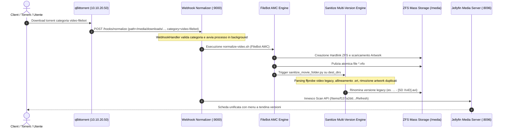

# Workflow: Pipeline di Normalizzazione Multimediale e Multi-Versione

Questo workflow documenta l'architettura canonica, il ciclo di vita GitOps e il funzionamento runtime della pipeline di normalizzazione video e audio dell'homelab, basata sul microservizio **`webhook-normalizer`** in esecuzione su TrueNAS SCALE bare-metal (`10.10.20.50:9000`).

---

## 🎯 1. Principi Architetturali & Immutabilità (Single Source of Truth)

Per prevenire disallineamenti di codice (*code drift*), hotpatching volatile o ambiguità di versionamento:
1. **Unica Sorgente di Verità (SSOT)**:
   L'intero codice della pipeline (gli script bash [`normalize-video.sh`](file:///Users/olindo/prj/pindaroli-arr-helm/custom-docker-images/custom-normalizer/normalize-video.sh), `normalize.sh`, `utils.sh`, il server [`webhook_server.py`](file:///Users/olindo/prj/pindaroli-arr-helm/custom-docker-images/custom-normalizer/webhook_server.py), la configurazione `categories.yaml` e l'engine di sanificazione [`sanitize_movie_folder.py`](file:///Users/olindo/prj/pindaroli-arr-helm/custom-docker-images/custom-normalizer/sanitize_movie_folder.py)) risiede **esclusivamente** nel repository Git canonico [`pindaroli-arr-helm`](file:///Users/olindo/prj/pindaroli-arr-helm/custom-docker-images/custom-normalizer/).
2. **Build Immutabile CI/CD**:
   Ad ogni incremento di versione nel file `VERSION` e relativo push su `main`, la GitHub Action `.github/workflows/build-custom-normalizer.yml` compila e pubblica l'immagine autocontenuta su GitHub Container Registry:
   `ghcr.io/pindaroli/custom-normalizer:<VERSION>`
3. **Divieto Assoluto di Bind-Mount di Codice in Produzione**:
   In `docker-compose.yaml` su TrueNAS SCALE, il container `webhook-normalizer` esegue **direttamente l'immagine immutabile**. È categoricamente vietato montare script `.sh` o `.py` dal filesystem host di TrueNAS: l'host monta unicamente i volumi di storage dei dati (`/media`) e i file di licenza (`/etc/filebot/license.psm`, `/etc/songkong/license.properties`).

---

## 🔄 2. Flusso Operativo End-to-End



---

## 🛠️ 3. Fasi Interne di Normalizzazione Video (`normalize-video.sh`)

Quando un download viene notificato con categoria `video-filebot`:
1. **Verifica Licenza**: Attivazione dinamica della licenza FileBot da `/etc/filebot/license.psm`.
2. **Parsing AMC TMDb**: FileBot AMC identifica il film tramite TheMovieDB ed esegue l'hardlink nella directory:
   `/media/movies/{n} ({y}) {'{tmdb-' + id + '}'}/{n} ({y}) {'{tmdb-' + id + '}'} - [{source} {vf} {vc}] [{group}].ext`
3. **Download Artwork**: Scaricamento locandine canonico (`poster.jpg`, `fanart.jpg`, `logo.png`).
4. **Purge NFO**: Eliminazione automatica di qualsiasi file `.nfo` generato, in conformità al pattern [[movie-metadata-and-artwork-architecture]].
5. **Sanificazione Versioni Multiple & Purge Duplicati**:
   - Identificazione di tutte le directory di destinazione coinvolte (`dest_dirs`).
   - Per ciascuna cartella, esecuzione di `sanitize_movie_folder.py`:
     - Rilevamento di eventuali versioni video legacy non conformi allo standard `Titolo (Anno) {tmdb-ID} - [...]`.
     - Analisi `ffprobe` (risoluzione e codec video) e rinomina nel formato multi-versione Jellyfin (es. `Blackout (1997) {tmdb-25690} - [SD XviD].avi`).
     - Rinomina sincronizzata dei sottotitoli associati (`.en.srt`, `.it.srt`).
     - Bonifica selettiva di artwork duplicati (`*-poster.jpg`, `*-backdrop.jpg`, `*-landscape.jpg`, `*-logo.png`), preservando le sole locandine master di cartella.
6. **Trigger Rescan Jellyfin**:
   Chiamata HTTP REST verso Jellyfin (`/Items/<folder_id>/Refresh` o `/Library/Refresh`) per esporre istantaneamente la scheda aggiornata con selettore di qualità/versione.
7. **Notifiche Telegram / Email**: Invio del report di fine elaborazione all'amministratore.

---

## 📋 4. Configurazione Dichiarativa Docker Compose (`webhook-normalizer`)

Il servizio su TrueNAS SCALE bare-metal (`servarr/truenas-docker/docker-compose.yaml`) adotta la configurazione pulita:

```yaml
  webhook-normalizer:
    image: ghcr.io/pindaroli/custom-normalizer:1.7.1
    container_name: webhook-normalizer
    command: ["python3", "/app/webhook_server.py"]
    environment:
      - PUID=1000
      - PGID=1000
      - TZ=Europe/Rome
      - HOMEPAGE_ALLOWED_HOSTS=*
      - EMAIL_RECIPIENT=o.pindaro@gmail.com
    env_file:
      - .env
    volumes:
      - /mnt/oliraid/arrdata/media:/media
      - /mnt/oliraid/arrdata/media/downloads:/data/downloads
      - /mnt/oliraid/arrdata/media:/mnt/media
      - /mnt/stripe/truenas-docker/jellyfin/metadata:/var/lib/jellyfin/metadata
      - /mnt/stripe/truenas-docker/jellyfin/data/data:/var/lib/jellyfin/data
      - /mnt/stripe/truenas-docker/jellyfin/root:/var/lib/jellyfin/root
      - /mnt/stripe/truenas-docker/jellyfin/custom-cont-init.d:/custom-cont-init.d:ro
      - /mnt/stripe/truenas-docker/webhook-normalizer/songkong-license.properties:/etc/songkong/license.properties:ro
      - /mnt/stripe/truenas-docker/webhook-normalizer/filebot-license.psm:/etc/filebot/license.psm:ro
    ports:
      - 9000:9000
    restart: unless-stopped
```

---

## 💾 5. Riferimenti Correlati
- **Pattern Architetturale**: [[movie-metadata-and-artwork-architecture]]
- **Entità Servarr**: [[Servarr]]
- **Piano di Migrazione**: [[servarr-truenas-permanent-migration]]
- **Piano di Sanificazione Multi-Versione**: [[jellyfin-multi-version-sanitization]]
